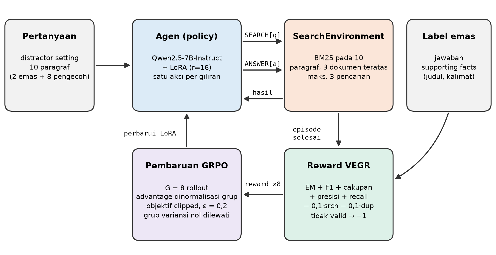

# BAB 3 — PERANCANGAN SISTEM

Bab ini menjelaskan bagaimana agen pencarian dibangun, dilatih, dan dievaluasi. Subbab 3.1 memberikan gambaran umum rancangan penelitian. Subbab 3.2–3.6 menjelaskan data, lingkungan pencarian, *reward* yang diusulkan (VEGR), model *policy*, dan algoritma pelatihan. Subbab 3.7 mendefinisikan protokol evaluasi, Subbab 3.8 memuat daftar eksperimen, dan Subbab 3.9 melaporkan detail implementasi dan komputasi.

## 3.1 Gambaran Umum Rancangan Penelitian

Penelitian ini merupakan eksperimen terkontrol. Model, data, lingkungan, *hyperparameter*, dan protokol evaluasi dibuat tetap; yang berubah antar-*run* hanyalah fungsi *reward* (dan, pada dua varian, *optimizer*). Terdapat dua batasan pada kontrol ini yang perlu dinyatakan sejak awal, yaitu sebagai berikut.

1. Perbandingan utama, yaitu R1 (VEGR) dibandingkan dengan R0 (*outcome-only*), mengubah **seluruh paket *reward* sekaligus**: enam komponen ditambahkan (F1, cakupan, presisi, *retrieval recall*, biaya pencarian, dan penalti duplikasi). Rancangan ini tidak dapat menunjukkan komponen mana yang menyebabkan suatu perbedaan.
2. *Reward* yang lebih padat juga mengubah jumlah langkah pelatihan yang menghasilkan pembaruan. R0 melewati sekitar separuh langkahnya sebagai grup dengan varians nol (Subbab 3.6), sehingga *run* R0 melakukan sekitar 130 pembaruan, sedangkan *run* R1 melakukan sekitar 240 pembaruan (Tabel 4.1).

Oleh karena itu, perbedaan antara R1 dan R0 diatribusikan kepada paket VEGR secara utuh, bersama dengan sinyal pelatihan yang dihasilkannya, dan bukan kepada satu komponen tertentu.

Setiap episode pelatihan mengikuti alur yang sama (Gambar 3.1), yaitu sebagai berikut.

1. Agen menerima sebuah pertanyaan HotpotQA.
2. Agen mengeluarkan satu aksi pada setiap giliran: `SEARCH[query]` atau aksi terminal `ANSWER[...] CITATIONS[...]`.
3. Lingkungan menjalankan pencarian dengan BM25 pada paragraf-paragraf milik pertanyaan tersebut dan mengembalikan hasilnya, atau memvalidasi jawaban dan sitasi.
4. Ketika episode berakhir, fungsi *reward* menilainya terhadap jawaban emas dan *supporting facts* emas HotpotQA.
5. GRPO membandingkan *reward* dari 8 episode pada pertanyaan yang sama dan memperbarui *adapter* LoRA.



**Gambar 3.1.** Satu langkah pelatihan: agen menerima pertanyaan HotpotQA, melakukan hingga 3 aksi `SEARCH` pada 10 paragraf milik pertanyaan tersebut, lalu mengakhiri episode dengan `ANSWER[a] CITATIONS[title|index; …]`; episode yang selesai dinilai oleh VEGR terhadap jawaban emas dan *supporting facts*, kemudian GRPO membandingkan *reward* dari 8 episode pada pertanyaan yang sama dan memperbarui *adapter* LoRA. Dibuat dengan `scripts/make_thesis_figures.py`.

Rancangan ini dipandu oleh tiga pertanyaan penelitian (Bab 1), yaitu sebagai berikut.

- **RQ1**: Apakah GRPO meningkatkan performa agen pencarian 7B dibandingkan dengan model tanpa pelatihan?
- **RQ2**: Apakah VEGR mencegah perilaku jalan pintas (*shortcut*) dari *reward* berbasis jawaban saja, tanpa kehilangan akurasi?
- **RQ3**: Bagaimana varian *reward* dan perbaikan *optimizer* memengaruhi *grounding* dan perilaku pencarian?

## 3.2 *Dataset* dan Pembagian Data

Penelitian ini menggunakan **HotpotQA** [6], versi 1.1, pada *distractor setting*. Setiap pertanyaan disertai 10 paragraf Wikipedia, yaitu 2 paragraf emas yang memuat bukti (*evidence*) jawaban dan 8 paragraf pengecoh (*distractor*). Setiap pertanyaan juga dianotasi dengan **_supporting facts_**, yaitu pasangan (judul, indeks kalimat) yang dibutuhkan untuk menjawabnya. Anotasi inilah yang memungkinkan *reward* bukti tanpa *judge*: benar atau tidaknya suatu sitasi dapat diperiksa secara berbasis aturan.

Baris data yang gagal validasi dilewati dan dicatat beserta alasannya (misalnya, kalimat kosong atau indeks *supporting fact* di luar jangkauan).

**Pembagian data.** Pembagian data dihasilkan oleh `scripts/prepare_splits.py` dan dicatat dalam `configs/evaluation/splits.json`, bersama dengan *hash* SHA-256 dari berkas sumber.

- **Train / validasi.** Keduanya diambil dari berkas pelatihan HotpotQA menggunakan *hash* deterministik. Setiap ID pertanyaan dipetakan ke sebuah *bucket* dalam [0; 1) dengan mengambil 8 *byte* pertama dari `sha256("7:" + question_id)`. Sebuah pertanyaan masuk ke data latih jika nilai *bucket*-nya di bawah 0,95, dan ke data validasi jika sebaliknya. Pembagian ini menghasilkan **85.573 pertanyaan latih** dan **4.452 pertanyaan validasi**. Pembagian ini tidak bergantung pada urutan berkas dan dapat direproduksi secara persis.
- ***Holdout*.** *Holdout* adalah himpunan beku berisi **300 pertanyaan**, yaitu 300 baris valid pertama dari berkas dev HotpotQA, yang disimpan dalam `configs/evaluation/holdout_v1_ids.json` beserta *hash* dari *manifest*-nya. *Holdout* tidak pernah digunakan untuk memilih pengaturan. Seluruh pengaturan dipilih pada data validasi, dan *holdout* hanya digunakan untuk angka akhir yang dilaporkan pada Bab 4.

**Sampel pelatihan.** Setiap *run* pelatihan mengambil **256 pertanyaan** dari data latih. Sampel ini bergantung pada *seed* *run*, sehingga *seed* yang berbeda melihat pertanyaan yang berbeda (Subbab 3.6).

## 3.3 Lingkungan Pencarian

Lingkungan (`SearchEnvironment`, `src/needle/environment/search.py`) adalah sesi pencarian yang terbatas dan dapat di-*reset* untuk satu pertanyaan.

**Korpus dan *retriever*.** Korpus yang dapat dicari adalah **kumpulan tertutup berisi 10 paragraf milik pertanyaan itu sendiri**, yang selalu memuat kedua paragraf emas. Hal ini membuat *retrieval* jauh lebih mudah dibandingkan dengan pencarian *open-domain*: model tanpa pelatihan sudah menemukan 83% dokumen emas (*retrieval recall* 0,829, Tabel 4.1). Dengan demikian, tugas ini lebih dekat dengan pemahaman bacaan (*reading comprehension*) dengan alat penelusur halaman dibandingkan dengan pencarian web, dan istilah "agen pencarian" pada tugas akhir ini selalu berarti pencarian pada kumpulan tertutup tersebut. *Retrieval* menggunakan Okapi BM25 [13], melalui implementasi `rank_bm25` dengan parameter bawaannya. Setiap paragraf diindeks sebagai judulnya ditambah seluruh kalimatnya, yang ditokenisasi menjadi token kata Unicode dengan *case folding*. Setiap pencarian mengembalikan **3 dokumen teratas**. Nilai yang sama dipecahkan berdasarkan urutan dokumen asli, sehingga *retrieval* bersifat deterministik. Setiap dokumen yang dikembalikan ditampilkan secara utuh dengan kalimat-kalimat bernomor.

**Anggaran.** Satu episode mengizinkan paling banyak **3 pencarian**.

**Tata bahasa aksi.** Pada setiap giliran, agen harus mengeluarkan tepat satu aksi, yaitu sebagai berikut.

- `SEARCH[query]` menjalankan pencarian BM25 dan menggunakan satu unit anggaran.
- `ANSWER[answer] CITATIONS[title|index; title|index; ...]` memberikan jawaban akhir beserta kalimat-kalimat bukti yang disitasi. Aksi ini mengakhiri episode.

**Validasi dan jenis kegagalan.** Sebuah episode dinyatakan **tidak valid** jika terjadi salah satu kondisi berikut.

- *Kegagalan protokol*: keluaran tidak sesuai dengan tata bahasa aksi (misalnya, terdapat teks tambahan, atau sitasi ditempelkan pada aksi SEARCH).
- *Kegagalan bukti*: sebuah sitasi merujuk pada judul atau indeks kalimat yang tidak pernah muncul pada hasil pencarian mana pun dalam episode tersebut. Dalam praktiknya, hal ini sebagian besar berarti sitasi yang dikarang.
- *Kegagalan anggaran*: agen menghabiskan seluruh pencariannya dan tetap tidak menjawab.

Episode yang tidak valid menerima penalti protokol sebesar −1 selama pelatihan (Subbab 3.4) dan dihitung salah selama evaluasi (Subbab 3.7).

**Celah yang diketahui.** Jawaban dengan daftar sitasi kosong (`ANSWER[x]` atau `ANSWER[x] CITATIONS[]`) diterima sebagai jawaban yang valid. *Prompt* itu sendiri mengizinkan `CITATIONS[]` untuk kasus ketika tidak ada sitasi yang dapat divalidasi. Celah ini sengaja tidak ditutup agar setiap *run* dilatih dan dievaluasi pada lingkungan yang sama. Bab 4 melaporkan bagaimana *reward* berbasis jawaban saja memanfaatkan celah ini.

## 3.4 *Reward* yang Diusulkan: VEGR

**_Verifiable Evidence-Grounded Reward_ (VEGR)** diimplementasikan dalam `src/needle/rewards/__init__.py`. Setiap komponennya dihitung secara berbasis aturan dari anotasi emas HotpotQA, sehingga tidak melibatkan *LLM judge*.

Misalkan *G* adalah himpunan *supporting facts* emas (judul, indeks kalimat) dan *C* adalah himpunan kalimat yang disitasi oleh agen. Untuk episode yang valid:

$$
R_{\text{VEGR}} = \text{EM} + \text{F1} + \text{Cov} + \text{Prec} + \text{RetR} - 0.1\cdot\text{Cost} - 0.1\cdot\text{Dup}
$$

| Komponen | Definisi | Rentang |
|---|---|---|
| EM | *exact match* ternormalisasi antara jawaban prediksi dan jawaban emas | {0; 1} |
| F1 | F1 tingkat token antara jawaban prediksi dan jawaban emas | [0; 1] |
| Cov (cakupan bukti) | \|G ∩ C\| / \|G\| | [0; 1] |
| Prec (presisi sitasi) | \|G ∩ C\| / \|C\|, didefinisikan 0 jika C kosong | [0; 1] |
| RetR (*retrieval recall*) | proporsi dokumen emas yang muncul pada hasil pencarian mana pun | [0; 1] |
| Cost (biaya pencarian) | jumlah pencarian yang digunakan / anggaran (3) | [0; 1] |
| Dup (penalti *query* duplikat) | (jumlah *query* − jumlah *query* unik) / jumlah *query* | [0; 1) |

Episode yang **tidak valid** menerima **R = −1**, terlepas dari komponen lainnya. Penalti protokol inilah yang membuat VEGR menegakkan tata bahasa aksi. Karena sitasi yang dikarang termasuk kegagalan bukti, agen tidak dapat menaikkan presisinya dengan menyitasi kalimat yang tidak pernah ia ambil.

Komponen-komponen tersebut terbagi ke dalam tiga kelompok, masing-masing ditujukan untuk jenis kegagalan yang berbeda, yaitu sebagai berikut.

- **Komponen jawaban (EM, F1)** memberi *reward* atas kebenaran jawaban. F1 memberikan nilai parsial, sehingga *reward* menjadi tidak sejarang EM saja.
- **Komponen bukti (Cov, Prec)** memberi *reward* atas penyitasian kalimat yang tepat. Presisi saja dapat dipenuhi dengan menyitasi satu kalimat yang aman, dan cakupan saja dapat dipenuhi dengan menyitasi semua kalimat, sehingga keduanya disertakan (bandingkan dengan ALCE [14]).
- **Komponen pencarian (RetR, Cost, Dup)** memberi *reward* atas ditemukannya dokumen emas dan memberi penalti atas pencarian yang sia-sia atau berulang. Penalti tersebut diberi bobot kecil (0,1) agar dapat membentuk perilaku pencarian tanpa membuat agen enggan melakukan pencarian sama sekali.

Komponen-komponen tersebut secara individual bukanlah hal baru. Kontribusi penelitian ini adalah penggabungan komponen-komponen tersebut menjadi *reward* tanpa *judge* untuk agen pencarian *multi-turn*, bersama dengan evaluasi terkontrol atas apa yang diubah oleh kombinasi tersebut (Subbab 3.8). Seluruh bobot merupakan nilai bawaan yang tidak di-*tuning*. Hal ini merupakan keterbatasan yang dibahas pada Bab 5.

**Contoh perhitungan.** Tabel 3.1 menilai dua episode *holdout* nyata untuk pertanyaan yang sama (`5abd94525542992ac4f382d2`, "Which company formed the boy group that debuted with *2014 S/S*?"). Keduanya menjawab "YG Entertainment" dengan benar. Dengan *reward outcome-only* (R0), keduanya menerima *reward* yang sama, yaitu 1. VEGR membedakan keduanya: episode yang satu sepenuhnya ter-*grounding*, sedangkan yang lain tidak memiliki bukti.

**Tabel 3.1.** Komponen VEGR untuk dua jawaban benar pada pertanyaan yang sama. Nilai diambil dari `results/2026-10-10-batch/{r1_full_seed8,r0_outcome_seed8}/episodes.jsonl`.

| | Episode A (R1 *seed* 8) | Episode B (R0 *seed* 8) |
|---|---|---|
| Aksi | `SEARCH[S/S 2014 debut South Korean boy group]` → `SEARCH[WINNER YG Entertainment]` → `ANSWER[YG Entertainment] CITATIONS[2014 S/S\|0; Winner (band)\|0]` | `SEARCH[2014 S/S debut album South Korean boy group formed by]` → `ANSWER[YG Entertainment]` |
| EM | 1 | 1 |
| F1 | 1 | 1 |
| Cakupan bukti | 1 (kedua kalimat emas disitasi) | 0 (tidak ada yang disitasi) |
| Presisi sitasi | 1 | 0 |
| *Retrieval recall* | 1 (kedua dokumen emas diambil) | 0,5 (satu dari dua) |
| − 0,1 · biaya pencarian | − 0,1 · 2/3 = − 0,067 | − 0,1 · 1/3 = − 0,033 |
| − 0,1 · penalti duplikasi | 0 | 0 |
| **Total VEGR** | **4,933** | **2,467** |
| *Reward outcome-only* (R0) | 1 | 1 |

**Varian *reward*.** Tiga varian mengubah satu aspek VEGR pada satu waktu, yaitu sebagai berikut.

- **R0, *outcome-only* (*reward* dasar).** R = EM. Seluruh bobot lainnya bernilai 0, tetapi episode yang tidak valid tetap menerima −1. Varian ini mencerminkan agen pencarian dengan *outcome reward* seperti Search-R1 [2].
- **R2, penalti bersyarat (*gated*).** Varian ini sama dengan VEGR, kecuali bahwa penalti biaya pencarian dan duplikasi hanya diterapkan ketika EM = 1. Tujuannya adalah agar pencarian tidak diberi penalti pada pertanyaan yang belum berhasil dijawab oleh agen.
- **R3, cakupan ×2.** Varian ini adalah VEGR dengan bobot cakupan bukti dinaikkan dari 1 menjadi 2. Varian ini menyasar pola sitasi "presisi tetapi tidak lengkap" yang dijelaskan pada Bab 4.

**Apa yang diberi *reward* oleh R0 terkait sitasi.** Pada R0, episode yang valid memperoleh nilai EM-nya (0 atau 1), baik dengan maupun tanpa sitasi. Sitasi tidak pernah dapat menambah *reward*, tetapi sitasi ke judul atau kalimat yang tidak diambil membuat episode tersebut menjadi kegagalan bukti yang bernilai −1. Dengan demikian, **R0 menghukum sitasi yang salah tetapi tidak pernah memberi imbalan atas sitasi yang benar**. Apakah menyitasi menguntungkan atau tidak kemudian hanya bergantung pada seberapa sering upaya sitasi oleh *policy* tidak valid.

Pada awal pelatihan, tingkat ini tinggi. Pada 32 langkah pertama R0 *seed* 8 (8 × 32 = 256 *rollout* pelatihan; Subbab 4.5) diperoleh hasil sebagai berikut.

- Sebanyak 176 *rollout* mencoba menyitasi. Sebanyak 90 di antaranya merupakan kegagalan bukti (−1), dan 86 *rollout* yang valid memperoleh rata-rata 0,50.
- Sebanyak 42 *rollout* valid tanpa sitasi memperoleh rata-rata 0,36.

Jawaban valid yang disertai sitasi justru memperoleh nilai *lebih tinggi* dibandingkan dengan jawaban tanpa sitasi, karena jawaban yang disertai sitasi lebih sering benar. Namun, sekitar separuh upaya menyitasi gagal, sehingga rata-rata *reward* dari *mencoba* menyitasi adalah sekitar (86 × 0,50 − 90) / 176 ≈ **−0,27**, dibandingkan dengan **+0,36** untuk tidak menyitasi. Dalam kondisi ini, *policy gradient* mendorong *policy* untuk menghilangkan sitasi. Penalti validitas −1, dikombinasikan dengan tidak adanya imbalan untuk sitasi yang benar, adalah penyebabnya. Hal ini bukanlah celah eksotis yang "ditemukan" oleh *policy*; hal ini merupakan konsekuensi dari definisi *reward* dan tingginya tingkat sitasi tidak valid pada model dasar (85 dari 130 kegagalan *holdout* B0 merupakan kegagalan bukti; Subbab 4.2).

VEGR mengubah pertukaran ini. Komponen cakupan dan presisinya memberi *reward* secara langsung atas sitasi yang benar. Pada R1 *seed* 8, *rollout* valid yang disertai sitasi memperoleh rata-rata sekitar 3,4 dan *rollout* valid tanpa sitasi sekitar 1,3, yaitu selisih sekitar 2 poin *reward*, dibandingkan dengan 0,14 pada R0. Subbab 4.5 memberikan bukti untuk kedua *run* tersebut.

## 3.5 Model *Policy*

**Model dasar.** *Policy* yang digunakan adalah **Qwen2.5-7B-Instruct** [12], yang dimuat dari bobot lokal dalam format bf16.

***Prompt*.** *Prompt* bersifat deterministik dan dibangun oleh fungsi `build_prompt` dalam `src/needle/inference/runner.py`. *Prompt* ini dibungkus dengan *chat template* milik model. Isi *prompt* adalah sebagai berikut.

1. Menjelaskan peran agen ("You are a careful evidence-seeking QA agent").
2. Menyatakan tata bahasa aksi, memberikan contoh (`ANSWER[United States] CITATIONS[Ursula K. Le Guin|1; The Left Hand of Darkness|1]`), dan memuat aturan format: satu `title|index` per sitasi, dipisahkan dengan titik koma, tidak ada teks setelah kurung penutup, judul disalin persis, dan tidak pernah mengarang judul.
3. Memberikan pertanyaan dan sisa anggaran pencarian.
4. Mencantumkan seluruh hasil pencarian sejauh ini. Untuk setiap pencarian, *prompt* menampilkan *query* lalu setiap dokumen yang dikembalikan dalam bentuk `[Title]` diikuti baris-baris `index: sentence`.

*Prompt* dibangun ulang dari awal pada setiap giliran, sehingga model selalu melihat seluruh riwayat pencarian. Lampiran A memberikan *prompt* lengkap untuk satu pertanyaan *holdout* nyata, pada titik tepat sebelum agen memberikan jawaban akhirnya.

***Adapter*.** Pelatihan menggunakan LoRA [18] dengan *rank* r = 16, α = 32, dan *dropout* 0. *Adapter* diterapkan pada seluruh proyeksi *attention* dan MLP (q, k, v, o, gate, up, down). Bobot dasar tetap dibekukan, sehingga pelatihan dapat dilakukan pada satu GPU 48 GB.

## 3.6 Algoritma Pelatihan

Pelatihan menggunakan ***policy gradient* bergaya GRPO dengan normalisasi grup**, yang mengikuti *Group Relative Policy Optimization* (GRPO) [3] dan diperluas untuk episode *multi-turn*. Algoritma ini berbeda dari GRPO penuh dalam hal-hal yang dinyatakan pada bagian "Fungsi objektif" di bawah. Implementasinya terdapat dalam `scripts/train_grpo.py` dan `src/needle/training/grpo.py`.

***Rollout*.** Untuk setiap pertanyaan pelatihan, *policy* saat ini menjalankan **G = 8** episode penuh, dengan *sampling* pada *temperature* 1,0 dan top-p 1,0. Setiap aksi dibatasi hingga 128 token baru. Setiap episode menerima satu nilai *reward* skalar dari fungsi *reward* milik *run* tersebut (R0–R3).

***Advantage*.** Setiap *reward* dinormalisasi di dalam grupnya:

$$
A_i = \frac{r_i - \operatorname{mean}(r_{1..G})}{\operatorname{std}(r_{1..G}) + 10^{-6}}
$$

Seluruh aksi dalam satu episode berbagi *advantage* episode tersebut. Jika kedelapan *reward* dalam satu grup bernilai sama, setiap *advantage* bernilai nol dan grup tersebut tidak membawa sinyal pembelajaran. **Grup dengan varians nol** seperti ini **dilewati**, yaitu tidak dilakukan pembaruan. Jumlah langkah yang dilewati dicatat, dan ternyata jumlah ini menjadi diagnostik yang penting (Bab 4).

**Fungsi objektif.** Pembaruan menggunakan *clipped surrogate* bergaya PPO [15] dengan ε = 0,2. *Log-probability* setiap *rollout* adalah **rata-rata atas seluruh token yang dihasilkan agen dalam episode tersebut**, mencakup seluruh aksinya. Token *prompt* dan observasi dikecualikan. Dengan demikian, rasio ρ dihitung satu kali per *rollout*.

$$
\mathcal{L} = -\,\mathbb{E}\left[\min\left(\rho\,A,\; \operatorname{clip}(\rho,\,1-\varepsilon,\,1+\varepsilon)\,A\right)\right],
\qquad \rho = \exp\left(\log\pi_\theta - \log\pi_{\theta_\text{old}}\right)
$$

**Tidak ada penalti KL** terhadap model referensi. *Rollout* yang tidak valid tetap berada di dalam *batch*, sehingga penalti −1 secara aktif mendorong *policy* menjauh dari aksi yang tidak sesuai format.

**Perilaku fungsi objektif dalam praktik.** Terdapat tiga sifat implementasi yang menyebabkan fungsi objektif ini bukan fungsi objektif GRPO bergaya PPO yang penuh, yaitu sebagai berikut.

- **Satu pembaruan per grup.** Delapan *rollout* dari setiap pertanyaan digunakan untuk tepat satu langkah *optimizer*. Tidak ada *epoch* berulang dan tidak ada penggunaan ulang *minibatch*, sehingga *policy* lama dan baru identik pada saat pembaruan, ρ ≈ 1, dan *clipping* tidak pernah aktif. Fraksi *clip* yang tercatat bernilai **0 pada seluruh 16 *run***, dan selisih *log-probability* lama/baru terbesar per *run* adalah 0,03–0,09, yang merupakan derau numerik bf16. Pada praktiknya, pembaruan ini adalah *policy gradient* bergaya REINFORCE dengan *baseline* rata-rata grup dan *advantage* yang dinormalisasi per grup.
- **Tanpa komponen KL.** DAPO [17] dan Dr. GRPO [16] juga menghilangkan penalti KL.
- **Rasio tingkat sekuens.** Rasio menggunakan *rata-rata* *log-probability* token dari setiap episode, sehingga dihitung per sekuens, bukan per token. Hal ini menskalakan gradien setiap *rollout* dengan satu per panjangnya, yaitu normalisasi panjang yang diidentifikasi oleh Dr. GRPO sebagai sumber bias [16].

*Clipping* dengan ε = 0,2 tetap dipertahankan dalam kode dan dalam deskripsi di atas demi kelengkapan, tetapi tidak berperan pada *run* yang dilaporkan.

**Optimasi.** AdamW dengan *learning rate* 2 × 10⁻⁵, *gradient-norm clipping* pada 1,0, bf16, dan *gradient checkpointing*. Satu *run* melakukan satu kali lintasan atas 256 pertanyaannya (256 langkah, satu pertanyaan per langkah).

***Seed*.** *Run* menggunakan *seed* 7, 8, dan 9. Sebuah *seed* menentukan sampel 256 pertanyaan pelatihan sekaligus *state* acak yang digunakan untuk *sampling* *rollout*. Dengan demikian, perbedaan antar-*seed* mencerminkan derau data maupun derau optimasi.

**Varian *optimizer*.** Dua varian mengubah *optimizer* alih-alih *reward*, yaitu sebagai berikut.

- **GRPO tanpa normalisasi std**, digunakan pada R4. *Advantage* dihitung tanpa pembagian dengan simpangan baku, A_i = r_i − mean(r), yang merupakan salah satu dari dua perubahan yang diusulkan pada Dr. GRPO [16]. R4 **bukan Dr. GRPO penuh**: R4 tetap mempertahankan normalisasi panjang per sekuens yang dijelaskan di atas. Karena *learning rate* tetap 2 × 10⁻⁵ sementara *advantage* berubah dari skala satuan menjadi selisih *reward* mentah (*reward* berkisar dari −1 hingga sekitar 5), ukuran langkah efektif juga berubah.
- ***Dynamic sampling* bergaya DAPO** [17], digunakan pada R0-dyn. Grup dengan varians nol tidak dihitung ke dalam anggaran langkah. *Trainer* terus mengambil pertanyaan, dari kumpulan berisi hingga 512 pertanyaan, sampai telah melakukan 256 pembaruan *optimizer* yang sesungguhnya atau kumpulan tersebut habis. Varian ini menguji apakah jalan pintas R0 berasal dari terlalu sedikitnya pembaruan yang informatif. Hanya *dynamic sampling* dari DAPO yang diimplementasikan, bukan komponen lainnya (*clip-higher*, *loss* tingkat token).

***Pseudocode*.**

```
for step, question in enumerate(sample(train_split, 256, seed)):
    episodes = [run_episode(policy, question) for _ in range(8)]   # multi-turn
    rewards  = [reward_fn(ep, gold(question)) for ep in episodes]  # VEGR or variant; invalid → −1
    if all rewards equal:
        log_skip(step); continue                                    # zero-variance group
    A = (rewards − mean(rewards)) / (std(rewards) + 1e-6)          # R4: no division
    for each episode i:
        ρ = exp(mean_token_logp_θ(actions_i) − mean_token_logp_old(actions_i))  # mean over all action tokens
        loss += −min(ρ·A_i, clip(ρ, 0.8, 1.2)·A_i)
    update LoRA with AdamW (lr 2e-5, grad clip 1.0)
```

## 3.7 Protokol Evaluasi

**Pengaturan.** Setiap model dievaluasi pada **300 pertanyaan *holdout*** beku yang sama, dengan *greedy decoding* dan **tanpa percobaan ulang**. Jika sebuah aksi tidak sesuai format, episode tersebut gagal.

**Metrik.** Metrik yang digunakan adalah sebagai berikut.

- **EM (seluruh episode)** adalah angka akurasi utama. Setiap episode yang tidak valid dihitung 0, sehingga penyebutnya selalu 300.
- **Episode selesai** adalah jumlah episode valid dari 300 episode. Kegagalan dirinci berdasarkan jenisnya (bukti, protokol, anggaran).
- **Metrik kualitas** meliputi F1, cakupan bukti, presisi sitasi, *retrieval recall*, dan jumlah pencarian per episode. Setiap metrik dirata-ratakan hanya atas episode yang selesai, menggunakan definisi pada Subbab 3.4.
- **EM pada episode selesai** adalah EM yang dirata-ratakan hanya atas episode yang valid. Metrik ini memisahkan kualitas jawaban dari kepatuhan terhadap protokol.
- ***Precision-grounded* EM** menghitung sebuah episode hanya jika EM = 1, episode tersebut memiliki setidaknya satu sitasi, dan setiap sitasinya merupakan *supporting fact* emas (presisi 1). Metrik ini ketat terhadap sitasi yang *salah*, tetapi longgar terhadap sitasi yang *hilang*: jawaban benar yang menyitasi satu dari dua kalimat emas tetap dihitung sepenuhnya ter-*grounding*. Metrik ini dilaporkan bersama tiga ukuran yang lebih ketat atau lebih standar, yaitu sebagai berikut.
  - ***Lenient grounded* EM:** EM = 1 dan setidaknya satu sitasi emas.
  - **Sup-EM:** himpunan yang disitasi sama dengan himpunan emas (presisi 1 dan cakupan 1), seperti pada evaluasi *supporting fact* HotpotQA [6].
  - **Joint-EM dan Joint-F1:** metrik gabungan HotpotQA. Joint-EM mensyaratkan EM dan Sup-EM sekaligus. Joint-F1 menggabungkan F1 jawaban dengan presisi dan cakupan sitasi (P = F1 × presisi, R = F1 × cakupan).
- **Tingkat sitasi** adalah proporsi episode selesai yang memiliki setidaknya satu sitasi.
- **Diagnostik perilaku** berasal dari log episode dan log pelatihan. Diagnostik ini mencakup proporsi episode yang mengulang *query*, distribusi jumlah sitasi dan indeks kalimat yang disitasi, tingkat ketidakvalidan selama pelatihan, serta jumlah langkah pelatihan yang dilewati (varians nol).

**Statistik.** Mengikuti Agarwal dkk. [10] dan Henderson dkk. [9], hasil dari satu *run* tidak dianggap konklusif.

- **Selang utama: *paired bootstrap* yang memperhitungkan *seed* (hierarkis).** Setiap dari 10.000 *resample* mengambil 3 *seed* dengan pengembalian untuk setiap metode, dan 300 pertanyaan *holdout* dengan pengembalian yang digunakan bersama oleh metode-metode yang dibandingkan. Dengan demikian, selang persentil 95% mencakup variasi dari pemilihan *seed* maupun pemilihan pertanyaan. Sebuah perbedaan dinyatakan signifikan hanya jika selang ini tidak memuat 0.
- **Selang sekunder: *paired bootstrap* hanya atas pertanyaan.** Skor setiap pertanyaan dirata-ratakan atas tiga *seed* milik metode tersebut, dan hanya pertanyaan yang di-*resample* (10.000 *resample*, *seed* RNG 0). Selang ini mengabaikan varians *seed* dan lebih sempit; selang ini dilaporkan hanya sebagai rujukan. Perbandingan antara satu *run* dengan satu *run* lainnya (R0-dyn s8 dibandingkan dengan R0 s8) hanya dapat diuji dengan cara ini.
- Setiap metode dilatih dengan **3 *seed*** (7, 8, 9). Hasil dilaporkan per *seed* dan sebagai rata-rata ± simpangan baku antar-*seed*. Proporsi atas *seed*, seperti berapa banyak *seed* R0 yang berhenti memberi sitasi, diberikan dengan selang Clopper–Pearson 95%.
- **Perbandingan utama dan eksploratif.** Perbandingan utama adalah RQ1 (setiap metode dibandingkan dengan B0) dan R1 − R0. Seluruh perbandingan lainnya (R2, R3, R4 dibandingkan dengan R1, serta R0-dyn dibandingkan dengan R0 s8) bersifat **eksploratif**: perbandingan tersebut tidak dikoreksi untuk perbandingan berganda, dan R3, R4, serta R0-dyn dirancang setelah hasil *holdout* diketahui (Subbab 3.8). Dengan tiga *seed*, hasil eksploratif yang tidak signifikan dilaporkan sebagai **tidak konklusif**, bukan sebagai bukti tidak adanya efek.

## 3.8 Matriks Eksperimen

| ID | Nama | *Reward* | *Optimizer* | *Seed* |
|---|---|---|---|---|
| B0 | *Baseline* tanpa pelatihan | — (tanpa pelatihan) | — | — |
| R0 | *Outcome-only* | EM, tidak valid −1 | GRPO | 7, 8, 9 |
| R1 | **VEGR** | VEGR penuh | GRPO | 7, 8, 9 |
| R2 | *Gated* | VEGR, penalti hanya ketika EM = 1 | GRPO | 7, 8, 9 |
| R3 | Cakupan ×2 | VEGR, bobot cakupan 2 | GRPO | 7, 8, 9 |
| R4 | GRPO tanpa normalisasi std | VEGR penuh | GRPO, tanpa pembagian std (normalisasi panjang dipertahankan) | 7, 8, 9 |
| R0-dyn | *Outcome-only* + *dynamic sampling* | EM, tidak valid −1 | GRPO + *dynamic sampling* DAPO | 8 |

Perbandingan-perbandingan tersebut dipetakan ke pertanyaan penelitian sebagai berikut.

- **RQ1 (utama):** setiap metode yang dilatih dibandingkan dengan B0.
- **RQ2 (utama):** R1 dibandingkan dengan R0. *Optimizer* dan *seed* sama, paket *reward* berbeda (Subbab 3.1).
- **RQ3 (eksploratif):**
  - R2 dan R3 dibandingkan dengan R1 untuk menelaah rancangan *reward*.
  - R4 dibandingkan dengan R1, serta R0-dyn dibandingkan dengan R0 s8, untuk menelaah perubahan *optimizer*.
  - R0-dyn merupakan kontrol diagnostik. Jika *dynamic sampling* menghilangkan jalan pintas R0 pada *seed* tempat jalan pintas tersebut terjadi, maka *optimizer*-lah yang terimplikasi. Jika tidak, maka *reward*-lah yang terimplikasi, meskipun satu *seed* tidak dapat memastikan hal ini, dan R0-dyn juga melihat hingga dua kali lebih banyak pertanyaan dibandingkan dengan R0.

R0-dyn dijalankan pada satu *seed* saja (*seed* 8) sebagai **eksperimen diagnostik**, bukan sebagai salah satu metode utama.

- **Alasan satu *seed* (biaya).** *Dynamic sampling* membuang grup dengan varians nol, dan R0 *seed* 8 melewati 128 dari 256 langkahnya. Oleh karena itu, mencapai 256 pembaruan yang sesungguhnya diperkirakan membutuhkan hingga sekitar 512 pertanyaan, kira-kira dua kali lipat jumlah *rollout* dan biaya *run* standar. Perluasan anggaran pada awalnya merencanakan uji ini pada dua *seed*, kemudian dipangkas menjadi satu agar *run* 3-*seed* dari metode-metode utama (R0–R4) tetap sesuai anggaran. Pada pelaksanaannya, *run* ini mengambil seluruh **512** pertanyaan dan mencapai **250** pembaruan, kurang 6 dari target 256, karena 262 grup yang diambil memiliki varians nol. Langkah-langkah pelatihannya memakan waktu total **2,64 jam** (jumlah waktu per langkah dalam `metrics.jsonl`), dibandingkan dengan 1,1–2,7 jam untuk *run* standar pada *batch* yang sama.
- **Alasan *seed* 8.** *Seed* ini adalah *seed* tempat pelatihan *outcome-only* runtuh menjadi jawaban tanpa sitasi. Pertanyaannya sempit: apakah perbaikan pada tingkat *optimizer* saja dapat mencegah jalan pintas ini pada kasus di mana jalan pintas tersebut benar-benar terjadi? *Seed* yang tidak membuat R0 runtuh tidak dapat menjawab pertanyaan tersebut.
- **Cara membacanya.** R0-dyn ditafsirkan sebagai studi kasus mengenai mekanisme, bukan sebagai perbandingan antarmetode yang didukung secara statistik.

**Terencana vs. *post hoc*.** B0, R0, R1, dan R2 telah ditetapkan sebelum *batch* multi-*seed* dijalankan (`logs/2026-10-10-r0-r1-r2-batch.md`). Pada saat itu, baru terdapat satu *run* R1 *seed* 7. R3, R4, dan R0-dyn ditambahkan pada 2026-10-11, setelah hasil R0/R1/R2 dianalisis (`docs/research/2026-10-11-results-diagnosis-and-improvements.md`). Ketiganya merespons pengamatan tertentu, yaitu rendahnya cakupan bukti, serta langkah yang dilewati dan jalan pintas pada R0. Oleh karena itu, ketiganya merupakan **tindak lanjut eksploratif**, dan Bab 4 melaporkannya sebagai demikian, bukan sebagai uji konfirmatori.

## 3.9 Implementasi dan Komputasi

**Perangkat lunak.** Python 3.11 (dikelola dengan `uv`), Transformers 4.57.6, PEFT 0.21.2, dan `rank_bm25`. Versi PyTorch berbeda antar-*run*, yaitu sebagai berikut.

- *Run* pertama (B0 dan R1 *seed* 7) menggunakan **2.14.1+cu130**.
- Seluruh *run* berikutnya menggunakan **2.11.0+cu128**, karena *driver* GPU pada *pod* berikutnya hanya mendukung CUDA 12.8.

Hal ini dilaporkan sebagai keterbatasan ketika melakukan perbandingan dengan R1 *seed* 7. Pelatihan dan evaluasi dijalankan secara *offline* dari bobot lokal, dengan mode *offline* Hugging Face diaktifkan.

**Perangkat keras dan biaya.** Satu NVIDIA L40S (48 GB) di RunPod dengan biaya sekitar $1,10 per jam. Satu *run* (pelatihan ditambah evaluasi *holdout*) memakan waktu sekitar 2,05 jam, atau sekitar **$2,25**. Anggaran proyek direncanakan sekitar $45. Tabel 3.2 memberikan pengeluaran aktual, yang diambil dari saldo RunPod yang dicatat pada setiap log *batch*.

**Tabel 3.2.** Biaya komputasi per *batch* (perkiraan; berdasarkan saldo akun, termasuk waktu menganggur dan *pod* yang gagal).

| *Batch* | *Run* | Biaya | Sumber |
|---|---|---|---|
| Uji *smoke*, B0, R1 *seed* 7 (2026-10-10) | Evaluasi B0, R1 s7 | ≈ $6,2 | `logs/2026-10-10-grpo-run2.md` |
| *Batch* utama (2026-10-10/11) | R0, R1, R2 pada *seed* 7–8 (5 *run*) | ≈ $16 | `logs/2026-10-10-r0-r1-r2-batch.md` |
| *Batch* perbaikan (2026-10-11/12) | R1/R2 s9, R0 s9, R3 ×3, R4 ×3, R0-dyn s8 (10 *run*) | ≈ $26,5 | `logs/2026-10-11-fixes-batch.md` |
| **Total** | 16 *run* terlatih + *baseline* | **≈ $49** | |

Total ini sedikit di atas rencana $45. *Batch* utama mencakup sekitar 4,5 jam waktu *pod* menganggur, dan *batch* perbaikan mencakup *restart* khusus CPU untuk mengunduh hasil.

**Reproduktibilitas.**

- Pembagian data ditetapkan dengan *manifest* ber-*hash* (Subbab 3.2).
- Setiap *run* didefinisikan oleh sebuah konfigurasi JSON dalam `configs/training/` dan menulis `run_metadata.json` (versi pustaka, *seed*, konfigurasi), `summary.json`, `episodes.jsonl` (setiap episode evaluasi), dan `metrics.jsonl` (metrik pelatihan per langkah) ke `results/<date>/<run>/`.
- Setiap *batch* memiliki log bertanggal dalam `logs/`.
- Prosedur langkah demi langkah untuk mereproduksi *run* di RunPod terdapat dalam `docs/runbooks/runpod.md`.
- ***Adapter* LoRA.** *Adapter* dari 15 dari 16 *run* terlatih disimpan dalam `checkpoints/2026-10-11-fixes/`. Folder ini disimpan secara lokal dan tidak dimasukkan ke dalam repositori git karena ukurannya (sekitar 470 MB per *adapter*). *Adapter* R1 *seed* 7 tidak disimpan dan telah hilang; episode *holdout* dan log pelatihannya masih tersedia.
- **Batasan.** `run_metadata.json` mencatat versi pustaka tetapi tidak mencatat *commit* git, sehingga versi kode dari setiap *run* hanya dapat diketahui dari log *batch*. Menjalankan ulang eksperimen membutuhkan GPU sewaan (Subbab 3.9).
