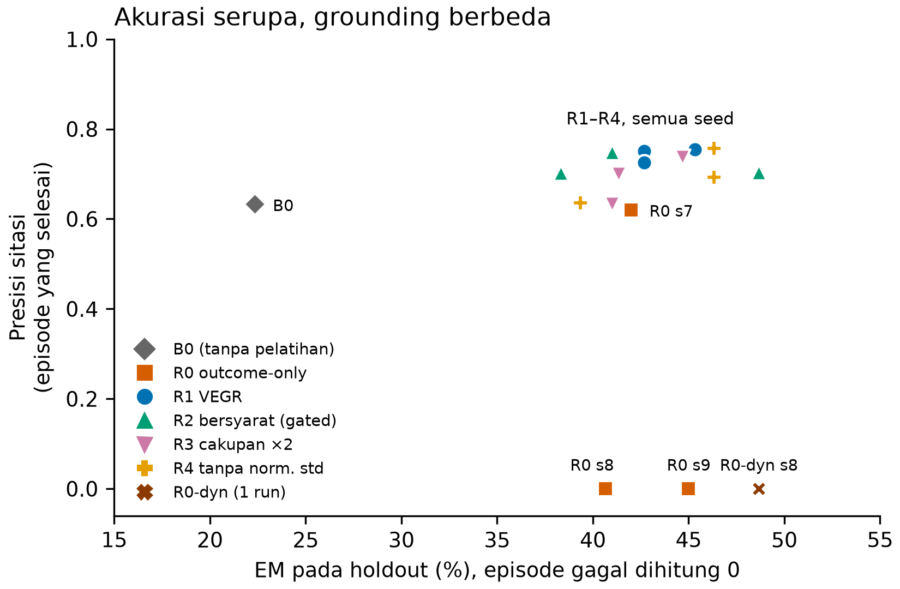
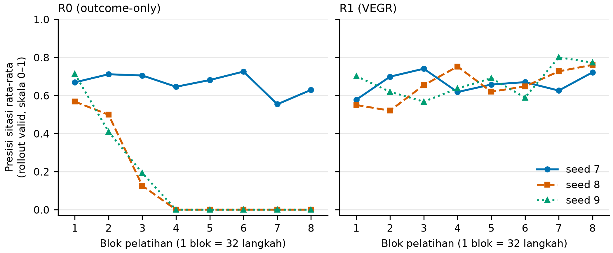
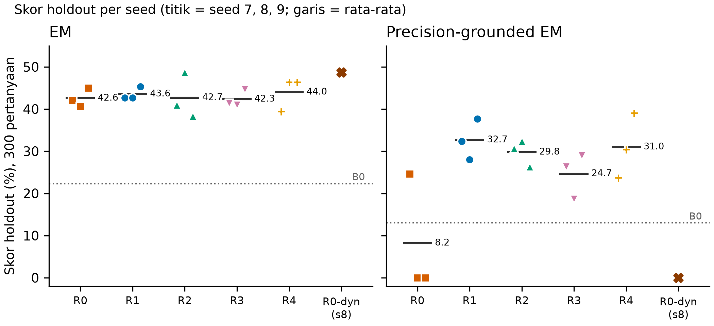
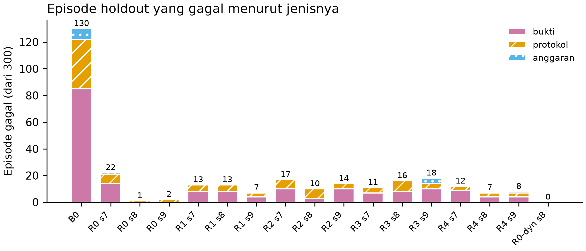

# BAB 4 HASIL DAN ANALISIS

Seluruh angka pada bab ini dihitung dari dua sumber data yang disimpan oleh setiap *run*, yaitu log episode evaluasi pada 300 pertanyaan *holdout* dan log metrik pelatihan per langkah. Perhitungan tabel, gambar, dan selang kepercayaan dilakukan oleh skrip analisis yang tercantum pada Tabel 3.5, sehingga setiap angka dapat dihitung ulang dari repositori.

Penamaan *run* mengikuti Tabel 3.3. Notasi seperti "R1 s8" berarti metode R1 yang dilatih dengan *seed* 8.

Bab ini menyajikan hasil sesuai urutan pertanyaan penelitian, yaitu sebagai berikut. Subbab 4.1 memaparkan pengaturan eksperimen. Subbab 4.2 menjelaskan *baseline* berupa model tanpa pelatihan. Subbab 4.3 sampai 4.6 menjawab RQ1, RQ2, dan RQ3, dengan diagnosis dinamika pelatihan di antaranya (Subbab 4.5). Subbab 4.7 menyajikan analisis kesalahan dan contoh *trace*. Subbab 4.8 membahas variasi hasil antar-*seed*, temuan, dan ancaman terhadap validitas.

Di seluruh bab ini, **EM (semua)** dan ***precision-grounded* EM** menghitung episode yang tidak valid sebagai salah, sehingga penyebutnya selalu 300. Metrik kualitas (cakupan, presisi, *recall*, dan jumlah pencarian) dirata-ratakan hanya atas episode yang **selesai** (Subbab 3.8). Perbandingan utama adalah R0, R1, dan R2 terhadap B0 (RQ1) serta R1 − R0 (RQ2); seluruh perbandingan lainnya, termasuk R3 dan R4 terhadap B0, perbandingan antarvarian terhadap R1, dan R0-dyn, bersifat eksploratif (Subbab 3.8). SK berarti selang kepercayaan 95%; jenis selangnya (*bootstrap* yang memperhitungkan *seed*, *bootstrap* yang hanya me-*resample* pertanyaan, atau Clopper–Pearson) disebutkan pada setiap penggunaan.

## 4.1 Pengaturan Eksperimen

Pengaturan yang sama digunakan oleh seluruh *run* dan diringkas di bawah ini. Rinciannya terdapat pada Bab 3.

| Pengaturan | Nilai |
|---|---|
| Model | Qwen2.5-7B-Instruct + LoRA (r = 16, α = 32) |
| Algoritma pelatihan | *Policy gradient* bergaya GRPO dengan normalisasi per grup, satu pembaruan per grup pertanyaan (Subbab 3.6) |
| Data pelatihan per *run* | 256 pertanyaan pelatihan HotpotQA (sampel bergantung pada *seed*), 1 *epoch*; R0-dyn: hingga 512 |
| Ukuran grup / *learning rate* | G = 8 / 2 × 10⁻⁵ |
| Anggaran pencarian / top-k | 3 pencarian / 3 dokumen, pada kumpulan tertutup berisi 10 paragraf milik pertanyaan tersebut |
| Evaluasi | *Holdout* beku 300 pertanyaan, *greedy decoding*, tanpa pengulangan |
| *Seed* | 7, 8, 9 (R0-dyn: hanya 8) |
| Perangkat keras | 1 × NVIDIA L40S 48 GB (Tabel 3.4) |
| Jumlah *run* | 16 *run* terlatih + B0 |

Seluruh *run* pelatihan berhenti setelah jumlah tetap sebesar 256 pertanyaan. Titik akhir ini ditentukan oleh rancangan eksperimen, bukan oleh konvergensi: rata-rata *reward* pelatihan per blok masih bergeser beberapa persepuluh poin antara dua blok 32 langkah terakhir pada sebagian *run*.

## 4.2 *Baseline* (B0)

Model tanpa pelatihan mencapai **EM 22,3%** dan ***precision-grounded* EM 13,0%** pada *holdout*. Masalah utamanya bukan jawaban yang salah, melainkan episode yang tidak valid: hanya **170 dari 300** episode yang selesai. Sebanyak 130 kegagalan tersebut terdiri atas 85 kegagalan bukti, 37 kegagalan protokol, dan 8 kegagalan anggaran. Kegagalan bukti terjadi ketika sebuah sitasi merujuk pada judul yang tidak termasuk dalam 10 paragraf milik pertanyaan tersebut (praktisnya, judul yang dikarang atau salah ditulis), pada indeks kalimat di luar jangkauan, atau ketika sitasi yang sama disebut dua kali (Subbab 3.4).

Ketika model berhasil menyelesaikan sebuah episode, kemampuannya cukup baik. EM pada episode yang selesai adalah 39,4%, presisi sitasi 0,633, dan *retrieval recall* 0,829 (Tabel 4.1). *Retrieval recall* yang tinggi ini menunjukkan betapa mudahnya pencarian pada kumpulan tertutup berisi 10 paragraf (Subbab 3.4). Dengan demikian, sebagian besar peningkatan yang dapat diperoleh dari pelatihan terletak pada kepatuhan terhadap protokol, sebagaimana dikonfirmasi pada Subbab 4.3.

## 4.3 RQ1: Apakah Pelatihan Bergaya GRPO Meningkatkan Agen Dibandingkan dengan Model Tanpa Pelatihan?

Tabel 4.1 menyajikan hasil *holdout* setiap *run*. Pada tabel ini, EM (semua) dan P-gEM (*precision-grounded* EM) menghitung kegagalan sebagai 0, sedangkan cakupan, presisi, *recall*, dan jumlah pencarian merupakan rata-rata atas episode yang selesai. Kolom "Dup." berisi jumlah episode selesai yang mengulang *query* pencarian. Kolom "Pembaruan" berisi jumlah langkah pelatihan yang menghasilkan pembaruan gradien dari 256 langkah, atau dari 512 pertanyaan yang diambil untuk R0-dyn.

**Tabel 4.1.** Hasil *holdout* per *run*

| *Run* | *Seed* | EM (semua) | P-gEM | Selesai /300 | Cakupan bukti | Presisi sitasi | *Retr. recall* | Pencarian | Dup. | Pembaruan |
|---|---|---|---|---|---|---|---|---|---|---|
| B0 | – | 22,3% | 13,0% | 170 | 0,472 | 0,633 | 0,829 | 1,92 | 32 | – |
| R0 (*outcome-only*) | 7 | 42,0% | 24,7% | 278 | 0,438 | 0,621 | 0,829 | 3,00 | 229 | 149 |
| R0 (*outcome-only*) | 8 | 40,7% | 0,0% | 299 | 0,000 | 0,000 | 0,710 | 1,01 | 0 | 128 |
| R0 (*outcome-only*) | 9 | 45,0% | 0,0% | 298 | 0,000 | 0,000 | 0,860 | 2,27 | 55 | 132 |
| R1 (VEGR) | 7 | 42,7% | 32,3% | 287 | 0,473 | 0,751 | 0,851 | 2,30 | 14 | 248 |
| R1 (VEGR) | 8 | 42,7% | 28,0% | 287 | 0,513 | 0,726 | 0,836 | 2,15 | 7 | 248 |
| R1 (VEGR) | 9 | 45,3% | 37,7% | 293 | 0,333 | 0,754 | 0,837 | 1,91 | 27 | 238 |
| R2 (*gated*) | 7 | 41,0% | 30,7% | 283 | 0,539 | 0,748 | 0,891 | 2,21 | 34 | 237 |
| R2 (*gated*) | 8 | 48,7% | 32,3% | 290 | 0,440 | 0,703 | 0,879 | 2,00 | 4 | 236 |
| R2 (*gated*) | 9 | 38,3% | 26,3% | 286 | 0,471 | 0,702 | 0,855 | 2,16 | 36 | 246 |
| R3 (cakupan ×2) | 7 | 41,3% | 26,3% | 289 | 0,607 | 0,701 | 0,854 | 2,01 | 12 | 245 |
| R3 (cakupan ×2) | 8 | 41,0% | 18,7% | 284 | 0,545 | 0,633 | 0,820 | 1,61 | 5 | 241 |
| R3 (cakupan ×2) | 9 | 44,7% | 29,0% | 282 | 0,557 | 0,738 | 0,882 | 2,35 | 34 | 246 |
| R4 (tanpa norm. std) | 7 | 39,3% | 23,7% | 288 | 0,469 | 0,636 | 0,796 | 1,89 | 35 | 248 |
| R4 (tanpa norm. std) | 8 | 46,3% | 30,3% | 293 | 0,509 | 0,693 | 0,865 | 2,30 | 44 | 246 |
| R4 (tanpa norm. std) | 9 | 46,3% | 39,0% | 292 | 0,346 | 0,757 | 0,867 | 2,41 | 25 | 242 |
| R0-dyn | 8 | 48,7% | 0,0% | 300 | 0,000 | 0,000 | 0,875 | 2,29 | 15 | 250 |

Tabel 4.2 merangkum hasil per metode sebagai rata-rata ± simpangan baku atas *seed* 7, 8, dan 9. B0 hanya memiliki satu evaluasi. EM, P-gEM, *Lenient* gEM, Sup-EM, dan Joint-EM merupakan persentase dari 300 pertanyaan. "EM selesai" dihitung atas episode yang selesai. Joint-F1 merupakan rata-rata skor (×100) atas 300 pertanyaan, sedangkan presisi dan cakupan merupakan rata-rata atas episode yang selesai.

**Tabel 4.2.** Rata-rata hasil per metode

| Metode | EM | EM selesai | P-gEM | *Lenient* gEM | Sup-EM | Joint-EM | Joint-F1 | Presisi sitasi | Cakupan bukti |
|---|---|---|---|---|---|---|---|---|---|
| B0 | 22,3 | 39,4 | 13,0 | 20,3 | 11,3 | 6,0 | 17,5 | 0,633 | 0,472 |
| R0 *outcome-only* | 42,6 ± 2,2 | 43,8 ± 2,6 | 8,2 ± 14,2 | 12,9 ± 22,3 | 5,0 ± 8,7 | 3,2 ± 5,6 | 10,5 ± 18,1 | 0,207 ± 0,358 | 0,146 ± 0,253 |
| **R1 VEGR** | 43,6 ± 1,5 | 45,2 ± 1,0 | **32,7 ± 4,8** | 39,9 ± 1,6 | 11,9 ± 10,1 | 7,1 ± 5,8 | 33,7 ± 3,9 | **0,744 ± 0,015** | 0,440 ± 0,095 |
| R2 *gated* | 42,7 ± 5,4 | 44,7 ± 5,2 | 29,8 ± 3,1 | 40,0 ± 4,5 | 15,9 ± 4,8 | 10,0 ± 1,9 | 35,2 ± 2,3 | 0,718 ± 0,026 | 0,483 ± 0,051 |
| R3 cakupan ×2 | 42,3 ± 2,0 | 44,6 ± 2,6 | 24,7 ± 5,4 | 40,1 ± 2,0 | **24,3 ± 4,2** | **13,4 ± 2,2** | **38,0 ± 2,2** | 0,690 ± 0,053 | **0,569 ± 0,033** |
| R4 tanpa norm. std | 44,0 ± 4,0 | 45,3 ± 3,8 | 31,0 ± 7,7 | 39,7 ± 3,3 | 12,4 ± 8,7 | 7,4 ± 5,3 | 33,7 ± 4,7 | 0,695 ± 0,060 | 0,441 ± 0,085 |

Tabel 4.3 memuat selisih berpasangan dalam poin persentase, dengan selang *bootstrap* 95% dari 10.000 *resample*. Selang **utama** memperhitungkan *seed*, yaitu me-*resample* *seed* sekaligus pertanyaan (Subbab 3.8). Selang yang hanya me-*resample* pertanyaan merata-ratakan *seed* terlebih dahulu, sehingga mengabaikan variansi antar-*seed* dan hanya diberikan sebagai acuan. Perbandingan utama adalah R0 − B0, R1 − B0, R2 − B0, dan R1 − R0; baris lainnya bersifat eksploratif. R0-dyn hanya memiliki satu *run*, sehingga hanya selang yang me-*resample* pertanyaan yang tersedia.

**Tabel 4.3.** Selisih berpasangan antarmetode

| Perbandingan | ΔEM (dengan *seed*) | ΔP-gEM (dengan *seed*) | ΔJoint-EM (dengan *seed*) | ΔEM (hanya pertanyaan) | ΔP-gEM (hanya pertanyaan) |
|---|---|---|---|---|---|
| R0 − B0 | +20,2 [+15,1; +25,6] | −4,8 [−16,0; +10,7] | −2,8 [−8,0; +3,4] | [+15,9; +24,6] | [−8,4; −1,2] |
| R1 − B0 | +21,2 [+16,4; +26,0] | +19,7 [+13,3; +26,1] | +1,1 [−5,1; +6,9] | [+17,0; +25,4] | [+15,8; +23,7] |
| R2 − B0 | +20,3 [+13,8; +27,4] | +16,8 [+11,7; +21,9] | +4,0 [+0,7; +7,2] | [+16,1; +24,7] | [+13,0; +20,6] |
| R3 − B0 | +20,0 [+14,8; +25,2] | +11,7 [+5,0; +18,2] | +7,4 [+3,6; +11,6] | [+15,4; +24,6] | [+7,9; +15,6] |
| R4 − B0 | +21,7 [+15,7; +27,6] | +18,0 [+10,0; +26,7] | +1,4 [−4,0; +7,3] | [+17,3; +26,0] | [+14,1; +22,0] |
| **R1 − R0** | +1,0 [−3,6; +5,4] | **+24,4 [+8,8; +37,3]** | +3,9 [−4,0; +11,4] | [−1,9; +3,8] | [+20,9; +28,1] |
| R2 − R1 | −0,9 [−7,1; +5,8] | −2,9 [−9,8; +3,6] | +2,9 [−2,9; +9,3] | [−4,0; +2,1] | [−5,9; +0,1] |
| R3 − R1 | −1,2 [−5,7; +3,3] | −8,0 [−16,1; −0,2] | +6,3 [+0,2; +13,1] | [−4,2; +1,8] | [−11,1; −4,9] |
| R4 − R1 | +0,4 [−5,2; +5,7] | −1,7 [−10,9; +7,7] | +0,3 [−7,0; +8,1] | [−2,6; +3,3] | [−4,4; +1,0] |
| R0-dyn s8 − R0 s8 | – | – | – | +8,0 [+3,3; +12,7] | 0,0 [0,0; 0,0] |

Gambar 4.1 menyajikan selisih EM (panel kiri) dan *precision-grounded* EM (panel kanan) dari Tabel 4.3 beserta selang utamanya yang memperhitungkan *seed*. Baris di atas garis putus-putus pertama membandingkan setiap metode dengan B0 (RQ1), baris di bawahnya membandingkan antarmetode (RQ2 dan RQ3), dan baris terakhir membandingkan R0-dyn dengan R0 *seed* 8. Karena R0-dyn hanya memiliki satu *run*, penanda kosong pada baris tersebut menunjukkan selang yang hanya me-*resample* pertanyaan.


**Gambar 4.1.** Selisih berpasangan EM dan *precision-grounded* EM

**Jawaban RQ1: ya, tetapi sebagian besar melalui pembelajaran protokol.** Setiap metode mengungguli B0 sekitar **+20 poin EM**, dan setiap selang yang memperhitungkan *seed* tidak mencakup nol (Tabel 4.3). Per *run*, ke-16 *run* terlatih memperoleh kenaikan antara +16,0 (R2 s9, SK yang hanya me-*resample* pertanyaan [+10,7; +21,3]) dan +26,3 poin (R2 s8 dan R0-dyn s8, masing-masing [+21,0; +31,7]) dibandingkan dengan B0.

Sebagian besar kenaikan ini berasal dari keberhasilan menyelesaikan protokol, bukan dari jawaban yang lebih baik. B0 kehilangan 130 dari 300 episode karena kegagalan, sedangkan setiap *run* terlatih kehilangan paling banyak 22 episode. Akurasi jawaban pada episode yang selesai naik jauh lebih sedikit, dan besarnya dapat diukur dengan dua cara.

- **EM pada episode yang selesai** bergeser dari **39,4% (B0) menjadi 43,8–45,3%** untuk setiap metode (45,2% untuk R1; Tabel 4.2). Angka ini membandingkan himpunan pertanyaan yang berbeda, yaitu 170 pertanyaan untuk B0 dan 278–300 untuk *run* terlatih.
- Pada **136 pertanyaan yang diselesaikan oleh setiap *run***, EM B0 adalah 37,5%, sedangkan rata-rata *seed* setiap metode berada di antara 43,4% dan 45,6% (R1: 45,6%, yaitu +8,1 poin).

Dengan demikian, RQ1 sebagian besar mengukur seberapa baik agen belajar menghasilkan aksi yang valid dan dapat diverifikasi, sedangkan akurasi jawaban pada episode yang selesai hanya naik sekitar 4–8 poin. Log pelatihan R1 *seed* 7 memperlihatkan pembelajaran protokol ini secara langsung. Tingkat *rollout* yang tidak valid turun dari 46% menjadi 29%, 13%, 13%, dan 7% pada lima blok 32 langkah pertama, sementara rata-rata *reward* naik dari 0,97 menjadi 2,81. *Baseline* berupa *prompt few-shot* tidak dijalankan, sehingga tidak diketahui seberapa besar kenaikan protokol ini dapat dicapai melalui *prompting* saja (Subbab 4.8).

*Grounding* menunjukkan hasil yang beragam. Metode yang memberi *reward* pada bukti (R1–R4) meningkatkan *precision-grounded* EM dibandingkan dengan B0 sebesar +11,7 hingga +19,7 poin, dan setiap selangnya tidak mencakup nol. Hal ini tidak berlaku untuk *reward outcome-only*: R0 − B0 bernilai −4,8 poin dengan selang yang memperhitungkan *seed* [−16,0; +10,7], sehingga arah selisihnya tidak dapat ditentukan. *Grounding* R0 bergantung pada *seed* (24,7% pada *seed* 7, 0% pada *seed* 8 dan 9). Pada Joint-EM HotpotQA, hanya R2 dan R3 yang selangnya berada di atas nol terhadap B0, dan batas bawah selang R2 (+0,7) sangat dekat dengan nol.

**Split validasi (hanya sebagai bukti pendukung).** Pada *split* validasi, R1 *seed* 7 mencapai EM 57,0% dibandingkan dengan 29,3% pada B0 (+27,7 poin, SK *bootstrap* yang me-*resample* pertanyaan dengan 5.000 *resample* [+21,7; +33,7]). *Split* validasi juga digunakan untuk menetapkan pengaturan *run* 2 (Subbab 3.3), sehingga angka ini bukan bukti yang independen. Pertanyaan validasi juga tampak lebih mudah daripada *holdout*. Oleh karena itu, angka ini hanya diperlakukan sebagai bukti pendukung bahwa kenaikan serupa juga muncul di luar *holdout*.

## 4.4 RQ2: *Reward Outcome-Only* dibandingkan dengan VEGR

**Tidak ada perbedaan akurasi yang terdeteksi.** R1 − R0 bernilai +1,0 poin EM dengan SK yang memperhitungkan *seed* [−3,6; +5,4], dan rata-rata tiga *seed* adalah 42,6% (R0) dan 43,6% (R1). Batas bawah selang ini berarti bahwa kehilangan akurasi yang lebih besar dari sekitar 3,6 poin EM tidak didukung oleh data, sedangkan kehilangan yang lebih kecil dari itu tidak dapat disingkirkan. Tidak ada margin non-inferioritas yang ditetapkan sebelumnya, sehingga hasil ini tidak dibaca sebagai bukti bahwa kedua *reward* setara.

***Grounding*-nya sangat berbeda.** Paket VEGR lengkap menaikkan *precision-grounded* EM sebesar **24,4 poin** dibandingkan dengan R0 (SK dengan *seed* **[+8,8; +37,3]**). Ini merupakan efek antarmetode terbesar dalam tugas akhir ini. Selangnya lebar karena *grounding* R0 sangat bervariasi antar-*seed* (24,7%, 0%, 0%), dan sebagian besar selisih rata-rata berasal dari dua *seed* R0 yang tidak memberi sitasi sama sekali. Perbandingan per pasangan *seed* menunjukkan hal yang sama dengan cara yang lebih transparan: setiap *seed* R1 (28,0–37,7%) berada di atas *seed* R0 terbaik (24,7%), sehingga kesembilan pasangan *seed* R1 × R0 bernilai positif, dengan selisih terkecil +3,3 poin (R1 *seed* 8 terhadap R0 *seed* 7). Terhadap R0 *seed* 7, satu-satunya *seed* R0 yang tetap memberi sitasi, rata-rata R1 unggul 32,7% dibandingkan dengan 24,7%. Metrik ini dihitung terhadap *supporting facts* emas yang sama dengan yang diberi *reward* oleh VEGR (Subbab 4.8). Pada ukuran yang lebih longgar maupun lebih ketat, arahnya sama tetapi besarnya berbeda: Joint-F1 bernilai 33,7 untuk R1 dibandingkan dengan 10,5 untuk R0, sedangkan selang selisih Joint-EM (+3,9, SK [−4,0; +11,4]) mencakup nol (penjelasannya pada Subbab 4.5 dan 4.6).

Sebagaimana dicatat pada Subbab 3.1, R1 dan R0 berbeda pada enam komponen *reward* dan pada jumlah pembaruan pelatihannya (238–248 dibandingkan dengan 128–149; Tabel 4.1). Perbandingan ini mengukur efek keseluruhan paket VEGR beserta sinyal pelatihan yang dihasilkannya, bukan efek satu komponen bukti tertentu.

**R0 *seed* 8 dan 9 berhenti memberi sitasi.** Kedua *policy* tersebut belajar menjawab **tanpa sitasi sama sekali**, yaitu perilaku jalan pintas sebagaimana didefinisikan pada Subbab 1.2. Tingkat sitasi pada *holdout* adalah 0%, sehingga presisi sitasi, cakupan bukti, dan *precision-grounded* EM seluruhnya bernilai 0. Seluruh 122 jawaban benar dari *seed* 8 dan seluruh 135 jawaban benar dari *seed* 9 tidak disertai sitasi. Jawaban tanpa sitasi tetap valid di dalam *environment* (Subbab 3.4), dan pada R0 jawaban seperti ini memperoleh nilai penuh. Kedua *seed* berbeda dalam cara mencari. *Seed* 8 hanya mencari satu kali (1,01 pencarian per episode). *Seed* 9 masih mencari rata-rata 2,27 kali dan sering menemukan paragraf yang tepat (*retrieval recall* 0,860), tetapi kemudian tidak menyitasinya (*Trace* 2, Subbab 4.7).

**R0 *seed* 7 tetap memberi sitasi, tetapi bergeser ke pencarian berulang.** *Run* ini selalu menggunakan ketiga pencarian (rata-rata 3,00), dan **229 dari 278** episode selesainya mengulang *query*, dibandingkan dengan 32 pada B0 dan 7 hingga 27 pada *seed* R1. Pada R0, komponen biaya pencarian dan duplikasi berbobot nol, sehingga pencarian berulang tidak memberi maupun mengurangi *reward*. Ini merupakan **pergeseran yang netral terhadap *reward***, bukan jalan pintas. *Seed* 7 tetap memberi sitasi dengan presisi yang serupa dengan B0 (0,621 dibandingkan dengan 0,633, secara deskriptif) dan memiliki *precision-grounded* EM dua kali lipat B0 (24,7% dibandingkan dengan 13,0%).

Dengan demikian, **2 dari 3 *seed* R0 berhenti memberi sitasi**, sedangkan R1 tidak mengalami hilangnya sitasi pada ketiga *seed*-nya. Dengan tiga *seed*, SK Clopper–Pearson untuk proporsi tersebut adalah [0,09; 0,99] untuk R0 (2/3) dan [0; 0,71] untuk R1 (0/3). Kedua selang ini tumpang-tindih lebar: hilangnya sitasi pada R0 cukup umum hingga muncul dua kali, tetapi frekuensinya pada kedua *reward* pada dasarnya tidak diketahui. Dukungan bahwa VEGR lebih tahan terhadap hilangnya sitasi terutama berasal dari struktur *reward*-nya (Subbab 4.5), bukan dari frekuensi pada tiga *seed*.

**Mengapa R0 berhenti memberi sitasi.** Definisi R0 (Subbab 3.5) memberi penalti −1 pada sitasi yang gagal validasi, tetapi tidak pernah memberi imbalan pada sitasi yang benar. Penjelasan yang paling sesuai dengan data adalah bahwa struktur ini membuat menyitasi hampir tidak menguntungkan bagi R0, sehingga hilangnya sitasi dapat terjadi tanpa ada tekanan yang menahannya. Penjelasan ini merupakan hipotesis yang diuraikan pada Subbab 4.5; data tidak menjelaskan mengapa *seed* 7 tetap memberi sitasi. Yang ditunjukkan oleh data secara langsung adalah *kapan* dan *pada seed mana* hal ini terjadi: *policy* tetap memberi sitasi selama sekitar 64 langkah, kemudian berhenti memberi sitasi dalam sekitar 32 langkah, pada dua dari tiga *seed*.

**Apakah kenaikan presisi merupakan efek seleksi?** Presisi dan cakupan dirata-ratakan atas episode yang selesai, dan himpunan episode yang selesai berbeda antar-*run* (170 untuk B0, hingga 300 untuk *run* lainnya). Pada 136 pertanyaan yang diselesaikan oleh setiap *run*, urutannya tetap sama: presisi sitasi adalah 0,627 untuk B0, 0,646 untuk R0 s7, dan 0,750–0,790 untuk ketiga *seed* R1. Cakupan bukti pada himpunan yang sama adalah 0,463 untuk B0 dan rata-rata 0,460 untuk R1. Tingkat sitasi setiap *run* yang memberi sitasi (semua kecuali R0 s8, R0 s9, dan R0-dyn) adalah sedikitnya 98,6%.

**R1 (VEGR) stabil.** Pada ketiga *seed*, EM berada di antara 42,7% dan 45,3%, yaitu rentang tersempit di antara seluruh metode. Presisi sitasi berada di antara 0,726 dan 0,754 (sd 0,015). Jumlah pencarian per episode berada di antara 1,91 dan 2,30, dan paling banyak 27 episode yang mengulang *query*.

Gambar 4.2 menggabungkan kedua dimensi tersebut. Setiap titik mewakili satu *run*, dengan EM *holdout* atas seluruh episode (kegagalan dihitung 0) pada satu sumbu dan presisi sitasi atas episode yang selesai pada sumbu lainnya. Bentuk dan warna titik menunjukkan metode. Setiap *run* terlatih berada pada pita akurasi yang serupa, yaitu sekitar 38–49% EM. Pada sumbu *grounding*, *run* yang diberi *reward* bukti berkumpul pada presisi 0,63–0,76, R0 *seed* 7 berada pada 0,62, sedangkan R0 *seed* 8 dan 9 serta R0-dyn berada pada 0.



**Gambar 4.2.** EM terhadap presisi sitasi per *run*

**Jawaban RQ2: sebagian ya, dengan beberapa catatan.** *Reward outcome-only* kehilangan sitasi pada dua dari tiga *seed*, sedangkan paket VEGR lengkap tidak mengalami hilangnya sitasi pada ketiga *seed* dan menaikkan *precision-grounded* EM sebesar 24,4 poin (SK [+8,8; +37,3]). Tidak ada perbedaan akurasi yang terdeteksi di antara keduanya (+1,0 EM, SK [−3,6; +5,4]), tetapi kehilangan akurasi yang lebih kecil dari sekitar 3,6 poin tidak dapat disingkirkan. Terdapat tiga catatan, yaitu sebagai berikut.

1. Tiga *seed* tidak cukup untuk memperkirakan seberapa sering hilangnya sitasi terjadi pada kedua *reward* (SK Clopper–Pearson [0,09; 0,99] untuk R0 dan [0; 0,71] untuk R1).
2. VEGR membuat sitasi menjadi *benar*, tetapi tidak *lengkap*. *Precision-grounded* EM R1 (32,7%) sekitar 11 poin di bawah EM-nya (43,6%), sedangkan Sup-EM (11,9%) dan Joint-EM (7,1%) rendah dan sangat bervariasi antar-*seed* (Subbab 4.5 dan 4.6).
3. VEGR tidak menaikkan cakupan bukti dibandingkan dengan model tanpa pelatihan, baik pada episode yang selesai (0,440 dibandingkan dengan 0,472 untuk B0) maupun pada 136 pertanyaan yang diselesaikan oleh setiap *run* (0,460 dibandingkan dengan 0,463).

## 4.5 Diagnosis: Mengapa *Reward Outcome-Only* Tidak Stabil

***Rollout* pelatihan.** Tabel 4.4 memilah *rollout* pelatihan R0 *seed* 8 dan 9 serta R1 *seed* 8 berdasarkan hasilnya, per blok 32 langkah (256 *rollout* per blok).

Pada Tabel 4.4, "gagal bukti" adalah *rollout* tidak valid dengan kegagalan bukti (*reward* −1). Log *rollout* tidak menyimpan daftar sitasi, sehingga *rollout* valid dipilah berdasarkan presisi sitasinya: "≥1 sitasi emas" berarti presisi lebih dari 0, sedangkan "tanpa sitasi emas" mencakup *rollout* tanpa sitasi sama sekali dan *rollout* yang hanya menyitasi kalimat bukan emas. Dua kolom terakhir berisi rata-rata *reward* pelatihan kedua kelompok tersebut. Kegagalan protokol dan kegagalan anggaran pencarian tidak ditampilkan, sehingga jumlah setiap baris tidak selalu 256.

**Tabel 4.4.** *Rollout* pelatihan berdasarkan hasil

| *Run* | Langkah | Gagal bukti | Valid, ≥1 sitasi emas | Valid, tanpa sitasi emas | *Reward*: valid, ≥1 sitasi emas | *Reward*: valid, tanpa sitasi emas |
|---|---|---|---|---|---|---|
| R0 s8 | 1–32 | 90 | 86 | 42 | 0,50 | 0,36 |
| R0 s8 | 33–64 | 79 | 94 | 75 | 0,48 | 0,20 |
| R0 s8 | 65–96 | 17 | 34 | 204 | 0,53 | 0,50 |
| R0 s8 | 97–256 | 0 | 0 | 253–256 per blok | – | 0,40–0,52 |
| R0 s9 | 1–32 | 48 | 161 | 27 | 0,67 | 0,26 |
| R0 s9 | 33–64 | 45 | 93 | 91 | 0,59 | 0,24 |
| R0 s9 | 65–96 | 14 | 52 | 189 | 0,71 | 0,39 |
| R0 s9 | 97–256 | 0 | 0 | 217–255 per blok | – | 0,43–0,64 |
| R1 s8 | 1–32 | 91 | 85 | 45 | 3,35 | 1,37 |
| R1 s8 | 97–128 | 23 | 199 | 29 | 3,49 | 1,28 |
| R1 s8 | 225–256 | 12 | 214 | 17 | 3,47 | 0,71 |

**Selisih *reward* di dalam grup.** GRPO membandingkan *rollout* di dalam grup yang sama, sehingga yang menentukan arah pembaruan adalah selisih *reward* antara *rollout* yang menyitasi bukti emas dan yang tidak. Pada R0, selisih ini kecil: *rollout* valid dengan sitasi emas memperoleh 0,50 dibandingkan dengan 0,36 pada blok pertama *seed* 8, dan 0,67 dibandingkan dengan 0,26 pada *seed* 9. Selisih ini pun hanya muncul karena jawaban yang disertai sitasi emas lebih sering benar, dan keduanya sama-sama dipengaruhi oleh keberhasilan pencarian. Pada R1, *rollout* valid dengan sitasi emas memperoleh sekitar **3,4** dibandingkan dengan sekitar **1,3**, yaitu selisih sekitar 2 poin yang diberikan langsung oleh komponen bukti. Jumlah *rollout* valid dengan sitasi emas pada R1 *seed* 8 bertambah dari 85 menjadi 214 per blok selama pelatihan, sedangkan pada R0 *seed* 8 dan 9 kelompok ini menghilang sejak blok langkah 97–128.

**Nilai harapan upaya menyitasi.** Ukuran kedua menggabungkan kegagalan bukti ke dalam perhitungan. Pada blok pertama R0 *seed* 8, 90 dari 176 upaya menyitasi (51%) merupakan kegagalan bukti dengan nilai −1, sehingga nilai harapan upaya menyitasi adalah (86 × 0,50 − 90) / 176 ≈ −0,27, dibandingkan dengan 0,36 untuk *rollout* valid tanpa sitasi emas. Namun, ukuran ini tidak membedakan *run* yang kehilangan sitasi dari yang tidak, yaitu sebagai berikut.

- R0 *seed* 9 kehilangan sitasi, padahal pada blok pertamanya hanya 23% upaya menyitasi yang gagal dan nilai harapan upaya menyitasi (+0,29) sedikit di atas nilai *rollout* tanpa sitasi emas (0,26). Pada blok kedua, nilainya turun menjadi +0,07 dibandingkan dengan 0,24.
- R0 *seed* 7 tetap memberi sitasi, padahal pada blok pertamanya 36% upaya menyitasi gagal dan nilai harapannya (−0,05) berada di bawah nilai *rollout* tanpa sitasi emas (0,30).
- R1 *seed* 8 tetap memberi sitasi, padahal nilai harapan upaya menyitasi pada blok pertamanya (+1,10) juga berada di bawah nilai *rollout* tanpa sitasi emas (1,37).

Dengan demikian, kedua ukuran tersebut mendukung hipotesis yang sama secara terbatas: **R0 memberi penalti pada sitasi yang gagal validasi tetapi tidak pernah memberi imbalan pada sitasi yang benar, sehingga tidak ada tekanan yang menahan *policy* untuk tetap menyitasi, sedangkan VEGR memberi imbalan langsung pada sitasi yang benar.** Hipotesis ini konsisten dengan log pelatihan dua *seed* R0 dan satu *seed* R1, tetapi bukan penjelasan kausal yang terbukti. Hipotesis ini menjelaskan mengapa hilangnya sitasi *mungkin* terjadi pada R0, bukan mengapa hal itu terjadi pada *seed* 8 dan 9 tetapi tidak pada *seed* 7.

**Grup dengan variansi nol.** GRPO tidak belajar apa pun dari grup yang seluruh 8 *rollout*-nya menerima *reward* yang sama (Subbab 3.6), dan langkah seperti ini dilewati. Pada *reward outcome-only* hal ini sering terjadi, karena *reward*-nya hanya mengambil tiga nilai (−1, 0, dan 1) dan banyak pertanyaan yang di dalam satu grup selalu terjawab atau tidak pernah terjawab.

Tabel 4.5 memuat jumlah langkah yang dilewati dari 256 langkah setiap *run*. Untuk R0-dyn, jumlahnya dihitung dari 512 pertanyaan yang diambil.

**Tabel 4.5.** Langkah pelatihan yang dilewati

| Metode | *Seed* 7 | *Seed* 8 | *Seed* 9 |
|---|---|---|---|
| R0 *outcome-only* | 107 | 128 | 124 |
| R1 VEGR | 8 | 8 | 18 |
| R2 *gated* | 19 | 20 | 10 |
| R3 cakupan ×2 | 11 | 15 | 10 |
| R4 tanpa norm. std | 8 | 10 | 14 |
| R0-dyn | – | 262 dari 512 yang diambil | – |

Dengan demikian, R0 hanya belajar dari sekitar separuh pertanyaannya, dan setiap pertanyaan tersebut hanya memberikan sinyal benar-atau-salah yang kasar. Metode yang diberi *reward* bukti hanya melewati 8–20 langkah, karena komponen kontinunya hampir selalu membedakan 8 *rollout*. Gambar 4.3 menampilkan jumlah langkah yang dilewati ini untuk setiap *run*. *Run* standar memiliki 256 langkah, sedangkan R0-dyn mengambil 512 pertanyaan dan melewati 262 di antaranya.


**Gambar 4.3.** Langkah pelatihan yang dilewati per *run*

**Dinamika pelatihan per blok.** Setiap *run* hanya melewati data pelatihannya satu kali (satu *epoch*), sehingga perkembangan selama pelatihan ditampilkan per blok 32 langkah. Satu blok berisi 32 pertanyaan × 8 *rollout* = 256 *rollout*. Gambar 4.4 menampilkan rata-rata presisi sitasi *rollout* pelatihan yang valid per blok untuk ketiga *seed* R0 dan R1. Sumbu vertikal adalah presisi sitasi dengan skala 0 sampai 1, dan jawaban valid tanpa sitasi bernilai 0 menurut definisi (Subbab 3.5). Setiap titik merata-ratakan 128–256 *rollout* valid yang diambil pada *temperature* 1,0 selama pelatihan, sehingga nilainya bukan hasil *holdout*. Lampiran B menyajikan grafik yang sama untuk R2, R3, R4, dan R0-dyn, beserta tabel per blok untuk seluruh 16 *run*.



**Gambar 4.4.** Presisi sitasi selama pelatihan, R0 dan R1

Gambar 4.4 menunjukkan kapan hilangnya sitasi pada R0 terjadi. Selama dua blok pertama (langkah 1–64), R0 dan R1 menghasilkan presisi sitasi pelatihan yang serupa, misalnya 0,568 dan 0,499 untuk R0 *seed* 8 dibandingkan dengan 0,550 dan 0,520 untuk R1 *seed* 8. R0 *seed* 8 kemudian turun menjadi 0,126 pada blok ketiga (langkah 65–96) dan bernilai 0,000 pada setiap blok sejak langkah 97. R0 *seed* 9 mengikuti jalur yang sama (0,714, 0,410, 0,192, lalu 0,000 sejak langkah 97). R0 *seed* 7, yaitu *run* yang tetap memberi sitasi, berada di antara 0,55 dan 0,73 sepanjang pelatihan. Ketiga *seed* R1 tidak pernah turun di bawah 0,52 dan berakhir antara 0,72 dan 0,77 pada blok terakhir.

Pola yang sama terlihat pada seluruh *run* lain (Lampiran B). Kedua belas *run* yang dilatih dengan VEGR atau variannya (R1–R4) mempertahankan presisi sitasi pelatihan antara 0,52 dan 0,85 pada setiap blok. Satu-satunya *run* lain yang kehilangan sitasi adalah R0-dyn, yang juga menggunakan *reward outcome-only*. Pada semua *run*, proporsi *rollout* tidak valid turun dari 24–52% pada blok pertama menjadi 0–15% pada blok terakhir, sehingga pembelajaran protokol terjadi pada setiap skenario.

**Apakah pelatihan yang lebih panjang memulihkan sitasi?** R0-dyn (Subbab 4.6) memberikan jawaban parsial untuk *seed* 8. Pada 256 langkah pertamanya, R0-dyn melatih 256 pertanyaan yang sama dengan R0 *seed* 8 dalam urutan yang sama, dengan konfigurasi algoritma yang identik. Kedua *run* sudah berbeda sejak langkah ke-2 karena nondeterminisme numerik GPU, sehingga jumlah langkah yang dilewati juga berbeda (29 dibandingkan dengan 19 pada langkah 1–96). Hilangnya sitasi tetap terjadi pada jadwal yang sama: presisi sitasi pelatihan R0-dyn adalah 0,550 dan 0,596 pada dua blok pertama, 0,250 pada blok langkah 65–96, dan 0,000 pada setiap blok selanjutnya kecuali satu (0,004). Karena hilangnya sitasi terjadi sebelum kedua konfigurasi berbeda, R0-dyn tidak menguji apakah pembaruan yang lebih banyak dapat *mencegah* hilangnya sitasi. Yang ditunjukkan oleh *run* ini adalah dua hal: hilangnya sitasi pada *seed* 8 terulang pada *run* kedua, dan 256 pertanyaan pelatihan tambahan (total 250 pembaruan) tidak *memulihkan* sitasi.

**Sitasi yang "presisi tetapi tidak lengkap".** VEGR menaikkan presisi sitasi (sekitar 0,73–0,75, dibandingkan dengan 0,633 untuk B0) tetapi tidak menaikkan cakupan bukti. Cakupan R1 adalah 0,473, 0,513, dan 0,333 pada *seed* 7, 8, dan 9, dibandingkan dengan 0,472 untuk B0, sehingga hanya *seed* 9 yang berada di bawah B0, dan rata-ratanya (0,440) berada di bawah B0 karena *seed* tersebut. Pada 136 pertanyaan yang diselesaikan oleh setiap *run*, cakupan R1 (0,460) praktis sama dengan B0 (0,463). Pola sitasi menunjukkan bahwa *policy* jarang menyitasi lebih dari dua kalimat. R1 *seed* 8 menyitasi 1 kalimat pada 97 episode, 2 kalimat pada 182 episode, dan 3 kalimat pada 8 episode. Berdasarkan posisi kalimat, kalimat ke-0 disitasi 233 kali, kalimat ke-1 161 kali, dan kalimat ke-2 57 kali. Gambar 4.5 menampilkan posisi seluruh 485 kalimat yang disitasi oleh R1 *seed* 8 pada episode *holdout* yang selesai: 451 di antaranya (93%) merujuk ke salah satu dari tiga kalimat pertama sebuah paragraf.


**Gambar 4.5.** Posisi kalimat yang disitasi oleh R1 *seed* 8

Sitasi terkumpul pada beberapa kalimat awal paragraf. Kalimat emas HotpotQA juga cenderung berada di awal paragraf, dan distribusi posisinya tidak dihitung pada tugas akhir ini, sehingga pola tersebut dapat mencerminkan letak bukti itu sendiri. Yang lebih jelas adalah jumlah sitasinya. Dengan *reward* yang dijumlahkan, menyitasi satu kalimat yang benar sudah menghasilkan presisi penuh dan cakupan parsial, sehingga *policy* hanya memiliki sedikit alasan untuk mengambil risiko menambah sitasi. Hal ini sesuai dengan pengamatan ALCE bahwa presisi sitasi dan *recall* sitasi merupakan dua hal yang berbeda, dan bahwa model cenderung presisi tetapi tidak lengkap [14].

R1 *seed* 9 menunjukkan pola ini paling jelas. *Run* ini memiliki *precision-grounded* EM tertinggi di antara *run* R1 (37,7%) tetapi cakupan terendah (0,333). *Run* ini hanya menyitasi 1,03 kalimat per episode bersitasi, dibandingkan dengan 1,49 dan 1,69 untuk *seed* 7 dan 8, dan Sup-EM-nya 0,7% karena hampir tidak pernah menyitasi kedua kalimat emas. R4 *seed* 9 menunjukkan pola yang sama (1,04 kalimat per episode bersitasi dan *precision-grounded* EM 39,0%). Karena pola ini muncul pada dua metode dengan *seed* yang sama, pola ini lebih mungkin berkaitan dengan *seed* atau sampel pertanyaan pelatihannya daripada dengan metodenya. *Precision-grounded* EM justru memberi nilai pada perilaku seperti ini, sehingga metrik tersebut harus dibaca bersama Sup-EM dan Joint-EM.

## 4.6 RQ3: Varian *Reward* dan Perubahan *Optimizer*

Seluruh perbandingan pada subbab ini bersifat **eksploratif**. Perbandingan ini tidak dikoreksi untuk perbandingan berganda, dan R3, R4, serta R0-dyn dirancang setelah hasil *holdout* R0/R1/R2 diketahui (Subbab 3.7). Dengan tiga *seed* dan simpangan baku EM hingga 5,4 poin, selisih yang selangnya mencakup nol bersifat **tidak konklusif**, bukan bukti bahwa kedua metode setara. Selain itu, perbandingan R2, R3, dan R4 terhadap R1 pada tiga metrik menghasilkan sembilan selang tanpa koreksi, sehingga satu atau dua selang yang nyaris tidak mencakup nol dapat muncul karena kebetulan.

**R2 (penalti bersyarat/*gated*): tidak konklusif, dan kenaikannya pada satu *seed* tidak tereplikasi.** Pada *seed* 8 saja, R2 tampak unggul dengan jelas: 48,7% dibandingkan dengan 42,7%, yaitu selisih +6,0 poin dengan SK yang hanya me-*resample* pertanyaan [+1,3; +11,0]. Hasil ini **tidak tereplikasi**. Pada *seed* 7, R2 berada 1,7 poin di bawah R1; pada *seed* 9, R2 mencapai 38,3% dibandingkan dengan 45,3% pada R1. Pada tiga *seed*, R2 − R1 bernilai −0,9 EM (SK dengan *seed* [−7,1; +5,8]) dan −2,9 *precision-grounded* EM ([−9,8; +3,6]). R2 memiliki rentang antar-*seed* terlebar di antara seluruh metode, yaitu dari 38,3% hingga 48,7% (sd 5,4; Gambar 4.6).

Hasil ini merupakan jenis hasil yang diperingatkan oleh Henderson dkk. [9] dan Agarwal dkk. [10]: perbandingan dengan satu *seed* dapat tampak signifikan tetapi tidak bertahan pada *seed* lain.

**R3 (cakupan ×2): *trade-off* presisi–cakupan yang pemenangnya bergantung pada metrik.** Menggandakan bobot cakupan memberikan efek yang dimaksudkan pada cakupan. R3 memiliki cakupan tertinggi di antara seluruh metode (0,569 ± 0,033, dibandingkan dengan 0,440 untuk R1), dan menyitasi lebih banyak kalimat, yaitu 1,83–2,06 per episode selesai dibandingkan dengan 1,03–1,69 untuk R1.

Sitasi tambahan tersebut lebih jarang merupakan kalimat emas. Presisi turun menjadi 0,690, dan *precision-grounded* EM berada 8,0 poin di bawah R1 (SK dengan *seed* [−16,1; −0,2], yang hanya nyaris tidak mencakup nol). Pada metrik HotpotQA sendiri, urutannya berbalik, yaitu sebagai berikut.

- R3 memiliki rata-rata Sup-EM tertinggi (24,3% dibandingkan dengan 11,9% untuk R1).
- R3 memiliki rata-rata Joint-EM tertinggi (13,4% dibandingkan dengan 7,1%; R3 − R1 = **+6,3**, SK [+0,2; +13,1]).
- R3 memiliki rata-rata Joint-F1 tertinggi (38,0 dibandingkan dengan 33,7).

EM tidak berubah secara terdeteksi (−1,2, SK [−5,7; +3,3]). Dengan demikian, R3 tidak sekadar lebih buruk daripada R1, melainkan menukar presisi dengan kelengkapan. Metrik yang menghukum setiap sitasi yang salah lebih menguntungkan R1, sedangkan metrik yang mensyaratkan bukti emas lengkap lebih menguntungkan R3. Kedua selang berada tepat di dekat nol, R3 dirancang setelah hasil *holdout* R0/R1/R2 diketahui, dan R3 tidak dibandingkan secara langsung dengan R2 (Joint-EM 13,4% dibandingkan dengan 10,0%). Oleh karena itu, temuan ini bersifat eksploratif dan tidak menghasilkan peringkat yang kokoh.

**R4 (GRPO tanpa normalisasi std): tidak konklusif.** R4 hanya menghapus pembagian dengan simpangan baku pada *advantage*. R4 tetap mempertahankan normalisasi panjang (Subbab 3.6), sehingga R4 merupakan ablasi parsial dari Dr. GRPO, bukan Dr. GRPO itu sendiri. Pengaruh perubahan ini terhadap besar langkah pembaruan juga terbatas, karena *gradient clipping* dengan ambang 1,0 aktif pada 86–100% langkah pembaruan R0–R3 dan pada 59–72% langkah pembaruan R4. Yang terutama berubah pada R4 adalah bobot relatif antar-pertanyaan: grup dengan sebaran *reward* yang besar berkontribusi lebih besar daripada grup dengan sebaran kecil. Dibandingkan dengan R1, R4 mengubah EM sebesar +0,4 (SK [−5,2; +5,7]) dan *precision-grounded* EM sebesar −1,7 ([−10,9; +7,7]). Sebaran antar-*seed*-nya lebih lebar (sd EM 4,0 dibandingkan dengan 1,5), tetapi tiga *seed* terlalu sedikit untuk menyebut hal ini sebagai perbedaan. Hasil ini tidak menunjukkan apakah Dr. GRPO secara utuh akan membantu.

**R0-dyn (R0 + *dynamic sampling*, *seed* 8): replikasi R0 *seed* 8 dengan pelatihan yang diperpanjang.** *Run* ini merupakan satu *run* diagnostik pada *seed* tempat R0 kehilangan sitasi (Subbab 3.7). Dalam implementasi ini, setiap langkah memuat satu grup pertanyaan dan grup dengan variansi nol sudah dilewati pada *run* standar. Oleh karena itu, *dynamic sampling* di sini hanya berarti melanjutkan pelatihan pada pertanyaan berikutnya hingga 256 pembaruan tercapai. Hal ini berbeda dari *dynamic sampling* DAPO, yang mengisi ulang *batch* berisi banyak grup agar ukurannya tetap.

- 256 langkah pertama R0-dyn menggunakan pertanyaan dan urutan yang sama dengan R0 *seed* 8, dan hilangnya sitasi terjadi pada langkah 65–96, sebelum kedua konfigurasi berbeda (Subbab 4.5). Dengan demikian, hilangnya sitasi pada *seed* 8 terulang pada *run* kedua.
- R0-dyn mengambil **512 pertanyaan** dan melakukan **250 pembaruan**, dibandingkan dengan 256 pertanyaan dan 128 pembaruan pada R0 s8 (targetnya 256 pembaruan, tetapi kumpulan pertanyaan habis lebih dahulu). Pelatihan tambahan ini tidak memulihkan sitasi: *precision-grounded* EM-nya **0,0%**, dan seluruh 146 jawaban benar tidak disertai sitasi.
- *Run* ini mencapai **EM 48,7%**, sama tinggi dengan R2 s8 sebagai nilai tertinggi di antara seluruh *run*, dan **+8,0 poin** di atas R0 s8 (SK yang hanya me-*resample* pertanyaan [+3,3; +12,7]). *Run* ini menyelesaikan seluruh 300 episode. Selang tersebut tidak memperhitungkan variabilitas antar-*run*, padahal R0-dyn dan R0 s8 sudah berbeda sejak langkah ke-2 meskipun konfigurasi awalnya sama. Kenaikan ini juga bersamaan dengan dua kali lipat jumlah pertanyaan pelatihan, sehingga tidak dapat diatribusikan pada *dynamic sampling*.

**Pada satu *seed* yang diuji, pelatihan yang diperpanjang tidak memulihkan sitasi.** *Run* ini tidak dapat menunjukkan apakah *dynamic sampling* dalam bentuk DAPO, atau pembaruan yang lebih banyak sejak awal pelatihan, dapat mencegah hilangnya sitasi.

Gambar 4.6 merangkum hasil per *seed* untuk setiap metode, dengan EM *holdout* pada panel kiri dan *precision-grounded* EM pada panel kanan. Titik menunjukkan *seed* 7, 8, dan 9 dari kiri ke kanan, batang horizontal beserta labelnya menunjukkan rata-rata *seed*, dan garis titik-titik menunjukkan B0. R0-dyn hanya memiliki satu *seed*.



**Gambar 4.6.** EM dan *precision-grounded* EM per *seed*

**Jawaban RQ3.** Tidak satu pun varian terbukti lebih baik daripada VEGR biasa, dan sebagian besar perbandingan tidak konklusif, yaitu sebagai berikut.

- R2 (penalti bersyarat/*gated*) dan R4 (tanpa normalisasi std): tidak konklusif.
- R3 (bobot cakupan lebih besar): memperoleh rata-rata cakupan dan Joint-EM tertinggi dengan mengorbankan presisi dan *precision-grounded* EM; kedua selangnya nyaris mencakup nol (eksploratif).
- R0-dyn (*dynamic sampling*): pada satu *seed*, hilangnya sitasi terulang dan pelatihan yang diperpanjang tidak memulihkannya; EM-nya lebih tinggi pada *run* tunggal ini, tetapi kenaikan tersebut tidak dapat diatribusikan pada *dynamic sampling*.
- Perilaku pencarian dan stabilitas: jumlah pencarian per episode R2–R4 (1,61–2,41) serupa dengan R1 (1,91–2,30), dan tidak ada varian yang menunjukkan pencarian berulang seperti R0 *seed* 7 (paling banyak 44 episode yang mengulang *query*; Tabel 4.1). Sebaran EM antar-*seed* R2 dan R4 lebih lebar daripada R1 (simpangan baku 5,4 dan 4,0 dibandingkan dengan 1,5; Tabel 4.2), tetapi tiga *seed* tidak cukup untuk menyatakannya sebagai perbedaan stabilitas.

Tugas akhir ini tidak mengklaim adanya perbedaan EM di antara metode-metode yang dilatih.

## 4.7 Analisis Kesalahan dan Contoh *Trace*

**Kategori kegagalan.** Tabel 4.6 memuat jumlah episode yang tidak selesai dari 300 episode *holdout* setiap *run*, dirinci berdasarkan jenis kegagalannya. Gambar 4.7 menampilkan data yang sama sebagai batang bertumpuk.

**Tabel 4.6.** Episode gagal per jenis kegagalan

| *Run* | Bukti | Protokol | Anggaran | Total |
|---|---|---|---|---|
| B0 | 85 | 37 | 8 | 130 |
| R0 s7 | 14 | 7 | 1 | 22 |
| R0 s8 | 0 | 1 | 0 | 1 |
| R0 s9 | 0 | 2 | 0 | 2 |
| R1 s7 | 8 | 5 | 0 | 13 |
| R1 s8 | 8 | 5 | 0 | 13 |
| R1 s9 | 4 | 3 | 0 | 7 |
| R2 s7 | 10 | 7 | 0 | 17 |
| R2 s8 | 3 | 7 | 0 | 10 |
| R2 s9 | 10 | 4 | 0 | 14 |
| R3 s7 | 7 | 4 | 0 | 11 |
| R3 s8 | 8 | 8 | 0 | 16 |
| R3 s9 | 10 | 4 | 4 | 18 |
| R4 s7 | 9 | 3 | 0 | 12 |
| R4 s8 | 4 | 3 | 0 | 7 |
| R4 s9 | 4 | 3 | 1 | 8 |
| R0-dyn s8 | 0 | 0 | 0 | 0 |



**Gambar 4.7.** Episode *holdout* yang gagal per *run*

Pelatihan menghilangkan sebagian besar kegagalan dari setiap jenis. Kegagalan bukti, yaitu sitasi ke judul di luar 10 paragraf pertanyaan atau ke indeks kalimat yang tidak ada, menyusut dari 85 pada B0 menjadi antara 3 dan 14 pada *run* yang agennya masih memberi sitasi.

*Run* R0 tanpa sitasi (s8, s9, R0-dyn) hampir tidak memiliki kegagalan, tetapi karena alasan yang degeneratif. Jawaban tanpa sitasi tidak mungkin menghasilkan kegagalan bukti, sehingga berhenti memberi sitasi menghilangkan jenis kegagalan tersebut sepenuhnya.

**Tabrakan *parser*.** Sebagian kegagalan protokol disebabkan oleh format aksi, bukan oleh agen (*Trace* 5 di bawah). Pada setiap *run* terlatih yang memberi sitasi, 2 hingga 5 kegagalan protokol pada *holdout* memiliki karakter '&' pada keluaran akhirnya. Angka ini merupakan batas atas jumlah tabrakan tersebut, yaitu paling banyak 1,7 poin EM per *run*. Jumlahnya serupa pada R1–R4, sehingga tidak ada perbandingan yang berubah. R3, yang memberi lebih banyak sitasi, sedikit lebih sering terdampak.

**Contoh *trace*.** *Trace* berikut diambil apa adanya dari log episode *holdout*; pada *Trace* 3 dan 4 hanya aksi akhirnya yang ditampilkan.

*Trace 1: pertanyaan yang sama, tiga perilaku.* Pertanyaannya menanyakan apakah Masjid Laleli dan Esma Sultan Mansion berada di lingkungan yang sama. Ketiga *policy* menjawab dengan benar (EM = 1).

```
R1 s8:  SEARCH[Laleli Mosque Esma Sultan Mansion location]
        SEARCH[Laleli neighborhood]
        ANSWER[no] CITATIONS[Laleli Mosque|0; Esma Sultan Mansion|0]
R0 s8:  SEARCH[Laleli Mosque and Esma Sultan Mansion location]
        ANSWER[no]
R0 s7:  SEARCH[neighborhood of Laleli Mosque and Esma Sultan Mansion]
        SEARCH[neighborhood of Laleli Mosque and Esma Sultan Mansion]
        SEARCH[neighborhood of Laleli Mosque and Esma Sultan Mansion]
        ANSWER[no] CITATIONS[Esma Sultan Mansion|0; Laleli Mosque|0]
```

**R1 (VEGR)** mencari dua kali dengan *query* yang berbeda dan menyitasi satu kalimat dari setiap paragraf emas; pada episode ini cakupan dan presisi keduanya bernilai 1,0. **R0 *seed* 8** menjawab setelah satu kali pencarian tanpa sitasi. **R0 *seed* 7** mengulang *query* yang sama tiga kali sebelum menjawab, yang tidak menimbulkan biaya apa pun pada R0.

*Trace 2: menemukan bukti tetapi tidak menyitasinya.* Pertanyaannya sama dengan pertanyaan pada Tabel 3.2 dan Lampiran A, yaitu perusahaan yang membentuk *boy group* yang debut dengan album *2014 S/S*.

```
R1 s8:      SEARCH[S/S 2014 debut South Korean boy group]
            SEARCH[WINNER YG Entertainment]
            ANSWER[YG Entertainment] CITATIONS[2014 S/S|0; Winner (band)|0]
R0 s8:      SEARCH[2014 S/S debut album South Korean boy group formed by]
            ANSWER[YG Entertainment]
R0 s9:      SEARCH[2014 S/S debut album South Korean boy group formed by]
            SEARCH[WINNER YG Entertainment connection]
            SEARCH[WINNER YG Entertainment]
            ANSWER[YG Entertainment]
R0-dyn s8:  SEARCH["2014 S/S debut album South Korean boy group formed by"]
            SEARCH["2014 S/S WINNER YG Entertainment"]
            ANSWER[YG Entertainment]
```

R1 menggunakan pencarian keduanya untuk mengikuti entitas jembatan ("WINNER") ke paragraf kedua, yaitu perilaku *multi-hop* yang memang dituntut oleh tugas ini, dan menyitasi kedua kalimat emas. R0 s8 memberikan jawaban yang sama tanpa dukungan apa pun. R0 s9 dan R0-dyn lebih menarik: keduanya juga mengikuti entitas jembatan dan mengambil paragraf emas, tetapi kemudian menjawab tanpa menyitasinya. Perilaku pencariannya bersifat *multi-hop*, tetapi jawabannya tidak didukung bukti.

*Trace 3: lebih banyak sitasi, lebih sedikit yang emas (R3 s8).* Pertanyaannya tentang pembalap Formula Satu asal Meksiko. Jawabannya benar, tetapi hanya satu dari tiga kalimat yang disitasi merupakan kalimat emas (presisi 0,33, cakupan 0,33; perhitungannya pada Subbab 3.5):

```
R3 s8:  ANSWER[Pedro Rodríguez] CITATIONS[Formula One drivers from Mexico|1;
        2014 Bahrain Grand Prix|3; 2009 Singapore Grand Prix|5]
```

Ini merupakan sisi negatif dari *trade-off* R3: bobot cakupan yang lebih besar mendorong *policy* untuk menambah sitasi, dan sebagian tambahan tersebut bukan kalimat emas.

*Trace 4: kegagalan bukti (R1 s8).* Aksi akhir `ANSWER[yes] CITATIONS[Ambroise Thomas|0; Provesi|1]` ditandai tidak valid sebagai kegagalan bukti, karena sitasinya merujuk pada dokumen "Provesi" yang tidak dikenal oleh lingkungan. Judul "Provesi" tidak termasuk dalam 10 paragraf milik pertanyaan tersebut, sehingga sitasinya merujuk pada dokumen yang tidak ada. Bahkan setelah pelatihan, kegagalan bukti tetap menjadi jenis kegagalan yang paling umum pada R1–R4 secara agregat per metode (Tabel 4.6), meskipun tidak pada setiap *run* (misalnya R2 s8 dan R3 s8).

Validasi sitasi hanya memeriksa judul dan indeks kalimat, bukan apakah paragraf yang disitasi pernah dikembalikan oleh pencarian (Subbab 3.4). Setidaknya 4 episode *holdout* menyitasi kalimat emas dari paragraf yang tidak pernah muncul pada hasil pencarian (2 pada B0, 1 pada R2 s7, dan 1 pada R4 s7), dan episode tersebut dinilai valid. Angka ini merupakan batas bawah, karena sitasi ke kalimat bukan emas dari paragraf yang tidak diambil tidak dapat dideteksi dari log episode.

*Trace 5: kegagalan protokol yang disebabkan oleh format sitasi (R1 s9).* Setelah tiga kali pencarian (dua di antaranya identik), agen menjawab `ANSWER[Adventure] CITATIONS[Tunnels &amp; Trolls|0]`. Model menuliskan karakter "&" pada judul sebagai entitas HTML `&amp;`, dan karakter `;` di dalam entitas tersebut dibaca sebagai pemisah antara dua sitasi. *Parser* kemudian menolak "Tunnels &amp" sebagai sitasi yang tidak memiliki indeks kalimat. Pemisah yang tidak mungkin muncul di dalam judul akan menghilangkan kasus ini.

## 4.8 Pembahasan

**Variasi hasil antar-*seed* dalam satu skenario.** *Run* dengan konfigurasi yang sama tetapi *seed* yang berbeda dapat berakhir dengan perilaku yang sangat berbeda. R0 merupakan contoh paling ekstrem (Tabel 4.1 dan Gambar 4.4).

- **R0 *seed* 7** tetap menyitasi dengan presisi yang serupa dengan B0, tetapi selalu menghabiskan ketiga pencariannya, dan 229 dari 278 episode selesainya mengulang *query* yang sama.
- **R0 *seed* 8** berhenti menyitasi dan hanya mencari satu kali per episode (1,01 pencarian).
- **R0 *seed* 9** juga berhenti menyitasi, tetapi tetap mencari rata-rata 2,27 kali. Pada blok pelatihan terakhirnya, 38 dari 256 *rollout* menghabiskan anggaran pencarian tanpa menjawab.

Terdapat tiga sumber variasi ini. Pertama, *seed* menentukan 256 pertanyaan pelatihan yang diambil beserta urutannya, sehingga setiap *seed* melihat data yang berbeda. Kedua, *seed* menentukan keacakan *sampling* *rollout*. Ketiga, pelatihan pada GPU tidak deterministik secara bit, sehingga konfigurasi dan pertanyaan yang sama pun dapat menempuh lintasan yang berbeda, seperti R0 *seed* 8 dan R0-dyn (Subbab 3.6). Pada R0, variasi ini diperbesar oleh rancangan *reward*-nya. *Reward outcome-only* tidak memberi nilai apa pun atas sitasi yang benar maupun atas pencarian yang efisien, sehingga perilaku sitasi dan pencarian tidak "dijaga" oleh *reward*. Perilaku tersebut dapat bergeser ke arah mana pun yang tidak menurunkan EM, dan arah pergeserannya ditentukan oleh kejadian acak pada awal pelatihan. Selain itu, R0 melewati 107–128 dari 256 langkahnya sebagai grup dengan variansi nol, sehingga setiap *run* hanya belajar dari sekitar separuh pertanyaannya.

Pada VEGR, komponen bukti dan pencarian memberi nilai langsung pada perilaku tersebut, sehingga ketiga *seed* R1 berakhir pada perilaku yang serupa: EM 42,7–45,3%, presisi sitasi 0,726–0,754, dan 1,91–2,30 pencarian per episode. Variasi yang tersisa pada R1 terutama terdapat pada cakupan bukti (0,333–0,513), yaitu komponen yang hanya berbobot 1 dari jumlah lima komponen positif. R1 *seed* 9 menyitasi rata-rata hanya 1,03 kalimat per episode bersitasi (Subbab 4.5). Varian lain juga menunjukkan variasi akurasi yang cukup lebar, misalnya EM R2 berkisar antara 38,3% dan 48,7%.

Variasi antar-*seed* ini memiliki empat konsekuensi bagi kesimpulan, yaitu sebagai berikut.

1. **Kesimpulan tidak diambil dari satu *seed*.** Setiap perbandingan menggunakan rata-rata *seed* dengan selang yang memperhitungkan *seed* (Subbab 3.8). Contoh R2 *seed* 8, yang tampak unggul +6,0 poin EM tetapi tidak tereplikasi pada *seed* lain (Subbab 4.6), menunjukkan mengapa hal ini diperlukan.
2. **Rata-rata R0 tidak mewakili perilaku yang khas.** *Precision-grounded* EM R0 sebesar 8,2 ± 14,2% merupakan rata-rata dari dua hasil yang sangat berbeda, yaitu satu *seed* yang tetap menyitasi (24,7%) dan dua *seed* yang tidak menyitasi sama sekali (0%). Oleh karena itu, hasil R0 selalu dilaporkan per *seed*, dan hilangnya sitasi dilaporkan sebagai proporsi *seed* (2 dari 3) beserta selang Clopper–Pearson-nya.
3. **Klaim utama tetap bertahan terhadap variasi ini.** Klaim RQ2 adalah bahwa VEGR mempertahankan akurasi yang setara dengan *outcome-only* sambil meningkatkan *grounding*. Rentang EM per *seed* R0 (40,7–45,0%) dan R1 (42,7–45,3%) saling tumpang-tindih, sedangkan pada *precision-grounded* EM kesembilan pasangan *seed* R1 × R0 bernilai positif (Subbab 4.4). Dengan demikian, kenaikan *grounding* tidak bergantung pada pemilihan *seed* tertentu, meskipun besarnya bergantung pada berapa banyak *seed* R0 yang kehilangan sitasi.
4. **Frekuensi perilaku tertentu belum dapat diperkirakan.** Tiga *seed* cukup untuk menunjukkan bahwa hilangnya sitasi dapat terjadi pada R0, tetapi tidak cukup untuk memperkirakan seberapa sering hal itu terjadi, baik pada R0 maupun pada R1.

**Jumlah *seed* yang berbeda antar-skenario.** Jumlah *seed* sengaja dibedakan sesuai peran setiap skenario (Subbab 3.7). R0–R4 dilatih dengan tiga *seed* karena dibandingkan secara statistik. B0 tidak dilatih dan dievaluasi dengan *greedy decoding* yang deterministik, sehingga cukup dievaluasi satu kali. R0-dyn hanya dijalankan pada *seed* 8 sebagai eksperimen diagnostik, yaitu untuk menguji apakah hilangnya sitasi pada *seed* tersebut terulang dan apakah pelatihan tambahan memulihkannya. Konsekuensinya, hasil R0-dyn hanya dapat dibaca sebagai studi kasus satu *run*: selangnya tidak memperhitungkan variasi antar-*seed*, dan R0-dyn tidak dapat menunjukkan seberapa bervariasi hasil *dynamic sampling* pada *seed* lain.

**Perbandingan dengan literatur.**

- **Hilangnya sitasi pada *reward outcome-only*.** CaRR [7] melaporkan bahwa agen GRPO dengan *reward outcome-only* mempelajari *shortcut*, yaitu menjawab dari sebagian *hop* tanpa memverifikasi seluruh *constraint* pertanyaan, dengan pemanggilan *tool* yang lebih sedikit. R0 *seed* 8 dan 9 menunjukkan pola yang berkaitan, tetapi tidak identik, pada pengaturan yang jauh lebih kecil (7B, LoRA, 256 pertanyaan, satu GPU): agen tetap mencari, tetapi berhenti menyitasi. Log pelatihan konsisten dengan hipotesis bahwa hal ini berkaitan dengan definisi *reward*, yaitu penalti −1 untuk sitasi yang gagal validasi dan tidak ada imbalan untuk sitasi yang benar (Subbab 4.5). R0 pada tugas akhir ini juga berbeda dari *reward* Search-R1 [2], yang tidak memberi penalti −1 pada aksi yang tidak valid (Subbab 2.6), sehingga temuan ini berlaku untuk rancangan R0 tersebut. Karena *supporting facts* HotpotQA bersifat eksak, perilaku ini dapat dideteksi dengan aturan, tanpa *judge*.
- **Ketergantungan pada *seed*.** Hanya dua dari tiga *seed* R0 yang berhenti memberi sitasi, sedangkan R0 *seed* 7 bergeser ke arah lain yang netral terhadap *reward*. Dengan demikian, apakah agen yang dilatih dengan *reward outcome-only* tetap memberi sitasi bergantung pada *seed*, dan tiga *seed* tidak cukup untuk memperkirakan seberapa sering hal itu terjadi.
- **Perubahan *optimizer*.** *Dynamic sampling* (DAPO [17]) dan *advantage* tanpa std dari Dr. GRPO [16] diusulkan untuk membuat pelatihan GRPO lebih efisien dan kurang bias. Pada pengaturan ini, R4 tidak dapat dibedakan dari R1. R0-dyn mereplikasi hilangnya sitasi R0 s8, dan pelatihan yang diperpanjang tidak memulihkan sitasi; EM-nya lebih tinggi pada *run* tunggal tersebut, bersamaan dengan dua kali lipat jumlah pertanyaan pelatihan. Tidak satu pun perubahan tersebut mengubah *apa* yang diberi *reward* pada *policy*.
- **Akurasi.** Hasil penelitian ini sejalan dengan Search-R1 [2] bahwa RL dengan *reward outcome-only* meningkatkan akurasi. Penelitian ini menambahkan bahwa angka akurasi saja menyembunyikan apakah jawaban tersebut di-*grounding* pada bukti.

**Hal yang didukung oleh hasil penelitian adalah sebagai berikut.**

1. Pelatihan bergaya GRPO dengan LoRA pada satu GPU meningkatkan agen 7B yang mencari pada kumpulan paragraf tertutup sekitar 20 poin EM dibandingkan dengan model tanpa pelatihan. Sebagian besar kenaikan berasal dari kemampuan menghasilkan aksi yang valid: akurasi jawaban pada episode yang selesai hanya naik sekitar 4–8 poin (39,4% menjadi 43,8–45,3% pada episode yang selesai; 37,5% menjadi 43,4–45,6% pada 136 pertanyaan yang diselesaikan oleh setiap *run*).
2. Tidak ada perbedaan akurasi yang terdeteksi antara *reward outcome-only* dan paket VEGR lengkap (+1,0 EM, SK dengan *seed* [−3,6; +5,4]), tetapi *precision-grounded* EM VEGR 24,4 poin lebih tinggi (SK dengan *seed* [+8,8; +37,3]), dan kesembilan pasangan *seed* R1 × R0 bernilai positif.
3. *Reward outcome-only* kehilangan sitasi pada dua dari tiga *seed* (SK Clopper–Pearson [0,09; 0,99]), sedangkan VEGR tidak mengalaminya pada ketiga *seed* (SK [0; 0,71]). Log pelatihan konsisten dengan hipotesis bahwa hal ini berkaitan dengan struktur R0, yang memberi penalti −1 pada sitasi yang gagal validasi tetapi tidak memberi imbalan pada sitasi yang benar.
4. VEGR membuat sitasi menjadi benar tetapi tidak lengkap: presisinya naik, tetapi cakupannya tidak naik dibandingkan dengan B0.

**Temuan eksploratif.** Bobot cakupan yang lebih besar (R3) menukar presisi dengan kelengkapan dan memperoleh rata-rata Joint-EM HotpotQA tertinggi. Kedua selangnya terhadap R1 nyaris mencakup nol, dan R3 dirancang setelah hasil *holdout* R0/R1/R2 diketahui, sehingga temuan ini hanya menunjukkan arah yang layak diuji lebih lanjut.

**Hal yang tidak didukung oleh hasil penelitian adalah sebagai berikut.**

- Bahwa VEGR lebih *akurat* daripada *reward outcome-only*, atau bahwa keduanya setara dalam akurasi.
- Bahwa satu komponen VEGR tertentu, alih-alih keseluruhan paket, yang bertanggung jawab atas kenaikan *grounding*.
- Bahwa penalti bersyarat (R2) atau penghapusan normalisasi std (R4) membantu atau merugikan. Kedua hasil tersebut tidak konklusif.
- Bahwa R3 merupakan varian terbaik.
- Bahwa *dynamic sampling* atau pembaruan yang lebih banyak sejak awal pelatihan membantu atau tidak membantu mencegah hilangnya sitasi. R0-dyn hanya menguji apakah pelatihan tambahan memulihkan sitasi, dan hanya terdiri atas satu *run*.
- Bahwa penalti −1 merupakan penyebab yang terbukti dari hilangnya sitasi.
- Bahwa VEGR meningkatkan cakupan bukti. VEGR tidak menaikkan cakupan dibandingkan dengan B0.

**Ancaman terhadap validitas.**

- **Sedikit *seed*, *holdout* kecil.** Tiga *seed* dan 300 pertanyaan *holdout* tidak dapat membedakan selisih EM sebesar beberapa poin. Selang yang memperhitungkan *seed* cukup lebar (misalnya, lebarnya sekitar 13 poin untuk EM R2 − R1). *Bootstrap* yang me-*resample* tiga *seed* dengan pengembalian hanya dapat menghasilkan 10 kombinasi *seed* yang berbeda per metode, sehingga distribusinya sangat diskret dan cenderung meremehkan variansi antar-*seed*. Selang yang batasnya dekat dengan nol perlu dibaca dengan hati-hati. Untuk R1 − R0 pada *precision-grounded* EM, perbandingan per pasangan *seed* (Subbab 4.4) memberikan pemeriksaan yang tidak bergantung pada *bootstrap*.
- **Paket *reward* dan jumlah pembaruan.** R1 dan R0 berbeda pada enam komponen *reward* dan pada jumlah pembaruannya (238–248 dibandingkan dengan 128–149). Ablasi yang memisahkan komponen bukti dari komponen jawaban dan pencarian yang lebih padat tidak dijalankan.
- **Tumpang-tindih metrik dan *reward* (Goodhart).** VEGR memberi *reward* pada presisi dan cakupan sitasi terhadap *supporting facts* emas yang sama dengan yang digunakan untuk menghitung metrik *grounding*. Oleh karena itu, kenaikan *precision-grounded* EM sebagian merupakan kenaikan pada target pelatihan itu sendiri, dan dapat melebih-lebihkan seberapa jauh agen lebih baik dalam menyitasi bukti secara lebih umum. *Precision-grounded* EM juga longgar, karena satu sitasi yang benar sudah dihitung sebagai sepenuhnya ter-*grounding*. Label *supporting facts* HotpotQA diketahui tidak lengkap, sehingga sitasi yang benar tetapi tidak berlabel dinilai salah. Sup-EM dan Joint-EM HotpotQA (Tabel 4.2) menuntut bukti yang lengkap sehingga lebih sulit dicapai dengan menyitasi satu kalimat yang aman, tetapi keduanya tetap dihitung terhadap label emas yang sama. Analisis pada 136 pertanyaan yang diselesaikan oleh setiap *run* (Subbab 4.4) menguji efek seleksi, bukan ketergantungan pada label emas. Pemeriksaan atribusi yang tidak menggunakan label emas, seperti evaluasi sitasi berbasis NLI [14], tidak dijalankan.
- **Tidak ada *baseline* berbasis *prompt* saja.** Karena kenaikan pada RQ1 sebagian besar merupakan pembelajaran protokol, *prompt few-shot* mungkin dapat memperoleh sebagian kenaikan tersebut tanpa pelatihan. Hal ini tidak diuji.
- **Korpus tertutup.** *Retrieval* menggunakan BM25 pada 10 paragraf milik setiap pertanyaan, bukan korpus terbuka atau web. Model tanpa pelatihan sudah mencapai *retrieval recall* 0,83, sehingga masalah pencariannya jauh lebih mudah daripada pada agen yang digunakan di dunia nyata.
- **Skala pelatihan kecil dan titik akhir tetap.** Setiap *run* menggunakan 256 pertanyaan selama satu *epoch* dengan model 7B yang diadaptasi LoRA, dan berhenti sebelum *reward* konvergen. Hasilnya mungkin berbeda pada skala yang lebih besar atau dengan pelatihan yang lebih lama.
- **Perubahan perangkat lunak.** Versi PyTorch berubah antara B0/R1 *seed* 7 (2.14.1) dan *run* selanjutnya (2.11.0) karena kendala *driver*. Setiap perbandingan terhadap B0, serta rata-rata *seed* R1, melintasi perubahan ini.
- **Celah *environment* dan *parser*.** *Environment* menerima jawaban tanpa sitasi. Hal ini sengaja dipertahankan demi keterbandingan, tetapi justru memungkinkan hilangnya sitasi pada R0. Validasi sitasi juga tidak memeriksa apakah paragraf yang disitasi pernah diambil (Subbab 4.7). Pemisah sitasi bertabrakan dengan karakter '&' pada sebagian judul (Subbab 4.7).
- **Bobot yang tidak di-*tuning*.** Bobot *reward* merupakan nilai *default* yang tidak di-*tuning*; R3 menunjukkan bahwa perubahan satu bobot menggeser keseimbangan antara cakupan dan presisi.
- ***Run* eksploratif dan penggunaan *holdout*.** Perbandingan antarvarian (R2–R4 terhadap R1), R3 dan R4 terhadap B0, serta R0-dyn bersifat eksploratif dan tidak dikoreksi untuk perbandingan berganda. R3, R4, dan R0-dyn, serta *seed* ketiga (*seed* 9) untuk R0, R1, dan R2, ditambahkan setelah hasil *holdout* *seed* 7 dan 8 diketahui (Subbab 3.7).
- **Nondeterminisme dan R0-dyn.** Pelatihan tidak deterministik secara bit: R0-dyn dan R0 *seed* 8 menjalankan konfigurasi dan urutan pertanyaan yang sama, tetapi sudah berbeda sejak langkah ke-2. Satu *seed* karena itu tidak menentukan satu lintasan pelatihan. R0-dyn hanya memiliki satu *run*, mencapai 250 dari 256 pembaruan yang direncanakan, dan menggunakan dua kali lipat jumlah pertanyaan dibandingkan dengan R0. Hasilnya merupakan replikasi hilangnya sitasi pada *seed* tersebut, bukan perbandingan metode.
