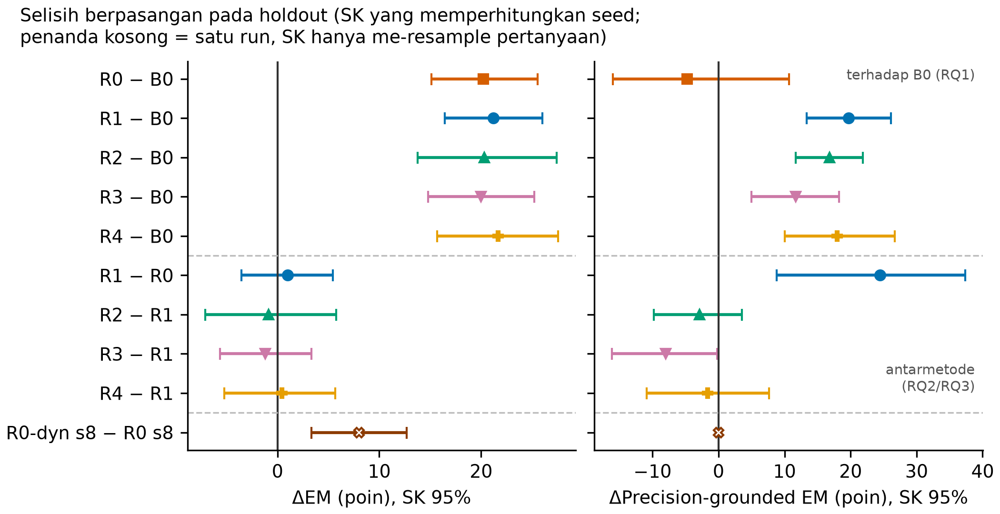
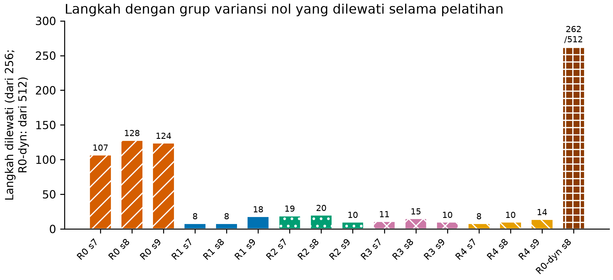
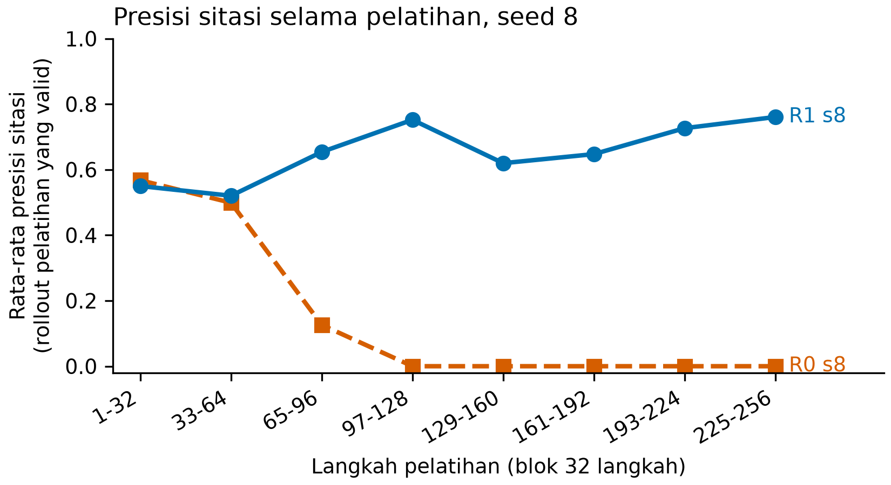
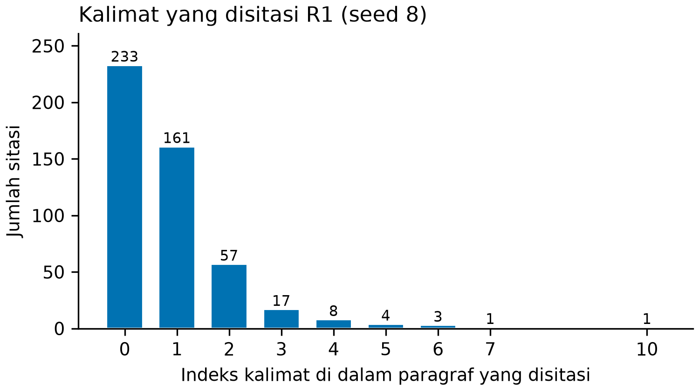

# BAB 4 — HASIL DAN ANALISIS

Seluruh angka pada bab ini berasal dari berkas episode *holdout* (`results/2026-10-10-*/`, `results/2026-10-11-fixes/results/*/episodes.jsonl`) dan log pelatihan (`metrics.jsonl`). Nilai per *run* dan nilai *bootstrap* yang hanya me-*resample* pertanyaan dihitung oleh `scripts/make_thesis_figures.py` dan disimpan di `docs/thesis/figures/figures_data.json`. *Bootstrap* yang memperhitungkan *seed*, metrik gabungan (*joint*) HotpotQA, dan rincian *rollout* pelatihan dihitung oleh `scripts/peer_review_reanalysis.py` (`logs/2026-10-13-peer-review-reanalysis.md`).

Bab ini menyajikan hasil sesuai urutan pertanyaan penelitian, yaitu sebagai berikut. Subbab 4.1 memaparkan pengaturan eksperimen. Subbab 4.2 menjelaskan *baseline* berupa model tanpa pelatihan. Subbab 4.3 sampai 4.6 menjawab RQ1, RQ2, dan RQ3, dengan diagnosis dinamika pelatihan di antaranya (Subbab 4.5). Subbab 4.7 menyajikan analisis kesalahan dan contoh *trace*. Subbab 4.8 membahas temuan dan ancaman terhadap validitas.

Di seluruh bab ini, **EM (semua)** dan ***precision-grounded* EM** menghitung episode yang tidak valid sebagai salah, sehingga penyebutnya selalu 300. Metrik kualitas (cakupan, presisi, *recall*, dan jumlah pencarian) dirata-ratakan hanya atas episode yang **selesai** (Subbab 3.7). Perbandingan utama adalah RQ1 dan R1 − R0; seluruh perbandingan pada RQ3 bersifat eksploratif (Subbab 3.7).

## 4.1 Pengaturan Eksperimen

| Pengaturan | Nilai |
|---|---|
| Model | Qwen2.5-7B-Instruct + LoRA (r = 16, α = 32) |
| Algoritma pelatihan | *Policy gradient* bergaya GRPO dengan normalisasi per grup, satu pembaruan per grup pertanyaan (Subbab 3.6) |
| Data pelatihan per *run* | 256 pertanyaan pelatihan HotpotQA (sampel bergantung pada *seed*), 1 *epoch*; R0-dyn: hingga 512 |
| Ukuran grup / *learning rate* | G = 8 / 2 × 10⁻⁵ |
| Anggaran pencarian / top-k | 3 pencarian / 3 dokumen, pada kumpulan tertutup berisi 10 paragraf milik pertanyaan tersebut |
| Evaluasi | *Holdout* beku 300 pertanyaan, *greedy decoding*, tanpa pengulangan |
| *Seed* | 7, 8, 9 (R0-dyn: hanya 8) |
| Perangkat keras | 1 × NVIDIA L40S 48 GB (RunPod, ~$1,10/jam) |
| Waktu dan biaya per *run* | ≈ 2,05 jam ≈ $2,25 (pelatihan + evaluasi *holdout*) |
| Total *run* dan biaya | 16 *run* terlatih + B0; total ≈ $49 (Tabel 3.2) |

Seluruh *run* pelatihan berhenti setelah anggaran tetap sebesar 256 pertanyaan. Titik akhir ini ditentukan oleh anggaran, bukan oleh konvergensi: rata-rata *reward* pelatihan per blok masih bergeser beberapa persepuluh poin antara dua blok 32 langkah terakhir pada sebagian *run*.

## 4.2 *Baseline* (B0)

Model tanpa pelatihan mencapai **EM 22,3%** dan ***precision-grounded* EM 13,0%** pada *holdout*. Masalah utamanya bukan jawaban yang salah, melainkan episode yang tidak valid: hanya **170 dari 300** episode yang selesai. Sebanyak 130 kegagalan tersebut terdiri atas 85 kegagalan bukti, 37 kegagalan protokol, dan 8 kegagalan anggaran. Sebagian besar kegagalan bukti berupa sitasi yang dikarang atau tidak pernah diambil, yaitu model menyitasi judul atau kalimat yang tidak pernah muncul pada hasil pencariannya.

Ketika model berhasil menyelesaikan sebuah episode, kemampuannya cukup baik. EM pada episode yang selesai adalah 39,4%, presisi sitasi 0,633, dan *retrieval recall* 0,829 (Tabel 4.1). *Retrieval recall* yang tinggi ini menunjukkan betapa mudahnya pencarian pada kumpulan tertutup berisi 10 paragraf (Subbab 3.3). Dengan demikian, sebagian besar peningkatan yang dapat diperoleh dari pelatihan terletak pada kepatuhan terhadap protokol, sebagaimana dikonfirmasi pada Subbab 4.3.

## 4.3 RQ1: Apakah GRPO Meningkatkan Agen Dibandingkan dengan Model Tanpa Pelatihan?

**Tabel 4.1.** Hasil *holdout* untuk setiap *run*. EM (semua) dan P-gEM (*precision-grounded* EM) menghitung kegagalan sebagai 0, sedangkan cakupan, presisi, *recall*, dan jumlah pencarian merupakan rata-rata atas episode yang selesai. "Dup." adalah jumlah episode selesai yang mengulang *query* pencarian, dan "Pembaruan" adalah jumlah langkah pelatihan yang menghasilkan pembaruan gradien (dari 256; R0-dyn dari 512 pertanyaan yang diambil).

| *Run* | *Seed* | EM (semua) | P-gEM | Selesai /300 | Cakupan bukti | Presisi sitasi | *Retr. recall* | Pencarian | Dup. | Pembaruan |
|---|---|---|---|---|---|---|---|---|---|---|
| B0 | – | 22,3% | 13,0% | 170 | 0,472 | 0,633 | 0,829 | 1,92 | 32 | – |
| R0 (*outcome-only*) | 7 | 42,0% | 24,7% | 278 | 0,438 | 0,621 | 0,829 | 3,00 | 229 | 149 |
| R0 (*outcome-only*) | 8 | 40,7% | 0,0% | 299 | 0,000 | 0,000 | 0,710 | 1,01 | 0 | 128 |
| R0 (*outcome-only*) | 9 | 45,0% | 0,0% | 298 | 0,000 | 0,000 | 0,860 | 2,27 | 55 | 132 |
| R1 (VEGR) | 7 | 42,7% | 32,3% | 287 | 0,473 | 0,751 | 0,851 | 2,30 | 14 | 248 |
| R1 (VEGR) | 8 | 42,7% | 28,0% | 287 | 0,513 | 0,726 | 0,836 | 2,15 | 7 | 248 |
| R1 (VEGR) | 9 | 45,3% | 37,7% | 293 | 0,333 | 0,754 | 0,837 | 1,91 | 27 | 238 |
| R2 (*gated*) | 7 | 41,0% | 30,7% | 283 | 0,539 | 0,748 | 0,891 | 2,21 | 34 | 237 |
| R2 (*gated*) | 8 | 48,7% | 32,3% | 290 | 0,440 | 0,703 | 0,879 | 2,00 | 4 | 236 |
| R2 (*gated*) | 9 | 38,3% | 26,3% | 286 | 0,471 | 0,702 | 0,855 | 2,16 | 36 | 246 |
| R3 (cakupan ×2) | 7 | 41,3% | 26,3% | 289 | 0,607 | 0,701 | 0,854 | 2,01 | 12 | 245 |
| R3 (cakupan ×2) | 8 | 41,0% | 18,7% | 284 | 0,545 | 0,633 | 0,820 | 1,61 | 5 | 241 |
| R3 (cakupan ×2) | 9 | 44,7% | 29,0% | 282 | 0,557 | 0,738 | 0,882 | 2,35 | 34 | 246 |
| R4 (tanpa norm. std) | 7 | 39,3% | 23,7% | 288 | 0,469 | 0,636 | 0,796 | 1,89 | 35 | 248 |
| R4 (tanpa norm. std) | 8 | 46,3% | 30,3% | 293 | 0,509 | 0,693 | 0,865 | 2,30 | 44 | 246 |
| R4 (tanpa norm. std) | 9 | 46,3% | 39,0% | 292 | 0,346 | 0,757 | 0,867 | 2,41 | 25 | 242 |
| R0-dyn | 8 | 48,7% | 0,0% | 300 | 0,000 | 0,000 | 0,875 | 2,29 | 15 | 250 |

**Tabel 4.2.** Rata-rata ± simpangan baku pada *seed* 7, 8, dan 9 (B0: evaluasi tunggal). Seluruh kolom selain presisi dan cakupan merupakan persentase dari 300 pertanyaan, kecuali "EM selesai" yang dihitung atas episode yang selesai.

| Metode | EM | EM selesai | P-gEM | *Lenient* gEM | Sup-EM | Joint-EM | Joint-F1 | Presisi sitasi | Cakupan bukti |
|---|---|---|---|---|---|---|---|---|---|
| B0 | 22,3 | 39,4 | 13,0 | 20,3 | 11,3 | 6,0 | 17,5 | 0,633 | 0,472 |
| R0 *outcome-only* | 42,6 ± 2,2 | 43,8 ± 2,6 | 8,2 ± 14,2 | 12,9 ± 22,3 | 5,0 ± 8,7 | 3,2 ± 5,6 | 10,5 ± 18,1 | 0,207 ± 0,358 | 0,146 ± 0,253 |
| **R1 VEGR** | 43,6 ± 1,5 | 45,2 ± 1,0 | **32,7 ± 4,8** | 39,9 ± 1,6 | 11,9 ± 10,1 | 7,1 ± 5,8 | 33,7 ± 3,9 | **0,744 ± 0,015** | 0,440 ± 0,095 |
| R2 *gated* | 42,7 ± 5,4 | 44,7 ± 5,2 | 29,8 ± 3,1 | 40,0 ± 4,5 | 15,9 ± 4,8 | 10,0 ± 1,9 | 35,2 ± 2,3 | 0,718 ± 0,026 | 0,483 ± 0,051 |
| R3 cakupan ×2 | 42,3 ± 2,0 | 44,6 ± 2,6 | 24,7 ± 5,4 | 40,1 ± 2,0 | **24,3 ± 4,2** | **13,4 ± 2,2** | **38,0 ± 2,2** | 0,690 ± 0,053 | **0,569 ± 0,033** |
| R4 tanpa norm. std | 44,0 ± 4,0 | 45,3 ± 3,8 | 31,0 ± 7,7 | 39,7 ± 3,3 | 12,4 ± 8,7 | 7,4 ± 5,3 | 33,7 ± 4,7 | 0,695 ± 0,060 | 0,441 ± 0,085 |

**Tabel 4.3.** Selisih berpasangan (poin) dengan selang *bootstrap* 95% dan 10.000 *resample*. Selang **utama** memperhitungkan *seed*, yaitu me-*resample* *seed* sekaligus pertanyaan (Subbab 3.7), sedangkan selang yang hanya me-*resample* pertanyaan merata-ratakan *seed* terlebih dahulu sehingga mengabaikan variansi antar-*seed* dan hanya diberikan sebagai acuan. Baris di bawah garis bersifat eksploratif.

| Perbandingan | ΔEM (dengan *seed*) | ΔP-gEM (dengan *seed*) | ΔJoint-EM (dengan *seed*) | ΔEM (hanya pertanyaan) | ΔP-gEM (hanya pertanyaan) |
|---|---|---|---|---|---|
| R0 − B0 | +20,2 [+15,1; +25,6] | −4,8 [−16,0; +10,7] | −2,8 [−8,0; +3,4] | [+15,9; +24,6] | [−8,4; −1,2] |
| R1 − B0 | +21,2 [+16,4; +26,0] | +19,7 [+13,3; +26,1] | +1,1 [−5,1; +6,9] | [+17,0; +25,4] | [+15,8; +23,7] |
| R2 − B0 | +20,3 [+13,8; +27,4] | +16,8 [+11,7; +21,9] | +4,0 [+0,7; +7,2] | [+16,1; +24,7] | [+13,0; +20,6] |
| R3 − B0 | +20,0 [+14,8; +25,2] | +11,7 [+5,0; +18,2] | +7,4 [+3,6; +11,6] | [+15,4; +24,6] | [+7,9; +15,6] |
| R4 − B0 | +21,7 [+15,7; +27,6] | +18,0 [+10,0; +26,7] | +1,4 [−4,0; +7,3] | [+17,3; +26,0] | [+14,1; +22,0] |
| **R1 − R0** | +1,0 [−3,6; +5,4] | **+24,4 [+8,8; +37,3]** | +3,9 [−4,0; +11,4] | [−1,9; +3,8] | [+20,9; +28,1] |
| R2 − R1 | −0,9 [−7,1; +5,8] | −2,9 [−9,8; +3,6] | +2,9 [−2,9; +9,3] | [−4,0; +2,1] | [−5,9; +0,1] |
| R3 − R1 | −1,2 [−5,7; +3,3] | −8,0 [−16,1; −0,2] | +6,3 [+0,2; +13,1] | [−4,2; +1,8] | [−11,1; −4,9] |
| R4 − R1 | +0,4 [−5,2; +5,7] | −1,7 [−10,9; +7,7] | +0,3 [−7,0; +8,1] | [−2,6; +3,3] | [−4,4; +1,0] |
| R0-dyn s8 − R0 s8 | +8,0 (*run* tunggal) | 0,0 | 0,0 | [+3,3; +12,7] | [0,0; 0,0] |



**Gambar 4.5.** Selisih berpasangan pada Tabel 4.3 dengan selang yang hanya me-*resample* pertanyaan; panel kiri menunjukkan EM dan panel kanan *precision-grounded* EM. Di atas garis putus-putus ditampilkan setiap metode terhadap B0 (RQ1), sedangkan di bawahnya perbandingan antarmetode (RQ2/RQ3).

[FIGURE UPDATE NEEDED: Figure 4.5 shows the question-only intervals. Redraw it with the seed-aware intervals of Table 4.3 as the primary bars (question-only as thin secondary bars or omitted), and relabel the right panel "ΔPrecision-grounded EM".]

**Jawaban RQ1: ya, tetapi sebagian besar melalui pembelajaran protokol.** Setiap metode mengungguli B0 sekitar **+20 poin EM**, dan setiap selang yang memperhitungkan *seed* tidak mencakup nol (Tabel 4.3). Per *run*, ke-16 *run* terlatih memperoleh kenaikan antara +16,0 (R2 s9, SK yang hanya me-*resample* pertanyaan [+10,7; +21,3]) dan +26,3 poin (R2 s8 dan R0-dyn s8, [+21,0; +31,7]) dibandingkan dengan B0.

Sebagian besar kenaikan ini berasal dari keberhasilan menyelesaikan protokol, bukan dari jawaban yang lebih baik. B0 kehilangan 130 dari 300 episode karena kegagalan, sedangkan setiap *run* terlatih kehilangan paling banyak 22 episode. Sementara itu, **EM pada episode yang selesai** hanya bergeser dari **39,4% (B0) menjadi 45,2% (R1)**, dan berada di antara 43,8% dan 45,3% untuk setiap metode (Tabel 4.2).

Dengan demikian, RQ1 sebagian besar mengukur seberapa baik agen belajar menghasilkan aksi yang valid dan dapat diverifikasi. Kenaikan kemampuan penalaran pada pertanyaan yang sebelumnya sudah dapat diselesaikan model hanya sekitar 4–6 poin. Log pelatihan R1 *seed* 7 memperlihatkan pembelajaran protokol ini secara langsung. Tingkat *rollout* yang tidak valid turun dari 46% menjadi 29%, 13%, 13%, dan 7% pada lima blok 32 langkah pertama, sementara rata-rata *reward* naik dari 0,97 menjadi 2,81. *Baseline* berupa *prompt few-shot* tidak dijalankan, sehingga tidak diketahui seberapa besar kenaikan protokol ini dapat dicapai melalui *prompting* saja (Subbab 4.8).

*Grounding* menunjukkan hasil yang beragam. Metode yang memberi *reward* pada bukti (R1–R4) meningkatkan *precision-grounded* EM dibandingkan dengan B0 sebesar +11,7 hingga +19,7 poin, dan setiap selangnya tidak mencakup nol. Hal ini tidak berlaku untuk *reward outcome-only*: R0 − B0 bernilai −4,8 poin, tetapi dengan selang yang memperhitungkan *seed* [−16,0; +10,7] selisih ini **tidak signifikan**. *Grounding* R0 bergantung pada *seed* (24,7% pada *seed* 7, 0% pada *seed* 8 dan 9). Pada Joint-EM HotpotQA, hanya R2 dan R3 yang secara signifikan berada di atas B0.

**Split validasi (hanya sebagai bukti pendukung).** Pada *split* validasi, R1 *seed* 7 mencapai EM 57,0% dibandingkan dengan 29,3% pada B0 (+27,7 poin, SK 95% [+21,7; +33,7]). Pertanyaan validasi tampaknya lebih mudah daripada *holdout*, sehingga angka ini tidak digunakan untuk klaim apa pun. Angka ini hanya menunjukkan bahwa kenaikan tersebut tidak khusus terjadi pada *holdout*.

## 4.4 RQ2: *Reward Outcome-Only* dibandingkan dengan VEGR

**Akurasinya sama.** R1 − R0 bernilai +1,0 poin EM dengan SK yang memperhitungkan *seed* [−3,6; +5,4], dan rata-rata tiga *seed* adalah 42,6% (R0) dan 43,6% (R1). **Tidak ada perbedaan akurasi yang dapat diklaim** antara kedua *reward* tersebut.

***Grounding*-nya sangat berbeda.** Paket VEGR lengkap menaikkan *precision-grounded* EM sebesar **24,4 poin** dibandingkan dengan R0 (SK dengan *seed* **[+8,8; +37,3]**). Ini merupakan efek antarmetode terbesar dalam tugas akhir ini, dan efek tersebut tetap jelas positif ketika variansi antar-*seed* diperhitungkan, meskipun selangnya lebar karena *grounding* R0 sangat bervariasi antar-*seed* (24,7%, 0%, 0%). Pada ukuran yang lebih longgar maupun lebih ketat, arahnya sama tetapi besarnya berbeda: Joint-F1 bernilai 33,7 untuk R1 dibandingkan dengan 10,5 untuk R0, sedangkan selisih Joint-EM (+3,9, SK [−4,0; +11,4]) tidak signifikan (penjelasannya pada Subbab 4.6).

Sebagaimana dicatat pada Subbab 3.1, R1 dan R0 berbeda pada enam komponen *reward* dan pada jumlah pembaruan pelatihannya (sekitar 240 dibandingkan dengan sekitar 130; Tabel 4.1). Perbandingan ini mengukur efek keseluruhan paket VEGR beserta sinyal pelatihan yang dihasilkannya, bukan efek satu komponen bukti tertentu.

**R0 *seed* 8 dan 9 berhenti memberi sitasi.** Kedua *policy* tersebut belajar menjawab **tanpa sitasi sama sekali**. Tingkat sitasi pada *holdout* adalah 0%, sehingga presisi sitasi, cakupan bukti, dan *precision-grounded* EM seluruhnya bernilai 0. Seluruh 122 jawaban benar dari *seed* 8 dan seluruh 135 jawaban benar dari *seed* 9 tidak disertai sitasi. Jawaban tanpa sitasi tetap valid di dalam *environment* (Subbab 3.3), dan pada R0 jawaban seperti ini memperoleh nilai penuh. Kedua *seed* berbeda dalam cara mencari. *Seed* 8 hanya mencari satu kali (1,01 pencarian per episode). *Seed* 9 masih mencari rata-rata 2,27 kali dan sering menemukan paragraf yang tepat (*retrieval recall* 0,860), tetapi kemudian tidak menyitasinya (*Trace* 2, Subbab 4.7).

**R0 *seed* 7 tetap memberi sitasi, tetapi bergeser ke pencarian berulang.** *Run* ini selalu menggunakan ketiga pencarian (rata-rata 3,00), dan **229 dari 278** episode selesainya mengulang *query*, dibandingkan dengan 32 pada B0 dan 7 hingga 27 pada *seed* R1. Pada R0, komponen biaya pencarian dan duplikasi berbobot nol, sehingga pencarian berulang tidak memberi maupun mengurangi *reward*. Ini merupakan **pergeseran yang netral terhadap *reward***, bukan jalan pintas. *Seed* 7 tetap memberi sitasi dengan presisi setara B0 (0,621 dibandingkan dengan 0,633) dan memiliki *precision-grounded* EM dua kali lipat B0 (24,7% dibandingkan dengan 13,0%).

Dengan demikian, **2 dari 3 *seed* R0 berhenti memberi sitasi**. Dengan tiga *seed*, selang Clopper–Pearson 95% untuk proporsi ini adalah [0,09; 0,99]: hilangnya sitasi cukup umum hingga muncul dua kali, tetapi frekuensinya pada dasarnya tidak diketahui.

**Mengapa R0 berhenti memberi sitasi.** Hilangnya sitasi ini bukan eksploitasi yang tidak terduga, melainkan konsekuensi dari definisi *reward* (Subbab 3.4): R0 memberi penalti −1 pada sitasi yang tidak valid tetapi tidak pernah memberi imbalan pada sitasi yang benar, dan pada awal pelatihan sekitar separuh dari seluruh upaya menyitasi tidak valid. Subbab 4.5 menyajikan bukti dari *rollout* pelatihan. Yang ditambahkan oleh data adalah *kapan* dan *pada seed mana* hal ini terjadi: *policy* tetap memberi sitasi selama sekitar 64 langkah, kemudian berhenti memberi sitasi dalam sekitar 32 langkah, pada dua dari tiga *seed*.

**Apakah kenaikan presisi merupakan efek seleksi?** Presisi dirata-ratakan atas episode yang selesai, dan himpunan episode yang selesai berbeda antar-*run* (170 untuk B0, hingga 300 untuk *run* lainnya). Pada 136 pertanyaan yang diselesaikan oleh setiap *run*, urutannya tetap sama: presisi sitasi adalah 0,627 untuk B0, 0,646 untuk R0 s7, dan 0,750–0,790 untuk ketiga *seed* R1. Tingkat sitasi adalah 99–100% untuk setiap *run* yang memberi sitasi (semua kecuali R0 s8, R0 s9, dan R0-dyn).

**R1 (VEGR) stabil.** Pada ketiga *seed*, EM berada di antara 42,7% dan 45,3%, yaitu rentang tersempit di antara seluruh metode. Presisi sitasi berada di antara 0,726 dan 0,754 (sd 0,015). Jumlah pencarian per episode berada di antara 1,91 dan 2,30, dan paling banyak 27 episode yang mengulang *query*.

Gambar 4.3 menggabungkan kedua dimensi tersebut. Setiap *run* terlatih berada pada pita akurasi yang sama, yaitu sekitar 38–49% EM. Pada sumbu *grounding*, *run* yang diberi *reward* bukti berkumpul pada presisi 0,63–0,76, sedangkan R0 *seed* 8 dan 9 serta R0-dyn berada pada 0.


**Gambar 4.3.** EM *holdout* (seluruh episode, kegagalan dihitung 0) terhadap presisi sitasi (episode yang selesai), satu titik per *run*; bentuk dan warna menunjukkan metode.

[FIGURE UPDATE NEEDED: Figure 4.3 legend says "R4 Dr. GRPO"; rename to "R4 no std normalisation".]

**Jawaban RQ2: ya, dengan beberapa catatan.** Paket VEGR lengkap menyamai akurasi *reward outcome-only*, terhindar dari hilangnya sitasi pada ketiga *seed*, dan menaikkan *precision-grounded* EM sebesar 24,4 poin (SK [+8,8; +37,3]). *Reward outcome-only* kehilangan sitasi pada dua dari tiga *seed*, karena alasan yang mengikuti definisinya sendiri. Terdapat dua catatan, yaitu sebagai berikut.

1. VEGR membuat sitasi menjadi *benar*, tetapi tidak *lengkap*. *Precision-grounded* EM R1 (32,7%) sekitar 11 poin di bawah EM-nya (43,6%), sedangkan Sup-EM (11,9%) dan Joint-EM (7,1%) rendah dan sangat bervariasi antar-*seed* (Subbab 4.6).
2. VEGR tidak menaikkan cakupan bukti dibandingkan dengan model tanpa pelatihan (0,440 dibandingkan dengan 0,472 untuk B0).

## 4.5 Diagnosis: Mengapa *Reward Outcome-Only* Tidak Stabil

***Rollout* pelatihan memperlihatkan mekanismenya.** Tabel 4.4 memilah *rollout* pelatihan R0 *seed* 8 dan 9 serta R1 *seed* 8 berdasarkan hasilnya, per blok 32 langkah (256 *rollout* per blok).

**Tabel 4.4.** *Rollout* pelatihan berdasarkan hasil. "Gagal bukti" adalah *rollout* tidak valid dengan kegagalan bukti (*reward* −1), sedangkan kolom *reward* berisi rata-rata *reward* pelatihan dari *rollout* valid yang disertai dan tidak disertai sitasi.

| *Run* | Langkah | Gagal bukti | Valid, bersitasi | Valid, tanpa sitasi | *Reward*: valid bersitasi | *Reward*: valid tanpa sitasi |
|---|---|---|---|---|---|---|
| R0 s8 | 1–32 | 90 | 86 | 42 | 0,50 | 0,36 |
| R0 s8 | 33–64 | 79 | 94 | 75 | 0,48 | 0,20 |
| R0 s8 | 65–96 | 17 | 34 | 204 | 0,53 | 0,50 |
| R0 s8 | 97–256 | 0 | 0 | 253–256 per blok | – | 0,40–0,52 |
| R0 s9 | 1–32 | 48 | 161 | 27 | 0,67 | 0,26 |
| R0 s9 | 33–64 | 45 | 93 | 91 | 0,59 | 0,24 |
| R0 s9 | 65–96 | 14 | 52 | 189 | 0,71 | 0,39 |
| R0 s9 | 97–256 | 0 | 0 | 217–255 per blok | – | 0,43–0,64 |
| R1 s8 | 1–32 | 91 | 85 | 45 | 3,35 | 1,37 |
| R1 s8 | 97–128 | 23 | 199 | 29 | 3,49 | 1,28 |
| R1 s8 | 225–256 | 12 | 214 | 17 | 3,47 | 0,71 |

Pada R0, jawaban valid yang bersitasi memperoleh *reward* sedikit lebih tinggi daripada jawaban tanpa sitasi (0,50 dibandingkan dengan 0,36 pada blok pertama *seed* 8), karena jawaban bersitasi lebih sering benar. Namun, pada blok tersebut 90 dari 176 *rollout* yang mencoba menyitasi merupakan kegagalan bukti dengan nilai −1. Jika dirata-ratakan atas seluruh upaya, mencoba menyitasi menghasilkan sekitar (86 × 0,50 − 90) / 176 ≈ **−0,27**, dibandingkan dengan **+0,36** untuk tidak menyitasi (Subbab 3.4). Sitasi hilang pada langkah ke-97 pada kedua *seed* yang mengalami keruntuhan.

Pada R1, tingkat kegagalan awal yang sama juga muncul (91 kegagalan bukti pada blok pertama *seed* 8). Perbedaannya terletak pada *reward* untuk sitasi yang valid: *rollout* valid yang bersitasi memperoleh sekitar **3,4** dibandingkan dengan sekitar **1,3** untuk yang tanpa sitasi, yaitu selisih sekitar 2 poin, bukan sekitar 0,14. Jumlah *rollout* valid yang bersitasi bertambah dari 85 menjadi 214 per blok selama pelatihan.

Singkatnya, **R0 memberi penalti pada sitasi yang buruk tetapi tidak pernah memberi imbalan pada sitasi yang baik, sedangkan VEGR memberi imbalan pada sitasi yang benar.** Ini merupakan interpretasi atas log pelatihan dari dua *seed* R0 dan satu *seed* R1, dan interpretasi ini tidak menjelaskan mengapa *seed* 7 tetap memberi sitasi.

**Grup dengan variansi nol.** GRPO tidak belajar apa pun dari grup yang seluruh 8 *rollout*-nya menerima *reward* yang sama (Subbab 3.6), dan langkah seperti ini dilewati. Pada *reward outcome-only* hal ini sering terjadi, karena *reward*-nya biner dan banyak pertanyaan yang di dalam satu grup selalu terjawab atau tidak pernah terjawab.

**Tabel 4.5.** Langkah pelatihan yang dilewati (variansi nol) dari 256 langkah.

| Metode | *Seed* 7 | *Seed* 8 | *Seed* 9 |
|---|---|---|---|
| R0 *outcome-only* | 107 | 128 | 124 |
| R1 VEGR | 8 | 8 | 18 |
| R2 *gated* | 19 | 20 | 10 |
| R3 cakupan ×2 | 11 | 15 | 10 |
| R4 tanpa norm. std | 8 | 10 | 14 |
| R0-dyn | – | 262 dari 512 yang diambil | – |

Dengan demikian, R0 hanya belajar dari sekitar separuh pertanyaannya, dan setiap pertanyaan tersebut hanya memberikan sinyal benar-atau-salah yang kasar. Metode yang diberi *reward* bukti hanya melewati 8–20 langkah, karena komponen kontinunya hampir selalu membedakan 8 *rollout*.



**Gambar 4.1.** Jumlah langkah pelatihan GRPO yang dilewati karena seluruh 8 *rollout* dalam grup menerima *reward* yang sama; *run* standar memiliki 256 langkah, sedangkan R0-dyn mengambil 512 pertanyaan dan melewati 262 di antaranya. Sumber: `metrics.jsonl` setiap *run*; nilai di `docs/thesis/figures/figures_data.json`.

[FIGURE UPDATE NEEDED: Figure 4.1 run labels are unchanged, but if R4 is named in a legend or caption elsewhere, use "R4 no std normalisation".]

Kurva pelatihan *seed* 8 (Gambar 4.2) menunjukkan kapan keruntuhan R0 terjadi. Selama 64 langkah pertama, kedua *reward* menghasilkan presisi sitasi pelatihan yang serupa (R0 0,568 dan 0,499; R1 0,550 dan 0,520). R0 kemudian turun menjadi 0,126 pada langkah 65–96 dan tetap 0,000 pada setiap blok sejak langkah 97, sedangkan R1 naik ke antara 0,62 dan 0,76. R0 *seed* 9 mengikuti jalur yang sama (0,714, 0,410, 0,192, lalu 0,000 sejak langkah 97). R0 *seed* 7, yaitu *run* yang tetap memberi sitasi, berada di antara 0,55 dan 0,73 sepanjang pelatihan.



**Gambar 4.2.** Rata-rata presisi sitasi *rollout* pelatihan yang valid per blok 32 langkah pada *seed* 8; jawaban valid tanpa sitasi memiliki presisi 0 menurut definisi (Subbab 3.4), dan setiap titik merata-ratakan 128–256 *rollout* valid yang diambil pada *temperature* 1,0 selama pelatihan, bukan hasil *holdout*. Sumber: `metrics.jsonl`; skrip `scripts/make_thesis_figures.py`.

**Apakah pembaruan yang lebih banyak mencegah keruntuhan?** Hipotesis yang wajar adalah bahwa sedikitnya pembaruan informatif pada R0 mengunci kebiasaan apa pun yang muncul di awal. R0-dyn menguji hipotesis ini pada *seed* 8 (Subbab 4.6). *Run* ini terus mengambil pertanyaan baru hingga sebuah grup memiliki variansi *reward*, dan tetap runtuh dengan jadwal yang sama: presisi sitasi pelatihan adalah 0,550 dan 0,596 pada 64 pertanyaan pertama yang diambil, 0,250 pada 32 pertanyaan berikutnya, dan 0,000 pada setiap blok selanjutnya kecuali satu (0,004). Pada satu *seed* ini, pembaruan informatif yang lebih banyak tidak mencegah keruntuhan. Hal ini sesuai dengan penjelasan berbasis *reward* di atas, tetapi satu *seed* tidak dapat menyingkirkan kemungkinan bahwa *dynamic sampling* membantu pada *seed* lain.

**Sitasi yang "presisi tetapi tidak lengkap".** VEGR menaikkan presisi sitasi (sekitar 0,73–0,75, dibandingkan dengan 0,633 untuk B0) tetapi tidak menaikkan cakupan bukti, yang berkisar antara 0,333 dan 0,513 pada *seed* R1 dan berada di bawah nilai B0 (0,472) pada dua dari tiga *seed*. Pola sitasi R1 *seed* 8 menunjukkan penyebabnya. *Run* ini menyitasi 1 kalimat pada 97 episode, 2 kalimat pada 182 episode, dan 3 kalimat pada 8 episode. Berdasarkan posisi kalimat, kalimat ke-0 disitasi 233 kali, kalimat ke-1 161 kali, dan kalimat ke-2 57 kali.



**Gambar 4.7.** Posisi setiap kalimat yang disitasi oleh R1 *seed* 8 pada episode *holdout* yang selesai (485 sitasi); 451 di antaranya (93%) merujuk ke salah satu dari tiga kalimat pertama sebuah paragraf.

*Policy* lebih menyukai beberapa kalimat awal, yang biasanya benar tetapi sering bukan bukti emas yang lengkap. Dengan *reward* yang dijumlahkan, menyitasi satu kalimat yang aman sudah menghasilkan presisi penuh dan cakupan parsial, sehingga *policy* hanya memiliki sedikit alasan untuk mengambil risiko menambah sitasi. Hal ini sesuai dengan pengamatan ALCE bahwa presisi sitasi dan *recall* sitasi merupakan dua hal yang berbeda, dan bahwa model cenderung presisi tetapi tidak lengkap [14].

Cakupan juga bervariasi antar-*seed*. R1 *seed* 9 memiliki *precision-grounded* EM terbaik di antara *run* R1 (37,7%) tetapi cakupan terendah (0,333). *Run* ini hanya menyitasi 1,03 kalimat per episode selesai, dibandingkan dengan 1,49 dan 1,69 untuk *seed* 7 dan 8, dan Sup-EM-nya 0,7% karena hampir tidak pernah menyitasi kedua kalimat emas. *Precision-grounded* EM justru memberi nilai pada perilaku seperti ini, sehingga metrik tersebut harus dibaca bersama Sup-EM dan Joint-EM.

## 4.6 RQ3: Varian *Reward* dan Perubahan *Optimizer*

Seluruh perbandingan pada subbab ini bersifat **eksploratif**. Perbandingan ini tidak dikoreksi untuk perbandingan berganda, dan R3, R4, serta R0-dyn dirancang setelah hasil *holdout* R0/R1/R2 diketahui (Subbab 3.8). Dengan tiga *seed* dan simpangan baku EM hingga 5,4 poin, selisih yang tidak signifikan di sini bersifat **tidak konklusif**, bukan bukti bahwa kedua metode setara.

**R2 (penalti *gated*): tidak konklusif, dan kenaikannya pada satu *seed* tidak tereplikasi.** Pada *seed* 8 saja, R2 tampak unggul dengan jelas: 48,7% dibandingkan dengan 42,7%, yaitu selisih +6,0 poin dengan SK yang hanya me-*resample* pertanyaan [+1,3; +11,0]. Hasil ini **tidak tereplikasi**. Pada *seed* 7, R2 berada 1,7 poin di bawah R1; pada *seed* 9, R2 mencapai 38,3% dibandingkan dengan 45,3% pada R1. Pada tiga *seed*, R2 − R1 bernilai −0,9 EM (SK dengan *seed* [−7,1; +5,8]) dan −2,9 *precision-grounded* EM ([−9,8; +3,6]). R2 memiliki rentang antar-*seed* terlebar di antara seluruh metode, yaitu dari 38,3% hingga 48,7% (sd 5,4; Gambar 4.4).

Hasil ini merupakan jenis hasil yang diperingatkan oleh Henderson dkk. [9] dan Agarwal dkk. [10]: perbandingan dengan satu *seed* dapat tampak signifikan tetapi tidak bertahan pada *seed* lain.

**R3 (cakupan ×2): *trade-off* presisi–cakupan yang pemenangnya bergantung pada metrik.** Menggandakan bobot cakupan memberikan efek yang dimaksudkan pada cakupan. R3 memiliki cakupan tertinggi di antara seluruh metode (0,569 ± 0,033, dibandingkan dengan 0,440 untuk R1), dan menyitasi lebih banyak kalimat, yaitu 1,83–2,06 per episode selesai dibandingkan dengan 1,03–1,69 untuk R1.

Sitasi tambahan tersebut lebih jarang merupakan kalimat emas. Presisi turun menjadi 0,690, dan *precision-grounded* EM berada 8,0 poin di bawah R1 (SK dengan *seed* [−16,1; −0,2], yang hanya nyaris tidak mencakup nol). Pada metrik HotpotQA sendiri, peringkatnya berbalik, yaitu sebagai berikut.

- R3 memiliki Sup-EM terbaik (24,3% dibandingkan dengan 11,9% untuk R1).
- R3 memiliki Joint-EM terbaik (13,4% dibandingkan dengan 7,1%; R3 − R1 = **+6,3**, SK [+0,2; +13,1]).
- R3 memiliki Joint-F1 terbaik (38,0 dibandingkan dengan 33,7).

EM tidak berubah (−1,2, SK [−5,7; +3,3]). Dengan demikian, R3 tidak sekadar lebih buruk daripada R1, melainkan menukar presisi dengan kelengkapan. Metrik yang menghukum setiap sitasi yang salah lebih menguntungkan R1, sedangkan metrik yang mensyaratkan bukti emas lengkap lebih menguntungkan R3. Kedua selang berada dekat dengan nol, sehingga tidak ada peringkat yang kokoh.

**R4 (GRPO tanpa normalisasi std): tidak konklusif.** R4 hanya menghapus pembagian dengan simpangan baku pada *advantage*. R4 tetap mempertahankan normalisasi panjang dan mengubah ukuran langkah efektif (Subbab 3.6), sehingga R4 merupakan ablasi parsial dari Dr. GRPO, bukan Dr. GRPO itu sendiri. Dibandingkan dengan R1, R4 mengubah EM sebesar +0,4 (SK [−5,2; +5,7]) dan *precision-grounded* EM sebesar −1,7 ([−10,9; +7,7]). Sebaran antar-*seed*-nya lebih lebar (sd EM 4,0 dibandingkan dengan 1,5), tetapi tiga *seed* terlalu sedikit untuk menyebut hal ini sebagai perbedaan. Hasil ini tidak menunjukkan apakah Dr. GRPO secara utuh akan membantu.

**R0-dyn (R0 + *dynamic sampling*, *seed* 8): lebih akurat, tetapi tetap tanpa sitasi.** *Run* ini merupakan satu *run* diagnostik pada *seed* tempat R0 mengalami keruntuhan (Subbab 3.8).

- *Run* ini mencapai **EM 48,7%**, setara dengan R2 s8 sebagai yang terbaik di antara seluruh *run*, dan **+8,0 poin** di atas R0 s8 (SK yang hanya me-*resample* pertanyaan [+3,3; +12,7]). *Run* ini menyelesaikan seluruh 300 episode.
- Kenaikan ini tidak dapat diatribusikan pada *dynamic sampling* saja. R0-dyn mengambil **512 pertanyaan** dibandingkan dengan 256 pada R0, dan melakukan **250 pembaruan** dibandingkan dengan 128 pada R0 s8 (targetnya 256, tetapi kumpulan pertanyaan habis lebih dahulu). Kenaikan +8 poin tersebut merupakan efek *dynamic sampling* bersama dengan dua kali lipat jumlah pertanyaan pelatihan.
- *Precision-grounded* EM-nya **0,0%**, sama dengan R0 s8: seluruh 146 jawaban benar tidak disertai sitasi.
- Selama pelatihan, *run* ini runtuh ke jawaban tanpa sitasi dengan jadwal yang sama seperti R0 s8 (Subbab 4.5).

**Pada satu *seed* yang diuji, *dynamic sampling* tidak mencegah jalan pintas tanpa sitasi.** Hal ini sesuai dengan penjelasan berbasis *reward* pada Subbab 4.5. *Seed* 8 dipilih karena R0 mengalami keruntuhan pada *seed* tersebut, dan hanya satu *run* yang dapat dilakukan, sehingga hasil ini tidak menunjukkan apakah *dynamic sampling* membantu pada *seed* lain.


**Gambar 4.4.** EM *holdout* (kiri) dan *precision-grounded* EM (kanan) per *seed* untuk setiap metode; titik menunjukkan *seed* 7, 8, dan 9 (dari kiri ke kanan), batang horizontal beserta labelnya menunjukkan rata-rata *seed*, dan garis titik-titik menunjukkan *baseline* tanpa pelatihan B0. R0-dyn hanya memiliki satu *seed*.

[FIGURE UPDATE NEEDED: Figure 4.4 right panel title says "Grounded EM"; relabel "Precision-grounded EM". Optionally add a third panel with Joint-EM per seed (values in results/2026-10-13-peer-review-reanalysis/output.md).]

**Jawaban RQ3.** Tidak satu pun varian terbukti lebih baik daripada VEGR biasa, dan sebagian besar perbandingan tidak konklusif, yaitu sebagai berikut.

- R2 (penalti *gated*) dan R4 (tanpa normalisasi std): tidak konklusif.
- R3 (bobot cakupan lebih besar): memperoleh cakupan dan Joint-EM dengan mengorbankan presisi dan *precision-grounded* EM.
- R0-dyn (*dynamic sampling*): pada satu *seed*, menaikkan akurasi bersama dengan dua kali lipat jumlah pertanyaan pelatihan, tetapi tidak menghilangkan jalan pintas *outcome-only*.

Tugas akhir ini tidak mengklaim adanya perbedaan EM di antara metode-metode yang dilatih.

## 4.7 Analisis Kesalahan dan Contoh *Trace*

**Kategori kegagalan.** Tabel 4.6 memuat episode yang tidak selesai.

**Tabel 4.6.** Episode gagal dari 300 episode, berdasarkan jenisnya.

| *Run* | Bukti | Protokol | Anggaran | Total |
|---|---|---|---|---|
| B0 | 85 | 37 | 8 | 130 |
| R0 s7 | 14 | 7 | 1 | 22 |
| R0 s8 | 0 | 1 | 0 | 1 |
| R0 s9 | 0 | 2 | 0 | 2 |
| R1 s7 | 8 | 5 | 0 | 13 |
| R1 s8 | 8 | 5 | 0 | 13 |
| R1 s9 | 4 | 3 | 0 | 7 |
| R2 s7 | 10 | 7 | 0 | 17 |
| R2 s8 | 3 | 7 | 0 | 10 |
| R2 s9 | 10 | 4 | 0 | 14 |
| R3 s7 | 7 | 4 | 0 | 11 |
| R3 s8 | 8 | 8 | 0 | 16 |
| R3 s9 | 10 | 4 | 4 | 18 |
| R4 s7 | 9 | 3 | 0 | 12 |
| R4 s8 | 4 | 3 | 0 | 7 |
| R4 s9 | 4 | 3 | 1 | 8 |
| R0-dyn s8 | 0 | 0 | 0 | 0 |


**Gambar 4.6.** Episode *holdout* yang gagal per *run*, ditumpuk berdasarkan jenis kegagalan. Pelatihan menghilangkan sebagian besar kegagalan dari setiap jenis, dan kegagalan bukti (sitasi yang dikarang atau tidak pernah diambil) menyusut dari 85 menjadi antara 3 dan 14 pada *run* yang agennya masih memberi sitasi.

*Run* R0 tanpa sitasi (s8, s9, R0-dyn) hampir tidak memiliki kegagalan, tetapi karena alasan yang degeneratif. Jawaban tanpa sitasi tidak mungkin menghasilkan kegagalan bukti, sehingga berhenti memberi sitasi menghilangkan jenis kegagalan tersebut sepenuhnya.

**Tabrakan *parser*.** Sebagian kegagalan protokol disebabkan oleh format aksi, bukan oleh agen (*Trace* 5 di bawah). Pada setiap *run* terlatih yang memberi sitasi, 2 hingga 5 kegagalan protokol pada *holdout* memiliki karakter '&' pada keluaran akhirnya. Angka ini merupakan batas atas jumlah tabrakan tersebut, yaitu paling banyak 1,7 poin EM per *run*. Jumlahnya serupa pada R1–R4, sehingga tidak ada perbandingan yang berubah. R3, yang memberi lebih banyak sitasi, sedikit lebih sering terdampak.

**Contoh *trace*.** *Trace* berikut diambil apa adanya dari log episode *holdout*.

*Trace 1: pertanyaan yang sama, tiga perilaku* (pertanyaan `5adbf0a255429947ff17385a`). Ketiga *policy* menjawab dengan benar (EM = 1).

```
R1 s8:  SEARCH[Laleli Mosque Esma Sultan Mansion location]
        SEARCH[Laleli neighborhood]
        ANSWER[no] CITATIONS[Laleli Mosque|0; Esma Sultan Mansion|0]
R0 s8:  SEARCH[Laleli Mosque and Esma Sultan Mansion location]
        ANSWER[no]
R0 s7:  SEARCH[neighborhood of Laleli Mosque and Esma Sultan Mansion]
        SEARCH[neighborhood of Laleli Mosque and Esma Sultan Mansion]
        SEARCH[neighborhood of Laleli Mosque and Esma Sultan Mansion]
        ANSWER[no] CITATIONS[Esma Sultan Mansion|0; Laleli Mosque|0]
```

**R1 (VEGR)** mencari dua kali dengan *query* yang berbeda dan menyitasi satu kalimat dari setiap paragraf emas; pada episode ini cakupan dan presisi keduanya bernilai 1,0. **R0 *seed* 8** menjawab setelah satu kali pencarian tanpa sitasi. **R0 *seed* 7** mengulang *query* yang sama tiga kali sebelum menjawab, yang tidak menimbulkan biaya apa pun pada R0.

*Trace 2: menemukan bukti tetapi tidak menyitasinya* (`5abd94525542992ac4f382d2`, pertanyaan pada Tabel 3.1 dan Lampiran A).

```
R1 s8:      SEARCH[S/S 2014 debut South Korean boy group]
            SEARCH[WINNER YG Entertainment]
            ANSWER[YG Entertainment] CITATIONS[2014 S/S|0; Winner (band)|0]
R0 s8:      SEARCH[2014 S/S debut album South Korean boy group formed by]
            ANSWER[YG Entertainment]
R0 s9:      SEARCH[2014 S/S debut album South Korean boy group formed by]
            SEARCH[WINNER YG Entertainment connection]
            SEARCH[WINNER YG Entertainment]
            ANSWER[YG Entertainment]
R0-dyn s8:  SEARCH["2014 S/S debut album South Korean boy group formed by"]
            SEARCH["2014 S/S WINNER YG Entertainment"]
            ANSWER[YG Entertainment]
```

R1 menggunakan pencarian keduanya untuk mengikuti entitas jembatan ("WINNER") ke paragraf kedua, yaitu perilaku *multi-hop* yang memang dituntut oleh tugas ini, dan menyitasi kedua kalimat emas. R0 s8 memberikan jawaban yang sama tanpa dukungan apa pun. R0 s9 dan R0-dyn lebih menarik: keduanya juga mengikuti entitas jembatan dan mengambil paragraf emas, tetapi kemudian menjawab tanpa menyitasinya. Perilaku pencariannya bersifat *multi-hop*, tetapi jawabannya tidak didukung bukti.

*Trace 3: lebih banyak sitasi, lebih sedikit yang emas (R3 s8)* (`5ae7a8175542993210983ed8`). Jawabannya benar, tetapi hanya satu dari tiga kalimat yang disitasi merupakan fakta emas (presisi 0,33, cakupan 0,33):

```
R3 s8:  ANSWER[Pedro Rodríguez] CITATIONS[Formula One drivers from Mexico|1;
        2014 Bahrain Grand Prix|3; 2009 Singapore Grand Prix|5]
```

Ini merupakan sisi biaya dari *trade-off* R3: bobot cakupan yang lebih besar mendorong *policy* untuk menambah sitasi, dan sebagian tambahan tersebut bukan kalimat emas.

*Trace 4: kegagalan bukti (R1 s8).* Aksi akhir `ANSWER[yes] CITATIONS[Ambroise Thomas|0; Provesi|1]` (pertanyaan `5ab29c24554299449642c932`) ditandai tidak valid sebagai kegagalan bukti: "citation references unknown document 'Provesi'". Model menyitasi judul dokumen yang tidak pernah muncul pada hasil pencariannya. Bahkan setelah pelatihan, sitasi yang dikarang atau tidak pernah diambil tetap menjadi jenis kegagalan yang paling umum pada R1–R4 (Tabel 4.6).

*Trace 5: kegagalan protokol yang disebabkan oleh format sitasi (R1 s9)* (`5a8a3e745542996c9b8d5e70`). Setelah tiga kali pencarian (dua di antaranya identik), agen menjawab `ANSWER[Adventure] CITATIONS[Tunnels &amp; Trolls|0]`. Model menuliskan karakter "&" pada judul sebagai entitas HTML `&amp;`, dan karakter `;` di dalam entitas tersebut dibaca sebagai pemisah antara dua sitasi. *Parser* kemudian menolak "Tunnels &amp" sebagai sitasi tanpa indeks ("each citation must have the form title|sentence_index"). Pemisah yang tidak mungkin muncul di dalam judul akan menghilangkan kasus ini.

## 4.8 Pembahasan

**Perbandingan dengan literatur.**

- **Hilangnya sitasi pada *reward outcome*.** CaRR [7] melaporkan bahwa agen GRPO dengan *reward outcome-only* mempelajari jawaban jalan pintas dan menggunakan lebih sedikit pemanggilan *tool*. R0 *seed* 8 dan 9 menunjukkan pola yang berkaitan pada pengaturan yang jauh lebih kecil (7B, LoRA, 256 pertanyaan, satu GPU). Di sini, penyebabnya dapat ditelusuri ke definisi *reward*, yaitu penalti −1 untuk sitasi yang tidak valid dan tidak ada imbalan untuk sitasi yang valid (Subbab 4.5). Karena *supporting facts* HotpotQA bersifat eksak, perilaku ini dapat dideteksi dengan aturan, tanpa *judge*.
- **Ketergantungan pada *seed*.** Hanya dua dari tiga *seed* R0 yang berhenti memberi sitasi, sedangkan R0 *seed* 7 bergeser ke arah lain yang netral terhadap *reward*. Dengan demikian, apakah agen yang dilatih dengan *reward outcome* tetap memberi sitasi bergantung pada *seed*, dan tiga *seed* tidak cukup untuk memperkirakan seberapa sering hal itu terjadi.
- **Perubahan *optimizer*.** *Dynamic sampling* (DAPO [17]) dan *advantage* tanpa std dari Dr. GRPO [16] diusulkan untuk membuat pelatihan GRPO lebih efisien dan kurang bias. Pada pengaturan ini, R0-dyn lebih akurat daripada R0 s8 (dengan dua kali lipat jumlah pertanyaan pelatihan), dan R4 tidak dapat dibedakan dari R1. Tidak satu pun perubahan tersebut mengubah *apa* yang diberi *reward* pada *policy*, dan pada *seed* yang diuji *dynamic sampling* tidak mengembalikan sitasi.
- **Akurasi.** Hasil penelitian ini sejalan dengan Search-R1 [2] bahwa RL dengan *reward outcome-only* meningkatkan akurasi. Penelitian ini menambahkan bahwa angka akurasi saja menyembunyikan apakah jawaban tersebut di-*grounding* pada bukti.

**Hal yang didukung oleh hasil penelitian adalah sebagai berikut.**

1. Pelatihan bergaya GRPO dengan LoRA pada satu GPU meningkatkan agen 7B yang mencari pada kumpulan paragraf tertutup sekitar 20 poin EM dibandingkan dengan model tanpa pelatihan. Sebagian besar kenaikan berasal dari kemampuan menghasilkan aksi yang valid: EM pada episode yang selesai hanya naik dari 39,4% menjadi sekitar 45%.
2. *Reward outcome-only* dan paket VEGR lengkap mencapai akurasi yang secara statistik tidak dapat dibedakan, tetapi *precision-grounded* EM VEGR 24,4 poin lebih tinggi (SK dengan *seed* [+8,8; +37,3]).
3. *Reward outcome-only* kehilangan sitasi pada dua dari tiga *seed* (SK 95% Clopper–Pearson untuk proporsinya [0,09; 0,99]). *Rollout* pelatihan menunjukkan penyebabnya: sitasi yang tidak valid bernilai −1, sedangkan sitasi yang benar tidak memperoleh apa pun.
4. VEGR membuat sitasi menjadi benar tetapi tidak lengkap. Bobot cakupan yang lebih besar (R3) menukar presisi dengan kelengkapan dan menempati peringkat terbaik pada Joint-EM HotpotQA.

**Hal yang tidak didukung oleh hasil penelitian adalah sebagai berikut.**

- Bahwa VEGR lebih *akurat* daripada *reward outcome-only*.
- Bahwa satu komponen VEGR tertentu, alih-alih keseluruhan paket, yang bertanggung jawab atas kenaikan *grounding*.
- Bahwa penalti *gated* (R2) atau penghapusan normalisasi std (R4) membantu atau merugikan. Kedua hasil tersebut tidak konklusif.
- Bahwa *dynamic sampling* tidak pernah dapat mencegah jalan pintas tersebut (hanya satu *seed*).
- Bahwa VEGR meningkatkan cakupan bukti. VEGR tidak menaikkan cakupan dibandingkan dengan B0.

**Ancaman terhadap validitas.**

- **Sedikit *seed*, *holdout* kecil.** Tiga *seed* dan 300 pertanyaan *holdout* tidak dapat membedakan selisih EM sebesar beberapa poin. Selang yang memperhitungkan *seed* cukup lebar (misalnya, lebarnya sekitar 13 poin untuk EM R2 − R1).
- **Paket *reward* dan jumlah pembaruan.** R1 dan R0 berbeda pada enam komponen *reward* dan pada jumlah pembaruannya (sekitar 240 dibandingkan dengan 130). Ablasi yang memisahkan komponen bukti dari komponen jawaban dan pencarian yang lebih padat tidak dijalankan.
- **Tumpang-tindih metrik dan *reward* (Goodhart).** VEGR memberi *reward* pada presisi dan cakupan sitasi terhadap *supporting facts* emas yang sama dengan yang digunakan untuk menghitung metrik *grounding*. Oleh karena itu, kenaikan *precision-grounded* EM sebagian merupakan kenaikan pada target pelatihan itu sendiri, dan dapat melebih-lebihkan seberapa jauh agen lebih baik dalam menyitasi bukti secara lebih umum. *Precision-grounded* EM juga longgar, karena satu sitasi yang benar sudah dihitung sebagai sepenuhnya ter-*grounding*. Label *supporting facts* HotpotQA diketahui tidak lengkap, sehingga sitasi yang benar tetapi tidak berlabel dinilai salah. Sup-EM dan Joint-EM HotpotQA (Tabel 4.2) serta pemeriksaan independen pada Subbab 4.4 mengurangi, tetapi tidak menghilangkan, kekhawatiran ini. Pemeriksaan atribusi yang tidak menggunakan label emas, seperti evaluasi sitasi berbasis NLI [14], tidak dijalankan.
- **Tidak ada *baseline* berbasis *prompt* saja.** Karena kenaikan pada RQ1 sebagian besar merupakan pembelajaran protokol, *prompt few-shot* mungkin dapat memperoleh sebagian kenaikan tersebut tanpa pelatihan. Hal ini tidak diuji.
- **Korpus tertutup.** *Retrieval* menggunakan BM25 pada 10 paragraf milik setiap pertanyaan, bukan korpus terbuka atau web. Model tanpa pelatihan sudah mencapai *retrieval recall* 0,83, sehingga masalah pencariannya jauh lebih mudah daripada pada agen yang digunakan di dunia nyata.
- **Skala pelatihan kecil dan titik akhir tetap.** Setiap *run* menggunakan 256 pertanyaan selama satu *epoch* dengan model 7B yang diadaptasi LoRA, dan berhenti sebelum *reward* konvergen. Hasilnya mungkin berbeda pada skala yang lebih besar atau dengan pelatihan yang lebih lama.
- **Perubahan perangkat lunak.** Versi PyTorch berubah antara B0/R1 *seed* 7 (2.14.1) dan *run* selanjutnya (2.11.0) karena kendala *driver*. Setiap perbandingan terhadap B0, serta rata-rata *seed* R1, melintasi perubahan ini.
- **Celah *environment* dan *parser*.** *Environment* menerima jawaban tanpa sitasi. Hal ini sengaja dipertahankan demi keterbandingan, tetapi justru memungkinkan keruntuhan R0. Pemisah sitasi juga bertabrakan dengan karakter '&' pada sebagian judul (Subbab 4.7).
- **Bobot yang tidak di-*tuning*.** Bobot *reward* merupakan nilai *default* yang tidak di-*tuning*; R3 menunjukkan bahwa perubahan satu bobot menggeser keseimbangan antara cakupan dan presisi.
- ***Run* eksploratif.** R2–R4 dan R0-dyn bersifat eksploratif dan tidak dikoreksi untuk perbandingan berganda, serta R3, R4, dan R0-dyn dirancang setelah hasil *holdout* diketahui.
- **R0-dyn hanya memiliki satu *seed* dan tidak mencapai targetnya.** *Run* ini mencapai 250 dari 256 pembaruan yang direncanakan, dan menggunakan dua kali lipat jumlah pertanyaan dibandingkan dengan R0. Hasilnya merupakan bukti tentang mekanisme pada *seed* tersebut, bukan perbandingan metode.
