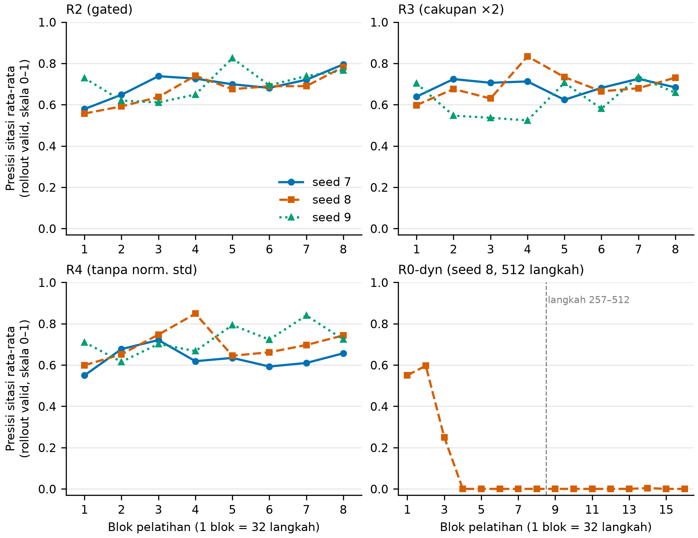

# LAMPIRAN B DINAMIKA PELATIHAN SELURUH *RUN*

Lampiran ini melengkapi Gambar 4.3, yang hanya menampilkan R0 dan R1. Setiap *run* melewati data pelatihannya satu kali (satu *epoch*), sehingga perkembangan pelatihan dilaporkan per blok 32 langkah. Blok B1 berisi langkah 1–32, B2 berisi langkah 33–64, dan seterusnya hingga B8 (langkah 225–256). R0-dyn memiliki 512 langkah, sehingga blok B9–B16 (langkah 257–512) ditampilkan pada baris tersendiri. Satu blok berisi 32 pertanyaan dengan 8 *rollout* per pertanyaan, yaitu 256 *rollout*.

Seluruh nilai dihitung dari log metrik pelatihan setiap *run* oleh skrip `scripts/make_training_dynamics.py`. Nilai yang sama juga tersedia dalam bentuk data di folder `results/2026-11-27-training-dynamics/`.

## B.1 Presisi Sitasi Selama Pelatihan

Gambar B.1 menampilkan rata-rata presisi sitasi *rollout* pelatihan yang valid per blok untuk R2, R3, R4, dan R0-dyn. Sumbu vertikal adalah presisi sitasi dengan skala 0 sampai 1, dan sumbu horizontal adalah nomor blok. Garis putus-putus vertikal pada panel R0-dyn menandai batas antara 256 langkah pertama, yang sama dengan R0 *seed* 8, dan 256 langkah tambahan.

**Gambar B.1.** Presisi sitasi selama pelatihan, R2, R3, R4, dan R0-dyn

Pada R2, R3, dan R4, presisi sitasi pelatihan berada antara 0,52 dan 0,85 pada setiap blok dan setiap *seed*, serupa dengan R1. Tidak ada *run* VEGR maupun variannya yang kehilangan sitasi. R0-dyn mengikuti jalur yang sama dengan R0 *seed* 8 dan R0 *seed* 9: presisinya turun ke 0,25 pada blok B3 dan tetap 0 pada setiap blok setelahnya, termasuk selama 256 langkah tambahan.

Tabel B.1 memuat nilai yang digambarkan pada Gambar 4.3 dan Gambar B.1 untuk seluruh 16 *run*. *Rollout* valid tanpa sitasi memiliki presisi 0 menurut definisi (Subbab 3.5).

**Tabel B.1.** Presisi sitasi rata-rata per blok

| *Run* | B1 | B2 | B3 | B4 | B5 | B6 | B7 | B8 |
|---|---|---|---|---|---|---|---|---|
| R0 s7 | 0,67 | 0,71 | 0,71 | 0,65 | 0,68 | 0,73 | 0,55 | 0,63 |
| R0 s8 | 0,57 | 0,50 | 0,13 | 0,00 | 0,00 | 0,00 | 0,00 | 0,00 |
| R0 s9 | 0,71 | 0,41 | 0,19 | 0,00 | 0,00 | 0,00 | 0,00 | 0,00 |
| R1 s7 | 0,58 | 0,70 | 0,74 | 0,62 | 0,66 | 0,67 | 0,63 | 0,72 |
| R1 s8 | 0,55 | 0,52 | 0,65 | 0,75 | 0,62 | 0,65 | 0,73 | 0,76 |
| R1 s9 | 0,70 | 0,62 | 0,57 | 0,64 | 0,69 | 0,59 | 0,80 | 0,77 |
| R2 s7 | 0,58 | 0,65 | 0,74 | 0,73 | 0,70 | 0,68 | 0,72 | 0,80 |
| R2 s8 | 0,56 | 0,59 | 0,64 | 0,74 | 0,68 | 0,69 | 0,69 | 0,78 |
| R2 s9 | 0,73 | 0,62 | 0,61 | 0,65 | 0,82 | 0,69 | 0,74 | 0,77 |
| R3 s7 | 0,64 | 0,72 | 0,71 | 0,71 | 0,62 | 0,68 | 0,73 | 0,68 |
| R3 s8 | 0,60 | 0,68 | 0,63 | 0,83 | 0,73 | 0,66 | 0,68 | 0,73 |
| R3 s9 | 0,70 | 0,55 | 0,54 | 0,52 | 0,71 | 0,58 | 0,73 | 0,66 |
| R4 s7 | 0,55 | 0,68 | 0,72 | 0,62 | 0,63 | 0,59 | 0,61 | 0,66 |
| R4 s8 | 0,60 | 0,65 | 0,75 | 0,85 | 0,64 | 0,66 | 0,70 | 0,74 |
| R4 s9 | 0,71 | 0,62 | 0,70 | 0,67 | 0,79 | 0,72 | 0,84 | 0,72 |
| R0-dyn s8 | 0,55 | 0,60 | 0,25 | 0,00 | 0,00 | 0,00 | 0,00 | 0,00 |
| R0-dyn s8 (B9–B16) | 0,00 | 0,00 | 0,00 | 0,00 | 0,00 | 0,00 | 0,00 | 0,00 |

## B.2 *Rollout* Tidak Valid Selama Pelatihan

Tabel B.2 memuat persentase *rollout* pelatihan yang tidak valid per blok, yaitu *rollout* yang mengalami kegagalan protokol, kegagalan bukti, atau kegagalan anggaran pencarian dan karena itu menerima *reward* −1. Pada setiap *run*, persentase ini turun tajam selama tiga blok pertama, yang menunjukkan bahwa agen mempelajari protokol aksi pada semua skenario. Kenaikan pada blok B8 R0 *seed* 9 (15%) hampir seluruhnya berasal dari *rollout* yang menghabiskan anggaran pencarian tanpa menjawab.

**Tabel B.2.** Persentase *rollout* tidak valid per blok

| *Run* | B1 | B2 | B3 | B4 | B5 | B6 | B7 | B8 |
|---|---|---|---|---|---|---|---|---|
| R0 s7 | 43 | 19 | 14 | 9 | 6 | 7 | 2 | 8 |
| R0 s8 | 50 | 34 | 7 | 0 | 1 | 0 | 0 | 0 |
| R0 s9 | 27 | 28 | 6 | 0 | 1 | 0 | 0 | 15 |
| R1 s7 | 46 | 29 | 13 | 13 | 7 | 5 | 6 | 6 |
| R1 s8 | 49 | 27 | 17 | 11 | 9 | 8 | 2 | 10 |
| R1 s9 | 29 | 28 | 16 | 14 | 3 | 2 | 1 | 7 |
| R2 s7 | 42 | 23 | 11 | 12 | 6 | 11 | 5 | 6 |
| R2 s8 | 45 | 22 | 12 | 12 | 4 | 2 | 4 | 2 |
| R2 s9 | 31 | 26 | 9 | 8 | 6 | 7 | 6 | 7 |
| R3 s7 | 37 | 18 | 19 | 13 | 6 | 7 | 2 | 8 |
| R3 s8 | 46 | 29 | 13 | 9 | 4 | 4 | 4 | 8 |
| R3 s9 | 30 | 38 | 20 | 18 | 14 | 6 | 9 | 5 |
| R4 s7 | 44 | 24 | 14 | 10 | 3 | 7 | 3 | 9 |
| R4 s8 | 46 | 26 | 27 | 7 | 7 | 9 | 5 | 2 |
| R4 s9 | 24 | 23 | 15 | 12 | 4 | 4 | 4 | 7 |
| R0-dyn s8 | 52 | 34 | 14 | 1 | 0 | 0 | 0 | 3 |
| R0-dyn s8 (B9–B16) | 2 | 2 | 0 | 0 | 0 | 0 | 0 | 0 |

## B.3 Langkah yang Dilewati Selama Pelatihan

Tabel B.3 memuat jumlah langkah yang dilewati per blok karena kedelapan *rollout* dalam grup menerima *reward* yang sama (grup dengan variansi nol, Subbab 3.6). Setiap blok berisi 32 langkah. Pada R0 dan R0-dyn, jumlah langkah yang dilewati meningkat setelah dua blok pertama dan berada pada 11–24 per blok sejak blok B4, termasuk pada R0 *seed* 7 yang tetap menyitasi. Pada R1–R4, jumlahnya tetap 0–7 per blok sepanjang pelatihan.

**Tabel B.3.** Langkah yang dilewati per blok

| *Run* | B1 | B2 | B3 | B4 | B5 | B6 | B7 | B8 |
|---|---|---|---|---|---|---|---|---|
| R0 s7 | 5 | 10 | 15 | 17 | 15 | 15 | 15 | 15 |
| R0 s8 | 4 | 11 | 14 | 20 | 19 | 21 | 21 | 18 |
| R0 s9 | 7 | 6 | 17 | 20 | 22 | 21 | 20 | 11 |
| R1 s7 | 2 | 1 | 1 | 1 | 1 | 0 | 0 | 2 |
| R1 s8 | 2 | 1 | 0 | 1 | 1 | 1 | 1 | 1 |
| R1 s9 | 2 | 2 | 0 | 3 | 1 | 5 | 4 | 1 |
| R2 s7 | 1 | 1 | 1 | 6 | 2 | 4 | 1 | 3 |
| R2 s8 | 1 | 3 | 2 | 1 | 1 | 2 | 7 | 3 |
| R2 s9 | 2 | 1 | 1 | 1 | 1 | 0 | 2 | 2 |
| R3 s7 | 1 | 0 | 1 | 2 | 1 | 1 | 2 | 3 |
| R3 s8 | 1 | 4 | 1 | 0 | 2 | 2 | 3 | 2 |
| R3 s9 | 4 | 1 | 1 | 1 | 1 | 0 | 2 | 0 |
| R4 s7 | 1 | 1 | 1 | 1 | 0 | 3 | 0 | 1 |
| R4 s8 | 3 | 4 | 1 | 0 | 0 | 0 | 2 | 0 |
| R4 s9 | 3 | 1 | 1 | 0 | 0 | 2 | 2 | 5 |
| R0-dyn s8 | 3 | 8 | 8 | 17 | 17 | 23 | 18 | 13 |
| R0-dyn s8 (B9–B16) | 19 | 20 | 15 | 19 | 19 | 24 | 21 | 18 |
