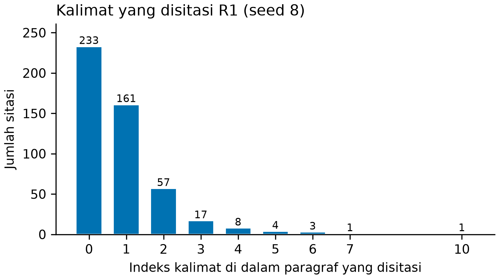

# LAMPIRAN C POSISI KALIMAT YANG DISITASI

Lampiran ini melengkapi pembahasan sitasi yang "presisi tetapi tidak lengkap" pada Subbab 4.5. Gambar C.1 menampilkan posisi seluruh 485 kalimat yang disitasi oleh R1 *seed* 8 pada episode *holdout* yang selesai. Sumbu horizontal adalah indeks kalimat di dalam paragrafnya (kalimat pertama berindeks 0), dan sumbu vertikal adalah jumlah sitasi. Angka di atas setiap batang adalah jumlah sitasi pada indeks tersebut.

**Gambar C.1.** Posisi kalimat yang disitasi oleh R1 *seed* 8

Sebanyak 451 dari 485 sitasi (93%) merujuk ke salah satu dari tiga kalimat pertama sebuah paragraf: kalimat ke-0 disitasi 233 kali, kalimat ke-1 161 kali, dan kalimat ke-2 57 kali. Distribusi posisi kalimat emas HotpotQA tidak dihitung pada tugas akhir ini, sehingga pola ini dapat mencerminkan letak bukti itu sendiri.
