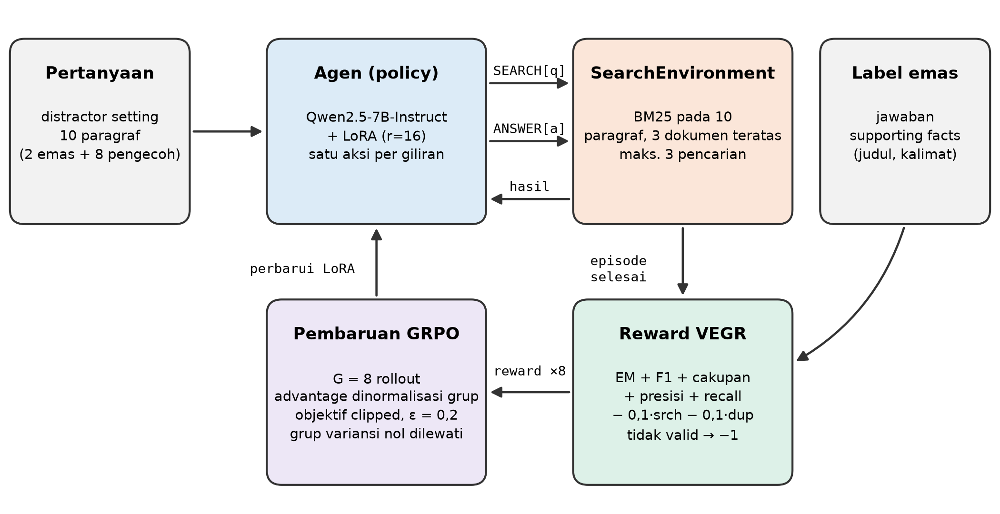

# Chapter 3 — Methodology

This chapter describes how the search agent is built, trained, and evaluated. Section 3.1 gives an overview of the research design. Sections 3.2–3.6 describe the data, the search environment, the proposed reward (VEGR), the policy model, and the training algorithm. Section 3.7 defines the evaluation protocol, Section 3.8 lists the experiments, and Section 3.9 reports the implementation and compute details.

## 3.1 Research design overview

The study is a controlled experiment. The model, data, environment, hyperparameters, and evaluation protocol stay fixed; only the reward function (and, in two variants, the optimizer) changes between runs. Two limits on this control should be stated up front:

- The main comparison, R1 (VEGR) against R0 (outcome-only), changes **the whole reward bundle at once**: six terms are added (F1, coverage, precision, retrieval recall, search cost, duplicate penalty). The design cannot say which of these terms is responsible for a difference.
- A denser reward also changes how many training steps produce an update. R0 skips about half its steps as zero-variance groups (Section 3.6), so R0 runs make about 130 updates while R1 runs make about 240 (Table 4.1).

Differences between R1 and R0 are therefore attributed to the full VEGR bundle, together with the training signal it produces, and not to any single term.

Each training episode follows the same loop (Figure 3.1):

1. The agent receives a HotpotQA question.
2. It emits one action per turn: either `SEARCH[query]` or a terminal `ANSWER[...] CITATIONS[...]`.
3. The environment runs the search with BM25 over the question's own paragraphs and returns the results, or validates the answer and citations.
4. When the episode ends, the reward function scores it against HotpotQA's gold answer and gold supporting facts.
5. GRPO compares the rewards of 8 episodes on the same question and updates the LoRA adapter.



**Figure 3.1.** One training step:

1. The agent receives a HotpotQA question and takes up to 3 `SEARCH` actions over the question's 10 paragraphs.
2. It ends with `ANSWER[a] CITATIONS[title|index; …]`.
3. The finished episode is scored by VEGR against the gold answer and supporting facts.
4. GRPO compares the rewards of 8 such episodes on the same question and updates the LoRA adapter.

Drawn by `scripts/make_thesis_figures.py`.

Three research questions guide the design (Chapter 1):

- **RQ1**: Does GRPO improve a 7B search agent over the un-tuned model?
- **RQ2**: Does VEGR prevent the shortcut behaviour of answer-only reward, without losing accuracy?
- **RQ3**: How do reward variants and optimizer fixes affect grounding and search behaviour?

## 3.2 Dataset and splits

The study uses **HotpotQA** (Yang et al., 2018), version 1.1, in the *distractor* setting. Each question comes with 10 Wikipedia paragraphs: 2 gold paragraphs that contain the answer evidence, and 8 distractors. Each question is also annotated with **supporting facts**, the (title, sentence index) pairs needed to answer it. These annotations are what make a judge-free evidence reward possible: whether a citation is correct can be checked by rule.

Rows that fail validation are skipped and logged with a reason (for example, an empty sentence or a supporting-fact index out of range).

**Splits.** The split is produced by `scripts/prepare_splits.py` and recorded in `configs/evaluation/splits.json`, together with SHA-256 hashes of the source files.

- **Train / validation.** These are both drawn from the HotpotQA training file using a deterministic hash. Each question ID is mapped to a bucket in [0, 1) by taking the first 8 bytes of `sha256("7:" + question_id)`. A question goes to train if the bucket is below 0.95, and to validation otherwise. This gives **85,573 training** and **4,452 validation** questions. The split does not depend on file order and can be reproduced exactly.
- **Holdout.** The holdout is a frozen set of **300 questions**: the first 300 valid rows of the HotpotQA dev file, stored in `configs/evaluation/holdout_v1_ids.json` along with a hash of the manifest. The holdout was never used to choose settings. All settings were chosen on the validation split, and the holdout is used only for the final numbers reported in Chapter 4.

**Training sample.** Each training run draws **256 questions** from the training split. The sample depends on the run seed, so different seeds see different questions (Section 3.6).

## 3.3 Search environment

The environment (`SearchEnvironment`, `src/needle/environment/search.py`) is a bounded, resettable search session over a single question.

**Corpus and retriever.** The searchable corpus is a **closed pool of the question's own 10 paragraphs**, which always contains both gold paragraphs. This makes retrieval much easier than open-domain search: the un-tuned model already retrieves 83% of the gold documents (retrieval recall 0.829, Table 4.1). The task is therefore closer to reading comprehension with a paging tool than to web search, and "search agent" in this thesis always means search over this closed pool. Retrieval uses Okapi BM25 (Robertson & Zaragoza, 2009), via the `rank_bm25` implementation with its default parameters. Each paragraph is indexed as its title plus all its sentences, tokenized into case-folded Unicode word tokens. A search returns the **top 3** documents. Ties are broken by original document order, so retrieval is deterministic. Each returned document is shown in full, with numbered sentences.

**Budget.** An episode allows at most **3 searches**.

**Action grammar.** On each turn the agent must output exactly one action:

- `SEARCH[query]` runs a BM25 search and spends one unit of budget.
- `ANSWER[answer] CITATIONS[title|index; title|index; ...]` gives the final answer together with the cited evidence sentences. This action ends the episode.

**Validation and failure types.** An episode is **invalid** if any of the following happens:

- *Protocol failure*: the output does not match the grammar (for example, extra text, or citations attached to a SEARCH action).
- *Evidence failure*: a citation refers to a title or sentence index that never appeared in any search result in the episode. In practice this mostly means invented citations.
- *Budget failure*: the agent uses all its searches and still does not answer.

Invalid episodes receive the protocol penalty of −1 during training (Section 3.4) and count as wrong during evaluation (Section 3.7).

**Known loophole.** An answer with an empty citation list (`ANSWER[x]` or `ANSWER[x] CITATIONS[]`) is accepted as valid. The prompt itself allows `CITATIONS[]` for the case where no citation can be validated. We did not close this loophole, so that every run is trained and evaluated in the same environment. Chapter 4 reports how the answer-only reward exploited it.

## 3.4 Proposed reward: VEGR

The **Verifiable Evidence-Grounded Reward (VEGR)** is implemented in `src/needle/rewards/__init__.py`. Every term is computed by rule from HotpotQA's gold annotations, so no LLM judge is involved.

Let *G* be the set of gold supporting facts (title, sentence index) and *C* the set of sentences the agent cites. For a valid episode:

$$
R_{\text{VEGR}} = \text{EM} + \text{F1} + \text{Cov} + \text{Prec} + \text{RetR} - 0.1\cdot\text{Cost} - 0.1\cdot\text{Dup}
$$

| Term | Definition | Range |
|---|---|---|
| EM | normalized exact match between predicted and gold answer | {0, 1} |
| F1 | token-level F1 between predicted and gold answer | [0, 1] |
| Cov (evidence coverage) | \|G ∩ C\| / \|G\| | [0, 1] |
| Prec (citation precision) | \|G ∩ C\| / \|C\|, defined as 0 when C is empty | [0, 1] |
| RetR (retrieval recall) | fraction of gold documents that appeared in any search result | [0, 1] |
| Cost (search cost) | searches used / budget (3) | [0, 1] |
| Dup (duplicate-query penalty) | (number of queries − number of unique queries) / number of queries | [0, 1) |

An **invalid** episode receives **R = −1**, regardless of the other terms. This protocol penalty is what makes VEGR enforce the action grammar. Because an invented citation is an evidence failure, the agent cannot raise its precision by citing sentences it never retrieved.

The terms fall into three groups, each aimed at a different failure:

- **Answer terms (EM, F1)** reward correctness. F1 gives partial credit, so the reward is less sparse than EM alone.
- **Evidence terms (Cov, Prec)** reward citing the right sentences. Precision alone could be satisfied by citing a single safe sentence, and coverage alone by citing everything, so both are included (cf. ALCE; Gao et al., 2023).
- **Search terms (RetR, Cost, Dup)** reward finding the gold documents and penalize wasted or repeated searches. The penalties have a small weight (0.1) so that they shape search behaviour without discouraging search altogether.

The individual terms are not new. The contribution is combining them into a judge-free reward for multi-turn search agents, together with a controlled evaluation of what the combination changes (Section 3.8). All weights are untuned defaults. This is a limitation, discussed in Chapter 5.

**Worked example.** Table 3.1 scores two real holdout episodes for the same question (`5abd94525542992ac4f382d2`, "Which company formed the boy group that debuted with *2014 S/S*?"). Both answer "YG Entertainment" correctly. Under the outcome-only reward (R0) both receive the same reward, 1. VEGR separates them: one is fully grounded, the other has no evidence.

**Table 3.1.** VEGR terms for two correct answers to the same question. Values are taken from `results/2026-10-10-batch/{r1_full_seed8,r0_outcome_seed8}/episodes.jsonl`.

| | Episode A (R1 seed 8) | Episode B (R0 seed 8) |
|---|---|---|
| Actions | `SEARCH[S/S 2014 debut South Korean boy group]` → `SEARCH[WINNER YG Entertainment]` → `ANSWER[YG Entertainment] CITATIONS[2014 S/S\|0; Winner (band)\|0]` | `SEARCH[2014 S/S debut album South Korean boy group formed by]` → `ANSWER[YG Entertainment]` |
| EM | 1 | 1 |
| F1 | 1 | 1 |
| Evidence coverage | 1 (both gold sentences cited) | 0 (nothing cited) |
| Citation precision | 1 | 0 |
| Retrieval recall | 1 (both gold documents retrieved) | 0.5 (one of two) |
| − 0.1 · search cost | − 0.1 · 2/3 = − 0.067 | − 0.1 · 1/3 = − 0.033 |
| − 0.1 · duplicate penalty | 0 | 0 |
| **VEGR total** | **4.933** | **2.467** |
| Outcome-only reward (R0) | 1 | 1 |

**Reward variants.** Three variants change one aspect of VEGR at a time:

- **R0, outcome-only (baseline reward).** R = EM. All other weights are 0, but invalid episodes still receive −1. This mirrors outcome-reward search agents such as Search-R1 (Jin et al., 2025).
- **R2, gated penalties.** This is VEGR, except that the search-cost and duplicate penalties apply only when EM = 1. The idea is to avoid penalizing search on questions the agent has not yet solved.
- **R3, coverage ×2.** This is VEGR with the evidence-coverage weight raised from 1 to 2. It targets the "precise but incomplete" citation pattern described in Chapter 4.

**What R0 rewards about citations.** Under R0, a valid episode earns its EM (0 or 1), with or without citations. A citation can never add reward, but a citation to a title or sentence that was not retrieved makes the episode an evidence failure, which scores −1. So **R0 punishes bad citations but never rewards good ones**. Whether citing pays off then depends only on how often the policy's citation attempts are invalid.

Early in training this rate is high. In the first 32 steps of R0 seed 8 (8 × 32 = 256 training rollouts; Section 4.5):

- 176 rollouts tried to cite. 90 of them were evidence failures (−1), and the 86 valid ones earned 0.50 on average.
- The 42 valid uncited rollouts earned 0.36 on average.

A valid cited answer actually scored *higher* than an uncited one, because cited answers were more often correct. But about half of the attempts to cite failed, so the average reward of *trying* to cite was about (86 × 0.50 − 90) / 176 ≈ **−0.27**, against **+0.36** for not citing. Under these conditions the policy gradient pushes the policy toward omitting citations. The −1 validity penalty, combined with no reward for citing correctly, is what drives this. It is not an exotic loophole that the policy "discovered"; it follows from the reward definition and the base model's high rate of invalid citations (85 of B0's 130 holdout failures are evidence failures; Section 4.2).

VEGR changes this trade. Its coverage and precision terms reward correct citations directly. In R1 seed 8, a valid cited rollout earned about 3.4 on average and a valid uncited one about 1.3, a gap of about 2 reward points, against 0.14 under R0. Section 4.5 gives the evidence for both runs.

## 3.5 Policy model

**Base model.** The policy is **Qwen2.5-7B-Instruct** (Qwen Team, 2024), loaded from local weights in bf16.

**Prompt.** The prompt is deterministic and built by `build_prompt` in `src/needle/inference/runner.py`. It is wrapped in the model's chat template. The prompt:

1. Describes the role ("You are a careful evidence-seeking QA agent").
2. States the action grammar, gives a worked example (`ANSWER[United States] CITATIONS[Ursula K. Le Guin|1; The Left Hand of Darkness|1]`), and lists formatting rules: one `title|index` per citation, semicolon-separated, no text after the closing bracket, titles copied exactly, never invent a title.
3. Gives the question and the remaining search budget.
4. Lists all search results so far. For each search, it shows the query and then every returned document as `[Title]` followed by `index: sentence` lines.

The prompt is rebuilt from scratch every turn, so the model always sees the full search history. Appendix A gives the complete prompt for one real holdout question, at the point just before the agent gives its final answer.

**Adapter.** Training uses LoRA (Hu et al., 2022) with rank r = 16, α = 32, and dropout 0. The adapter is applied to all attention and MLP projections (q, k, v, o, gate, up, down). The base weights stay frozen, which makes training on a single 48 GB GPU possible.

## 3.6 Training algorithm

Training uses a **GRPO-style group-normalised policy gradient**, following Group Relative Policy Optimization (GRPO; Shao et al., 2024) and extended to multi-turn episodes. It differs from full GRPO in the ways stated under "Objective" below. The implementation is in `scripts/train_grpo.py` and `src/needle/training/grpo.py`.

**Rollouts.** For each training question, the current policy runs **G = 8** full episodes, sampling with temperature 1.0 and top-p 1.0. Each action is limited to 128 new tokens. Each episode receives one scalar reward from the reward function of the run (R0–R3).

**Advantage.** Each reward is normalized within its group:

$$
A_i = \frac{r_i - \operatorname{mean}(r_{1..G})}{\operatorname{std}(r_{1..G}) + 10^{-6}}
$$

All actions in an episode share the episode's advantage. If all 8 rewards in a group are equal, every advantage is zero and the group carries no learning signal. Such **zero-variance groups are skipped**: no update is made. The number of skipped steps is logged, and it turns out to be an important diagnostic (Chapter 4).

**Objective.** The update uses the PPO-style clipped surrogate (Schulman et al., 2017) with ε = 0.2. Each rollout's log-probability is the **mean over all tokens the agent generated in that episode**, across all its actions. Prompt and observation tokens are excluded. The ratio ρ is therefore computed once per rollout.

$$
\mathcal{L} = -\,\mathbb{E}\left[\min\left(\rho\,A,\; \operatorname{clip}(\rho,\,1-\varepsilon,\,1+\varepsilon)\,A\right)\right],
\qquad \rho = \exp\left(\log\pi_\theta - \log\pi_{\theta_\text{old}}\right)
$$

There is **no KL penalty** to a reference model. Invalid rollouts stay in the batch, so the −1 penalty actively pushes the policy away from malformed actions.

**How the objective behaves in practice.** Three properties of the implementation mean that it is not the full PPO-style GRPO objective:

- **One update per group.** Each question's 8 rollouts are used for exactly one optimizer step. There are no repeated epochs and no minibatch reuse, so the old and new policies are the same at update time, ρ ≈ 1, and the clipping never activates. The logged clip fraction is **0 in all 16 runs**, and the largest old/new log-probability difference per run is 0.03–0.09, which is bf16 numerical noise. In effect the update is a REINFORCE-style policy gradient with a group-mean baseline and group-normalised advantages.
- **No KL term.** DAPO (Yu et al., 2025) and Dr. GRPO (Liu et al., 2025) also drop the KL penalty.
- **Sequence-level ratio.** The ratio uses each episode's *mean* token log-probability, so it is computed per sequence rather than per token. This scales each rollout's gradient by one over its length, the length normalisation that Dr. GRPO identifies as a source of bias (Liu et al., 2025).

The ε = 0.2 clipping is kept in the code and in the description above for completeness, but it played no role in the reported runs.

**Optimization.** AdamW with learning rate 2 × 10⁻⁵, gradient-norm clipping at 1.0, bf16, and gradient checkpointing. A run makes one pass over its 256 questions (256 steps, one question per step).

**Seeds.** Runs use seeds 7, 8, and 9. A seed fixes both the 256-question training sample and the random state used for sampling rollouts. Seed-to-seed differences therefore reflect both data and optimization noise.

**Optimizer variants.** Two variants change the optimizer instead of the reward:

- **GRPO without std normalisation**, used in R4. The advantage is computed without dividing by the standard deviation, A_i = r_i − mean(r), which is one of the two changes proposed in Dr. GRPO (Liu et al., 2025). R4 is **not full Dr. GRPO**: it keeps the per-sequence length normalisation described above. Because the learning rate stays at 2 × 10⁻⁵ while the advantages change from unit scale to raw reward differences (rewards range from −1 to about 5), the effective step size also changes.
- **DAPO-style dynamic sampling** (Yu et al., 2025), used in R0-dyn. Zero-variance groups do not count toward the step budget. The trainer keeps drawing questions, from a pool of up to 512, until it has made 256 actual optimizer updates or the pool runs out. This tests whether R0's shortcut comes from having too few informative updates. Only DAPO's dynamic sampling is implemented, not its other components (clip-higher, token-level loss).

**Pseudocode.**

```
for step, question in enumerate(sample(train_split, 256, seed)):
    episodes = [run_episode(policy, question) for _ in range(8)]   # multi-turn
    rewards  = [reward_fn(ep, gold(question)) for ep in episodes]  # VEGR or variant; invalid → −1
    if all rewards equal:
        log_skip(step); continue                                    # zero-variance group
    A = (rewards − mean(rewards)) / (std(rewards) + 1e-6)          # R4: no division
    for each episode i:
        ρ = exp(mean_token_logp_θ(actions_i) − mean_token_logp_old(actions_i))  # mean over all action tokens
        loss += −min(ρ·A_i, clip(ρ, 0.8, 1.2)·A_i)
    update LoRA with AdamW (lr 2e-5, grad clip 1.0)
```

## 3.7 Evaluation protocol

**Setting.** Every model is evaluated on the same frozen **300-question holdout**, with greedy decoding and **no retries**. If an action is malformed, the episode fails.

**Metrics.**

- **EM (all)** is the headline accuracy number. Every invalid episode counts as 0, so the denominator is always 300.
- **Completed episodes** is the number of valid episodes out of 300. Failures are broken down by type (evidence, protocol, budget).
- **Quality metrics** are F1, evidence coverage, citation precision, retrieval recall, and searches per episode. Each is averaged over completed episodes only, using the definitions in Section 3.4.
- **EM on completed episodes** is EM averaged over valid episodes only. It separates answer quality from protocol compliance.
- **Precision-grounded EM** counts an episode only if EM = 1, it has at least one citation, and every citation is a gold supporting fact (precision 1). It is strict about *wrong* citations but lenient about *missing* ones: a correct answer citing one of two gold sentences counts as fully grounded. It is reported together with three stricter or standard measures:
  - **Lenient grounded EM:** EM = 1 and at least one gold citation.
  - **Sup-EM:** the cited set equals the gold set (precision 1 and coverage 1), as in HotpotQA's supporting-fact evaluation (Yang et al., 2018).
  - **Joint-EM and Joint-F1:** HotpotQA's joint metrics. Joint-EM requires both EM and Sup-EM. Joint-F1 combines answer F1 with citation precision and coverage (P = F1 × precision, R = F1 × coverage).
- **Citation rate** is the share of completed episodes with at least one citation.
- **Behavioural diagnostics** come from the episode and training logs. They include the share of episodes that repeat a query, the distribution of citation counts and cited sentence indices, the invalid rate during training, and the number of skipped (zero-variance) training steps.

**Statistics.** Following Agarwal et al. (2021) and Henderson et al. (2018), single runs are not treated as conclusive.

- **Primary interval: seed-aware (hierarchical) paired bootstrap.** Each of 10,000 resamples draws 3 seeds with replacement for each method, and 300 holdout questions with replacement, shared across the methods being compared. The 95% percentile interval therefore includes variation from both the choice of seeds and the choice of questions. A difference is called significant only if this interval excludes 0.
- **Secondary interval: question-only paired bootstrap.** Each question's score is averaged over the method's three seeds, and only questions are resampled (10,000 resamples, RNG seed 0). This interval ignores seed variance and is narrower; it is reported for reference only. A single run compared with another single run (R0-dyn s8 against R0 s8) can only be tested this way.
- Each method is trained with **3 seeds** (7, 8, 9). Results are reported per seed and as the mean ± standard deviation across seeds. Rates over seeds, such as how many R0 seeds dropped citations, are given with a Clopper–Pearson 95% interval.
- **Primary and exploratory comparisons.** The primary comparisons are RQ1 (each method against B0) and R1 − R0. All other comparisons (R2, R3, R4 against R1, and R0-dyn against R0 s8) are **exploratory**: they are not corrected for multiple comparisons, and R3, R4 and R0-dyn were designed after holdout results had been seen (Section 3.8). With three seeds, a non-significant exploratory result is reported as **inconclusive**, not as evidence of no effect.

## 3.8 Experiment matrix

| ID | Name | Reward | Optimizer | Seeds |
|---|---|---|---|---|
| B0 | Un-tuned baseline | — (no training) | — | — |
| R0 | Outcome-only | EM, invalid −1 | GRPO | 7, 8, 9 |
| R1 | **VEGR** | full VEGR | GRPO | 7, 8, 9 |
| R2 | Gated | VEGR, penalties only when EM = 1 | GRPO | 7, 8, 9 |
| R3 | Coverage ×2 | VEGR, coverage weight 2 | GRPO | 7, 8, 9 |
| R4 | GRPO without std normalisation | full VEGR | GRPO, no std division (length normalisation kept) | 7, 8, 9 |
| R0-dyn | Outcome-only + dynamic sampling | EM, invalid −1 | GRPO + DAPO dynamic sampling | 8 |

The comparisons map onto the research questions:

- **RQ1 (primary):** every trained method against B0.
- **RQ2 (primary):** R1 against R0. Same optimizer and seeds, different reward bundle (Section 3.1).
- **RQ3 (exploratory):**
  - R2 and R3 against R1 probe reward design.
  - R4 against R1, and R0-dyn against R0 s8, probe optimizer changes.
  - R0-dyn is a diagnostic control. If dynamic sampling removed R0's shortcut on the seed where it occurred, the optimizer would be implicated. If it did not, the reward is implicated, though one seed cannot settle this, and R0-dyn also sees up to twice as many questions as R0.

R0-dyn was run on a single seed (seed 8) as a **diagnostic experiment**, not as one of the main methods.

- **Why one seed (cost).** Dynamic sampling discards zero-variance groups, and R0 seed 8 skipped 128 of its 256 steps. Reaching 256 real updates is therefore expected to take up to about 512 questions, roughly twice the rollouts and cost of a standard run. The budget extension originally planned this test on two seeds. It was cut to one so that the 3-seed runs of the main methods (R0–R4) fit the budget. In the event, the run drew all **512** questions and reached **250** updates, 6 short of the 256 target, because 262 of the drawn groups had zero variance. Its training steps took **2.64 hours** in total (sum of per-step times in `metrics.jsonl`), against 1.1–2.7 hours for the standard runs of the same batch.
- **Why seed 8.** It is the seed on which outcome-only training collapsed to uncited answers. The question is narrow: does an optimizer-level fix alone prevent this shortcut where it actually happened? A seed on which R0 did not collapse could not answer that.
- **How it is read.** R0-dyn is interpreted as a case study about mechanism, not as a statistically supported comparison between methods.

**Planned vs. post hoc.** B0, R0, R1, and R2 were specified before the multi-seed batch ran (`logs/2026-10-10-r0-r1-r2-batch.md`). Only the single R1 seed-7 run existed at that point. R3, R4, and R0-dyn were added on 2026-10-11, after the R0/R1/R2 results had been analysed (`docs/research/2026-10-11-results-diagnosis-and-improvements.md`). They respond to specific observations: low evidence coverage, and R0's skipped steps and shortcuts. They are therefore **exploratory follow-ups**, and Chapter 4 reports them as such rather than as confirmatory tests.

## 3.9 Implementation and compute

**Software.** Python 3.11 (managed with `uv`), Transformers 4.57.6, PEFT 0.21.2, and `rank_bm25`. PyTorch differs between runs:

- The first runs (B0 and R1 seed 7) used **2.14.1+cu130**.
- All later runs used **2.11.0+cu128**, because the later pod's GPU driver supported only CUDA 12.8.

This is reported as a limitation when comparing against R1 seed 7. Training and evaluation run offline from local weights, with Hugging Face offline mode on.

**Hardware and cost.** One NVIDIA L40S (48 GB) on RunPod at about $1.10 per hour. One run (training plus holdout evaluation) takes about 2.05 hours, or roughly **$2.25**. The project was budgeted at about $45. Table 3.2 gives the actual spend, taken from the RunPod balance recorded in each batch log.

**Table 3.2.** Compute cost by batch (approximate; from account balances, including idle time and failed pods).

| Batch | Runs | Cost | Source |
|---|---|---|---|
| Smoke test, B0, R1 seed 7 (2026-10-10) | B0 eval, R1 s7 | ≈ $6.2 | `logs/2026-10-10-grpo-run2.md` |
| Main batch (2026-10-10/11) | R0, R1, R2 on seeds 7–8 (5 runs) | ≈ $16 | `logs/2026-10-10-r0-r1-r2-batch.md` |
| Fixes batch (2026-10-11/12) | R1/R2 s9, R0 s9, R3 ×3, R4 ×3, R0-dyn s8 (10 runs) | ≈ $26.5 | `logs/2026-10-11-fixes-batch.md` |
| **Total** | 16 trained runs + baseline | **≈ $49** | |

The total is slightly above the planned $45. The main batch includes about 4.5 hours of idle pod time, and the fixes batch includes a CPU-only restart to download results.

**Reproducibility.**

- Splits are fixed by hashed manifests (Section 3.2).
- Every run is defined by a JSON config in `configs/training/` and writes `run_metadata.json` (library versions, seed, config), `summary.json`, `episodes.jsonl` (every evaluation episode), and `metrics.jsonl` (per-step training metrics) to `results/<date>/<run>/`.
- Each batch has a dated log in `logs/`.
- The step-by-step procedure for reproducing the runs on RunPod is in `docs/runbooks/runpod.md`.
- **LoRA adapters.** The adapters of 15 of the 16 trained runs are kept in `checkpoints/2026-10-11-fixes/`. This folder is stored locally and is not in the git repository because of its size (about 470 MB per adapter). The R1 seed-7 adapter was not kept and is lost; its holdout episodes and training log remain.
- **Limits.** `run_metadata.json` records library versions but not the git commit, so the code version of each run is known only from the batch logs. Re-running the experiments requires a rented GPU (Section 3.9).
