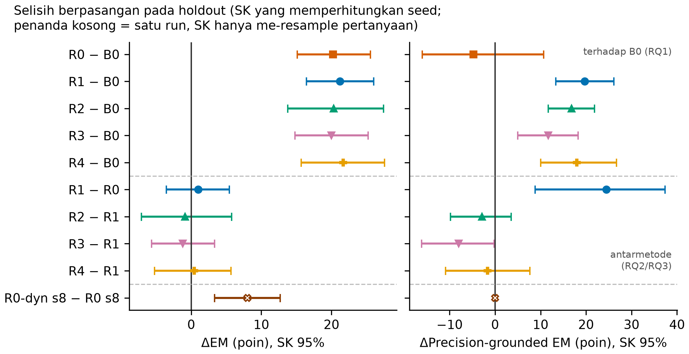
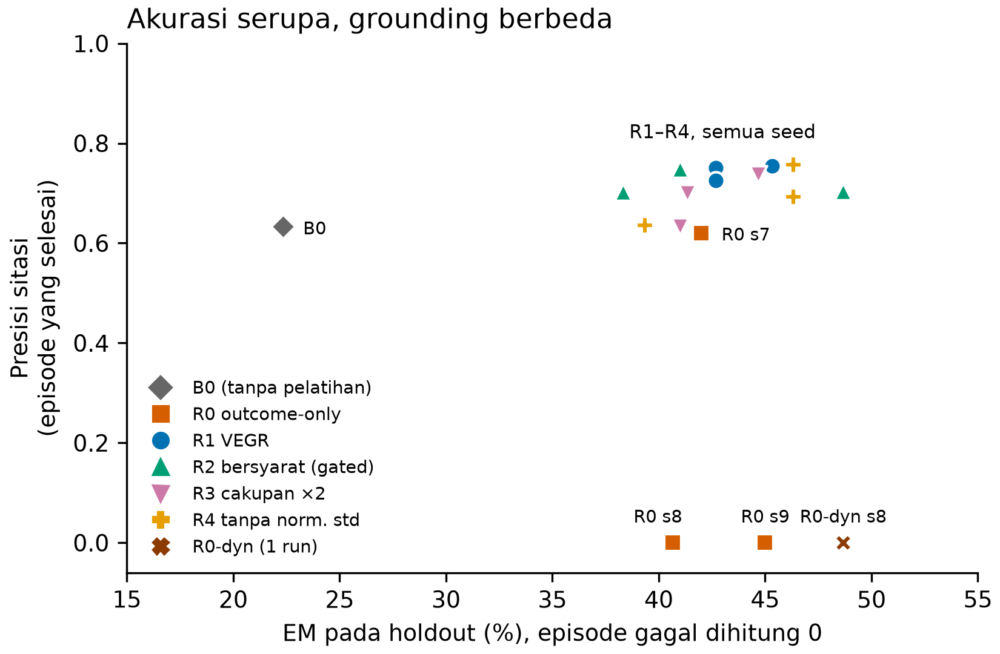
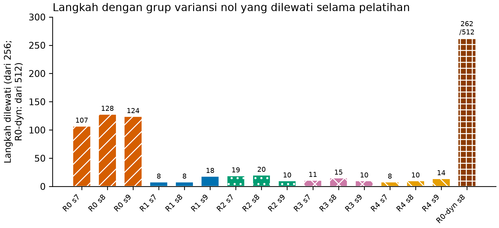
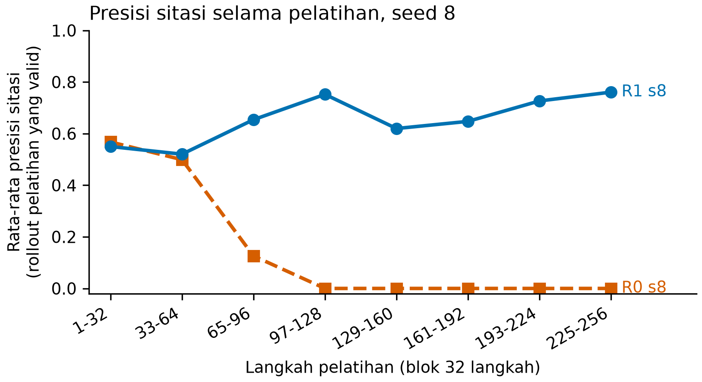
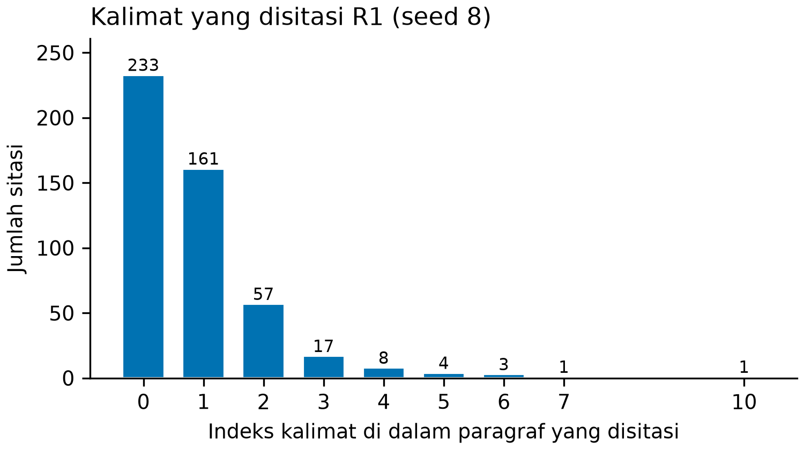
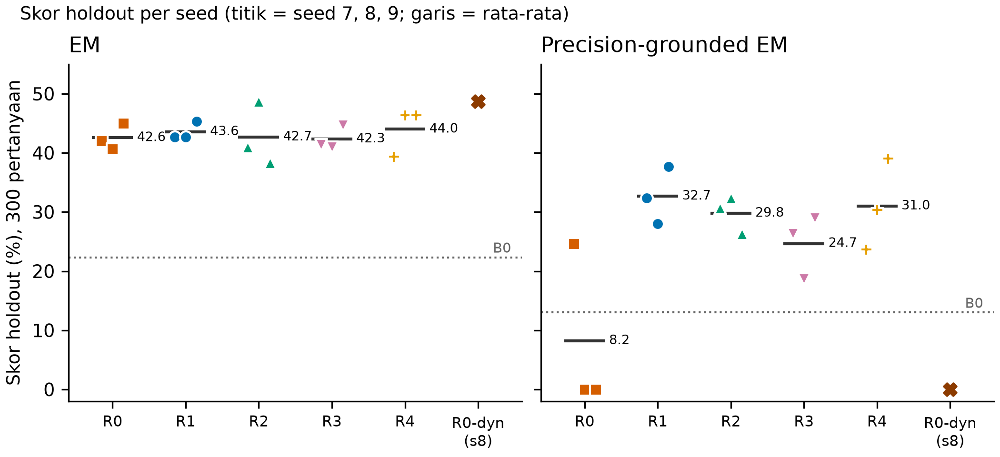
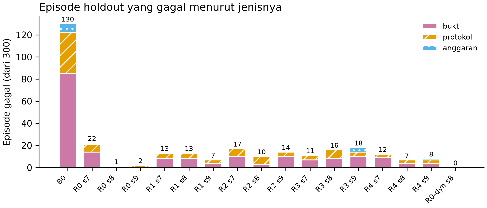

# Chapter 4 — Results and Discussion

All numbers in this chapter come from the holdout episode files (`results/2026-10-10-*/`, `results/2026-10-11-fixes/results/*/episodes.jsonl`) and the training logs (`metrics.jsonl`).

- Per-run and question-only bootstrap values are computed by `scripts/make_thesis_figures.py` and stored in `docs/thesis/figures/figures_data.json`.
- The seed-aware bootstrap, the HotpotQA joint metrics and the training-rollout breakdown are computed by `scripts/peer_review_reanalysis.py` (`logs/2026-10-13-peer-review-reanalysis.md`).

This chapter reports the results in the order of the research questions:

- **4.1** gives the experimental setup.
- **4.2** describes the un-tuned baseline.
- **4.3 to 4.6** answer RQ1, RQ2 and RQ3, with a diagnosis of training dynamics in between (4.5).
- **4.7** shows error analysis and example traces.
- **4.8** discusses the findings and threats to validity.

Throughout, **EM (all)** and **precision-grounded EM** count invalid episodes as wrong, so the denominator is always 300. Quality metrics (coverage, precision, recall, searches) are averaged over **completed** episodes only (Section 3.7). The primary comparisons are RQ1 and R1 − R0; everything under RQ3 is exploratory (Section 3.7).

## 4.1 Experimental setup

| Setting | Value |
|---|---|
| Model | Qwen2.5-7B-Instruct + LoRA (r = 16, α = 32) |
| Training algorithm | GRPO-style group-normalised policy gradient, one update per question group (Section 3.6) |
| Training data per run | 256 HotpotQA training questions (seed-dependent sample), 1 epoch; R0-dyn: up to 512 |
| Group size / learning rate | G = 8 / 2 × 10⁻⁵ |
| Search budget / top-k | 3 searches / 3 documents, over the question's closed pool of 10 paragraphs |
| Evaluation | 300-question frozen holdout, greedy decoding, no retries |
| Seeds | 7, 8, 9 (R0-dyn: 8 only) |
| Hardware | 1 × NVIDIA L40S 48 GB (RunPod, ~$1.10/h) |
| Time and cost per run | ≈ 2.05 h ≈ $2.25 (training + holdout evaluation) |
| Total runs and cost | 16 trained runs + B0; ≈ $49 in total (Table 3.2) |

All training runs stop after a fixed budget of 256 questions. This is a budget-limited endpoint, not a point of convergence: block-mean training rewards still move by several tenths of a point between the last two 32-step blocks of some runs.

## 4.2 Baseline (B0)

The un-tuned model reaches **22.3% EM** and **13.0% precision-grounded EM** on the holdout. Its main problem is not wrong answers but invalid episodes: only **170 of 300** episodes complete. The 130 failures break down into 85 evidence failures, 37 protocol failures, and 8 budget failures. Most evidence failures are invented or unretrievable citations, meaning the model cites a title or sentence it never retrieved.

When the model does complete an episode, it is reasonably capable. EM over completed episodes is 39.4%, citation precision 0.633, and retrieval recall 0.829 (Table 4.1). The high retrieval recall shows how easy the closed 10-paragraph pool is to search (Section 3.3). Much of what training can gain therefore lies in following the protocol, which Section 4.3 confirms.

## 4.3 RQ1: Does GRPO improve the agent over the un-tuned model?

**Table 4.1.** Holdout results for every run. EM (all) and P-gEM (precision-grounded EM) count failures as 0; coverage, precision, recall and searches are means over completed episodes. "Dup." is the number of completed episodes that repeat a search query. "Updates" is the number of training steps that produced a gradient update (out of 256; R0-dyn out of 512 drawn).

| Run | Seed | EM (all) | P-gEM | Completed /300 | Evid. cov. | Cit. prec. | Retr. recall | Searches | Dup. | Updates |
|---|---|---|---|---|---|---|---|---|---|---|
| B0 | – | 22.3% | 13.0% | 170 | 0.472 | 0.633 | 0.829 | 1.92 | 32 | – |
| R0 (outcome-only) | 7 | 42.0% | 24.7% | 278 | 0.438 | 0.621 | 0.829 | 3.00 | 229 | 149 |
| R0 (outcome-only) | 8 | 40.7% | 0.0% | 299 | 0.000 | 0.000 | 0.710 | 1.01 | 0 | 128 |
| R0 (outcome-only) | 9 | 45.0% | 0.0% | 298 | 0.000 | 0.000 | 0.860 | 2.27 | 55 | 132 |
| R1 (VEGR) | 7 | 42.7% | 32.3% | 287 | 0.473 | 0.751 | 0.851 | 2.30 | 14 | 248 |
| R1 (VEGR) | 8 | 42.7% | 28.0% | 287 | 0.513 | 0.726 | 0.836 | 2.15 | 7 | 248 |
| R1 (VEGR) | 9 | 45.3% | 37.7% | 293 | 0.333 | 0.754 | 0.837 | 1.91 | 27 | 238 |
| R2 (gated) | 7 | 41.0% | 30.7% | 283 | 0.539 | 0.748 | 0.891 | 2.21 | 34 | 237 |
| R2 (gated) | 8 | 48.7% | 32.3% | 290 | 0.440 | 0.703 | 0.879 | 2.00 | 4 | 236 |
| R2 (gated) | 9 | 38.3% | 26.3% | 286 | 0.471 | 0.702 | 0.855 | 2.16 | 36 | 246 |
| R3 (coverage ×2) | 7 | 41.3% | 26.3% | 289 | 0.607 | 0.701 | 0.854 | 2.01 | 12 | 245 |
| R3 (coverage ×2) | 8 | 41.0% | 18.7% | 284 | 0.545 | 0.633 | 0.820 | 1.61 | 5 | 241 |
| R3 (coverage ×2) | 9 | 44.7% | 29.0% | 282 | 0.557 | 0.738 | 0.882 | 2.35 | 34 | 246 |
| R4 (no std norm.) | 7 | 39.3% | 23.7% | 288 | 0.469 | 0.636 | 0.796 | 1.89 | 35 | 248 |
| R4 (no std norm.) | 8 | 46.3% | 30.3% | 293 | 0.509 | 0.693 | 0.865 | 2.30 | 44 | 246 |
| R4 (no std norm.) | 9 | 46.3% | 39.0% | 292 | 0.346 | 0.757 | 0.867 | 2.41 | 25 | 242 |
| R0-dyn | 8 | 48.7% | 0.0% | 300 | 0.000 | 0.000 | 0.875 | 2.29 | 15 | 250 |

**Table 4.2.** Mean ± standard deviation across seeds 7, 8 and 9 (B0: single evaluation). All columns except precision and coverage are percentages of the 300 questions, except "EM completed", which is over completed episodes.

| Method | EM | EM completed | P-gEM | Lenient gEM | Sup-EM | Joint-EM | Joint-F1 | Cit. prec. | Evid. cov. |
|---|---|---|---|---|---|---|---|---|---|
| B0 | 22.3 | 39.4 | 13.0 | 20.3 | 11.3 | 6.0 | 17.5 | 0.633 | 0.472 |
| R0 outcome-only | 42.6 ± 2.2 | 43.8 ± 2.6 | 8.2 ± 14.2 | 12.9 ± 22.3 | 5.0 ± 8.7 | 3.2 ± 5.6 | 10.5 ± 18.1 | 0.207 ± 0.358 | 0.146 ± 0.253 |
| **R1 VEGR** | 43.6 ± 1.5 | 45.2 ± 1.0 | **32.7 ± 4.8** | 39.9 ± 1.6 | 11.9 ± 10.1 | 7.1 ± 5.8 | 33.7 ± 3.9 | **0.744 ± 0.015** | 0.440 ± 0.095 |
| R2 gated | 42.7 ± 5.4 | 44.7 ± 5.2 | 29.8 ± 3.1 | 40.0 ± 4.5 | 15.9 ± 4.8 | 10.0 ± 1.9 | 35.2 ± 2.3 | 0.718 ± 0.026 | 0.483 ± 0.051 |
| R3 coverage ×2 | 42.3 ± 2.0 | 44.6 ± 2.6 | 24.7 ± 5.4 | 40.1 ± 2.0 | **24.3 ± 4.2** | **13.4 ± 2.2** | **38.0 ± 2.2** | 0.690 ± 0.053 | **0.569 ± 0.033** |
| R4 no std norm. | 44.0 ± 4.0 | 45.3 ± 3.8 | 31.0 ± 7.7 | 39.7 ± 3.3 | 12.4 ± 8.7 | 7.4 ± 5.3 | 33.7 ± 4.7 | 0.695 ± 0.060 | 0.441 ± 0.085 |

**Table 4.3.** Paired differences (points) with 95% bootstrap intervals, 10,000 resamples. The **primary** interval is seed-aware: it resamples both seeds and questions (Section 3.7). The question-only interval averages seeds first and resamples only questions; it ignores seed variance and is given for reference. Rows below the line are exploratory.

| Comparison | ΔEM (seed-aware) | ΔP-gEM (seed-aware) | ΔJoint-EM (seed-aware) | ΔEM (question-only) | ΔP-gEM (question-only) |
|---|---|---|---|---|---|
| R0 − B0 | +20.2 [+15.1, +25.6] | −4.8 [−16.0, +10.7] | −2.8 [−8.0, +3.4] | [+15.9, +24.6] | [−8.4, −1.2] |
| R1 − B0 | +21.2 [+16.4, +26.0] | +19.7 [+13.3, +26.1] | +1.1 [−5.1, +6.9] | [+17.0, +25.4] | [+15.8, +23.7] |
| R2 − B0 | +20.3 [+13.8, +27.4] | +16.8 [+11.7, +21.9] | +4.0 [+0.7, +7.2] | [+16.1, +24.7] | [+13.0, +20.6] |
| R3 − B0 | +20.0 [+14.8, +25.2] | +11.7 [+5.0, +18.2] | +7.4 [+3.6, +11.6] | [+15.4, +24.6] | [+7.9, +15.6] |
| R4 − B0 | +21.7 [+15.7, +27.6] | +18.0 [+10.0, +26.7] | +1.4 [−4.0, +7.3] | [+17.3, +26.0] | [+14.1, +22.0] |
| **R1 − R0** | +1.0 [−3.6, +5.4] | **+24.4 [+8.8, +37.3]** | +3.9 [−4.0, +11.4] | [−1.9, +3.8] | [+20.9, +28.1] |
| R2 − R1 | −0.9 [−7.1, +5.8] | −2.9 [−9.8, +3.6] | +2.9 [−2.9, +9.3] | [−4.0, +2.1] | [−5.9, +0.1] |
| R3 − R1 | −1.2 [−5.7, +3.3] | −8.0 [−16.1, −0.2] | +6.3 [+0.2, +13.1] | [−4.2, +1.8] | [−11.1, −4.9] |
| R4 − R1 | +0.4 [−5.2, +5.7] | −1.7 [−10.9, +7.7] | +0.3 [−7.0, +8.1] | [−2.6, +3.3] | [−4.4, +1.0] |
| R0-dyn s8 − R0 s8 | +8.0 (single runs) | 0.0 | 0.0 | [+3.3, +12.7] | [0.0, 0.0] |



**Figure 4.5.** The paired differences of Table 4.3, question-only intervals. Left: EM; right: precision-grounded EM. Above the dashed line, each method against B0 (RQ1); below it, comparisons between methods (RQ2/RQ3).

[FIGURE UPDATE NEEDED: Figure 4.5 shows the question-only intervals. Redraw it with the seed-aware intervals of Table 4.3 as the primary bars (question-only as thin secondary bars or omitted), and relabel the right panel "ΔPrecision-grounded EM".]

**Answer to RQ1: yes, but mostly through protocol learning.** Every method beats B0 by about **+20 EM points**, and every seed-aware interval excludes zero (Table 4.3). Run by run, the 16 trained runs gain between +16.0 (R2 s9, question-only CI [+10.7, +21.3]) and +26.3 points (R2 s8 and R0-dyn s8, [+21.0, +31.7]) over B0.

Most of this gain comes from completing the protocol, not from answering better:

- B0 loses 130 of 300 episodes to failures, while every trained run loses at most 22.
- **EM on completed episodes** moves only from **39.4% (B0) to 45.2% (R1)**, and to between 43.8% and 45.3% for every method (Table 4.2).

So RQ1 mostly measures how well the agent learns to produce valid, verifiable actions. The gain in reasoning on questions the model could already complete is about 4–6 points. The training logs of R1 seed 7 show the protocol learning directly. The invalid-rollout rate falls from 46% to 29%, 13%, 13% and 7% over the first five 32-step blocks, while average reward rises from 0.97 to 2.81. No few-shot prompt baseline was run, so it is not known how much of this protocol gain prompting alone could achieve (Section 4.8).

Grounding tells a mixed story. The evidence-rewarded methods (R1–R4) improve precision-grounded EM over B0 by +11.7 to +19.7 points, and each interval excludes zero. The outcome-only reward does not: R0 − B0 is −4.8 points, but with the seed-aware interval [−16.0, +10.7] this is **not significant**. R0's grounding depends on the seed (24.7% on seed 7, 0% on seeds 8 and 9). On HotpotQA's Joint-EM, only R2 and R3 are significantly above B0.

**Validation split (supporting evidence only).** On the validation split, R1 seed 7 reaches 57.0% EM against B0's 29.3% (+27.7 points, 95% CI [+21.7, +33.7]). The validation questions appear easier than the holdout, so this number is not used for any claim. It only shows that the gain is not specific to the holdout.

## 4.4 RQ2: Outcome-only reward vs. VEGR

**Accuracy is the same.** R1 − R0 is +1.0 EM points with seed-aware CI [−3.6, +5.4], and the 3-seed means are 42.6% (R0) and 43.6% (R1). **No accuracy difference can be claimed** between the two rewards.

**Grounding is very different.** The full VEGR bundle raises precision-grounded EM by **24.4 points** over R0 (seed-aware CI **[+8.8, +37.3]**). This is the largest between-method effect in the thesis, and it remains clearly positive when seed variance is included, though the interval is wide because R0's grounding varies so much between seeds (24.7%, 0%, 0%). On softer or stricter measures the direction is the same but the size differs: Joint-F1 is 33.7 for R1 against 10.5 for R0, while the Joint-EM difference (+3.9, CI [−4.0, +11.4]) is not significant (Section 4.6 explains why).

As Section 3.1 notes, R1 and R0 differ in six reward terms and in their number of training updates (about 240 against about 130; Table 4.1). The comparison measures the effect of the whole VEGR bundle and the training signal it produces, not of any single evidence term.

**R0 seeds 8 and 9 dropped citations.** Both policies learned to answer **without any citations**.

- Holdout citation rate is 0%, so citation precision, evidence coverage and precision-grounded EM are all 0.
- All 122 correct answers of seed 8 and all 135 of seed 9 come with no citation.
- An answer with no citations is valid in the environment (Section 3.3), and under R0 it earns full credit.
- The two seeds differ in how they search. Seed 8 searches once (1.01 searches per episode). Seed 9 still searches 2.27 times on average and often finds the right paragraphs (retrieval recall 0.860), but then does not cite them (Trace 2, Section 4.7).

**R0 seed 7 kept citing but drifted into repeated searches.** It always used all 3 searches (mean 3.00), and **229 of its 278** completed episodes repeat a query, against 32 for B0 and 7 to 27 for the R1 seeds. Under R0 the search-cost and duplicate terms have zero weight, so repeated searches neither earn nor cost reward. This is **reward-neutral drift**, not a shortcut. Seed 7 kept citing at B0's level of precision (0.621 against 0.633) and has twice B0's precision-grounded EM (24.7% against 13.0%).

So **2 of 3 R0 seeds dropped citations**. With three seeds, the Clopper–Pearson 95% interval for this rate is [0.09, 0.99]: the collapse is common enough to appear twice, but its frequency is essentially unknown.

**Why R0 drops citations.** The collapse is not an unexpected exploit. It follows from the reward (Section 3.4): R0 punishes invalid citations with −1 but never rewards correct ones, and early in training about half of all attempts to cite were invalid. Section 4.5 gives the training-rollout evidence. What the data add is *when* and *on which seeds* this happens: the policy keeps citing for about 64 steps, then drops citations within about 32 steps, on two of three seeds.

**Is the precision gain a selection effect?** Precision is averaged over completed episodes, and the sets of completed episodes differ between runs (170 for B0, up to 300 for others). On the 136 questions that every run completed, the ordering is the same: citation precision is 0.627 for B0, 0.646 for R0 s7, and 0.750–0.790 for the three R1 seeds. The citation rate is 99–100% for every run that cites (all except R0 s8, R0 s9 and R0-dyn).

**R1 (VEGR) is stable.** Across all three seeds:

- EM stays between 42.7% and 45.3%, the narrowest range of any method.
- Citation precision stays between 0.726 and 0.754 (sd 0.015).
- Searches per episode stay between 1.91 and 2.30, and at most 27 episodes repeat a query.

Figure 4.3 puts both dimensions together. Every trained run sits in the same accuracy band, roughly 38–49% EM. Along the grounding axis, the evidence-rewarded runs cluster at precision 0.63–0.76, while R0 seeds 8 and 9 and R0-dyn lie at 0.



**Figure 4.3.** Holdout EM (all episodes, failures counted as 0) against citation precision (completed episodes), one point per run. Shape and colour encode the method.

[FIGURE UPDATE NEEDED: Figure 4.3 legend says "R4 Dr. GRPO"; rename to "R4 no std normalisation".]

**Answer to RQ2: yes, with qualifications.** The full VEGR bundle matches the accuracy of outcome-only reward, avoided citation loss on all three seeds, and raises precision-grounded EM by 24.4 points (CI [+8.8, +37.3]). The outcome-only reward lost citations on two of three seeds, for a reason that follows from its definition. Two qualifications apply:

- VEGR makes citations *correct*, not *complete*. R1's precision-grounded EM (32.7%) is about 11 points below its EM (43.6%), and its Sup-EM (11.9%) and Joint-EM (7.1%) are low and vary strongly between seeds (Section 4.6).
- VEGR does not raise evidence coverage over the un-tuned model (0.440 against 0.472 for B0).

## 4.5 Diagnosis: why outcome-only reward is unstable

**Training rollouts show the mechanism.** Table 4.4 splits the training rollouts of R0 seeds 8 and 9 and R1 seed 8 by outcome, per 32-step block (256 rollouts per block).

**Table 4.4.** Training rollouts by outcome. "Evid. fail." are invalid rollouts with an evidence failure (reward −1). The reward columns are mean training rewards of valid rollouts with and without citations.

| Run | Steps | Evid. fail. | Valid, cited | Valid, uncited | Reward: valid cited | Reward: valid uncited |
|---|---|---|---|---|---|---|
| R0 s8 | 1–32 | 90 | 86 | 42 | 0.50 | 0.36 |
| R0 s8 | 33–64 | 79 | 94 | 75 | 0.48 | 0.20 |
| R0 s8 | 65–96 | 17 | 34 | 204 | 0.53 | 0.50 |
| R0 s8 | 97–256 | 0 | 0 | 253–256 per block | – | 0.40–0.52 |
| R0 s9 | 1–32 | 48 | 161 | 27 | 0.67 | 0.26 |
| R0 s9 | 33–64 | 45 | 93 | 91 | 0.59 | 0.24 |
| R0 s9 | 65–96 | 14 | 52 | 189 | 0.71 | 0.39 |
| R0 s9 | 97–256 | 0 | 0 | 217–255 per block | – | 0.43–0.64 |
| R1 s8 | 1–32 | 91 | 85 | 45 | 3.35 | 1.37 |
| R1 s8 | 97–128 | 23 | 199 | 29 | 3.49 | 1.28 |
| R1 s8 | 225–256 | 12 | 214 | 17 | 3.47 | 0.71 |

Under R0, a valid cited answer earns slightly more than an uncited one (0.50 against 0.36 in the first block of seed 8), because cited answers were more often correct. But in that block 90 of the 176 rollouts that tried to cite were evidence failures, scoring −1. Averaged over all attempts, trying to cite earned about (86 × 0.50 − 90) / 176 ≈ **−0.27**, against **+0.36** for not citing (Section 3.4). Citations disappear by step 97 on both seeds that collapsed.

Under R1, the same early failure rate is present (91 evidence failures in the first block of seed 8). The difference is the reward for a valid citation: valid cited rollouts earn about **3.4** against about **1.3** for uncited ones, a gap of about 2 points instead of about 0.14. The number of valid cited rollouts grows from 85 to 214 per block over training.

In short, **R0 punishes bad citations but never rewards good ones; VEGR rewards correct citations.** This is an interpretation of training logs from two R0 seeds and one R1 seed, and it does not explain why seed 7 kept citing.

**Zero-variance groups.** GRPO learns nothing from a group in which all 8 rollouts receive the same reward (Section 3.6), and such steps are skipped. Under the outcome-only reward this happens often, because the reward is binary and many questions are either always solved or never solved within a group.

**Table 4.5.** Skipped (zero-variance) training steps out of 256.

| Method | Seed 7 | Seed 8 | Seed 9 |
|---|---|---|---|
| R0 outcome-only | 107 | 128 | 124 |
| R1 VEGR | 8 | 8 | 18 |
| R2 gated | 19 | 20 | 10 |
| R3 coverage ×2 | 11 | 15 | 10 |
| R4 no std norm. | 8 | 10 | 14 |
| R0-dyn | – | 262 of 512 drawn | – |

R0 therefore learns from only about half of its questions, and each of those gives only a coarse right-or-wrong signal. The evidence-rewarded methods skip 8–20 steps, because their continuous terms almost always separate the 8 rollouts.



**Figure 4.1.** Number of GRPO training steps skipped because all 8 rollouts in the group received the same reward. Standard runs have 256 steps; R0-dyn drew 512 questions and skipped 262 of them. Source: `metrics.jsonl` of each run; values in `docs/thesis/figures/figures_data.json`.

[FIGURE UPDATE NEEDED: Figure 4.1 run labels are unchanged, but if R4 is named in a legend or caption elsewhere, use "R4 no std normalisation".]

The training curve for seed 8 (Figure 4.2) shows when the R0 collapse happened. Over the first 64 steps, the two rewards produce similar citation precision during training (R0 0.568 and 0.499; R1 0.550 and 0.520). R0 then falls to 0.126 in steps 65–96 and stays at 0.000 for every block from step 97 on, while R1 rises to between 0.62 and 0.76. R0 seed 9 follows the same path (0.714, 0.410, 0.192, then 0.000 from step 97 on). R0 seed 7, the run that kept citing, stays between 0.55 and 0.73 throughout.



**Figure 4.2.** Mean citation precision of valid training rollouts per 32-step block, seed 8. A valid answer with no citations has precision 0 by definition (Section 3.4). Each point averages 128–256 valid rollouts. These are training rollouts sampled at temperature 1.0, not holdout results. Source: `metrics.jsonl`; script `scripts/make_thesis_figures.py`.

**Do more updates prevent the collapse?** A natural hypothesis is that R0's few informative updates lock in whatever habit appears early. R0-dyn tests this on seed 8 (Section 4.6). It draws new questions until a group has reward variance, and it still collapses on the same schedule: training citation precision is 0.550 and 0.596 over the first 64 drawn questions, 0.250 over the next 32, and 0.000 for every later block but one (0.004). On this one seed, more informative updates did not prevent the collapse. This fits the reward-based explanation above, but one seed cannot rule out that dynamic sampling helps on others.

**"Precise but incomplete" citations.** VEGR raises citation precision (about 0.73–0.75, against 0.633 for B0) but not evidence coverage, which ranges from 0.333 to 0.513 across R1 seeds and is below B0's 0.472 on two of three seeds. The citation pattern of R1 seed 8 shows why:

- It cites 1 sentence in 97 episodes, 2 sentences in 182, and 3 in 8.
- By sentence position, sentence 0 is cited 233 times, sentence 1 161 times, and sentence 2 57 times.



**Figure 4.7.** Position of every sentence cited by R1 seed 8 in its completed holdout episodes (485 citations). 451 of them (93%) point to one of the first three sentences of a paragraph.

The policy prefers a few early sentences, which are usually correct but often not the full gold evidence. Under a summed reward, citing one safe sentence already earns full precision and partial coverage, so the policy has little reason to risk adding more. This matches ALCE's observation that citation precision and citation recall are distinct, and that models tend to be precise but incomplete (Gao et al., 2023).

Coverage also varies between seeds. R1 seed 9 has the best precision-grounded EM of the R1 runs (37.7%) but the lowest coverage (0.333). It cites only 1.03 sentences per completed episode, against 1.49 and 1.69 for seeds 7 and 8, and its Sup-EM is 0.7%, because it almost never cites both gold sentences. Precision-grounded EM rewards exactly this behaviour, which is why it must be read next to Sup-EM and Joint-EM.

## 4.6 RQ3: Reward variants and optimizer changes

All comparisons in this section are **exploratory**. They are not corrected for multiple comparisons, and R3, R4 and R0-dyn were designed after the R0/R1/R2 holdout results had been seen (Section 3.8). With three seeds and EM standard deviations of up to 5.4 points, a non-significant difference here is **inconclusive**, not evidence that two methods are equal.

**R2 (gated penalties): inconclusive, and its single-seed gain did not replicate.**

- On seed 8 alone, R2 looked like a clear win: 48.7% against 42.7%, a +6.0-point difference with question-only CI [+1.3, +11.0].
- It **did not replicate**. On seed 7, R2 is 1.7 points below R1; on seed 9, it reaches 38.3% against R1's 45.3%.
- Over three seeds, R2 − R1 is −0.9 EM (seed-aware CI [−7.1, +5.8]) and −2.9 precision-grounded EM ([−9.8, +3.6]).
- R2 has the widest seed range of any method, from 38.3% to 48.7% (sd 5.4; Figure 4.4).

This is the kind of result Henderson et al. (2018) and Agarwal et al. (2021) warn about: a single-seed comparison can look significant and still not hold across seeds.

**R3 (coverage ×2): a precision–coverage trade-off whose winner depends on the metric.** Doubling the coverage weight does what it was meant to do on coverage:

- R3 has the highest coverage of any method (0.569 ± 0.033, against 0.440 for R1).
- It cites more sentences: 1.83–2.06 per completed episode, against 1.03–1.69 for R1.

The extra citations are less often gold. Precision falls to 0.690, and precision-grounded EM is 8.0 points below R1 (seed-aware CI [−16.1, −0.2], which only just excludes zero). On HotpotQA's own metrics the ranking reverses:

- R3 has the best Sup-EM (24.3% against 11.9% for R1).
- It has the best Joint-EM (13.4% against 7.1%; R3 − R1 = **+6.3**, CI [+0.2, +13.1]).
- It has the best Joint-F1 (38.0 against 33.7).

EM is unchanged (−1.2, CI [−5.7, +3.3]). So R3 is not simply worse than R1. It trades precision for completeness. A metric that punishes any wrong citation favours R1; a metric that requires the full gold evidence favours R3. Both intervals are close to zero, so neither ranking is firm.

**R4 (GRPO without std normalisation): inconclusive.** R4 removes only the standard-deviation division from the advantage. It keeps the length normalisation and changes the effective step size (Section 3.6), so it is a partial ablation of Dr. GRPO, not Dr. GRPO itself. Against R1, it changes EM by +0.4 (CI [−5.2, +5.7]) and precision-grounded EM by −1.7 ([−10.9, +7.7]). Its seed spread is wider (EM sd 4.0 against 1.5), but three seeds are too few to call this a difference. The result does not show whether full Dr. GRPO would help.

**R0-dyn (R0 + dynamic sampling, seed 8): more accurate, still uncited.** This is a single diagnostic run on the seed where R0 had collapsed (Section 3.8).

- It reached **48.7% EM**, tied with R2 s8 for the best of any run, and **+8.0 points** above R0 s8 (question-only CI [+3.3, +12.7]). It completed all 300 episodes.
- This gain cannot be attributed to dynamic sampling alone. R0-dyn drew **512 questions** against R0's 256, and made **250 updates** against R0 s8's 128 (the target was 256; the question pool ran out first). The +8 points are the effect of dynamic sampling together with twice the training questions.
- Its precision-grounded EM is **0.0%**, the same as R0 s8: all 146 correct answers have no citation.
- During training it collapsed to uncited answers on the same schedule as R0 s8 (Section 4.5).

**On the one seed tested, dynamic sampling did not prevent the citation shortcut.** This agrees with the reward-based explanation of Section 4.5. Seed 8 was chosen because R0 had collapsed there, and only one run was possible, so the result does not show whether dynamic sampling helps on other seeds.



**Figure 4.4.** Holdout EM (left) and precision-grounded EM (right) per seed for each method. Dots are seeds 7, 8 and 9 (left to right); the horizontal bar and its label give the seed mean. The dotted line is the un-tuned baseline B0. R0-dyn has one seed.

[FIGURE UPDATE NEEDED: Figure 4.4 right panel title says "Grounded EM"; relabel "Precision-grounded EM". Optionally add a third panel with Joint-EM per seed (values in results/2026-10-13-peer-review-reanalysis/output.md).]

**Answer to RQ3.** None of the variants is shown to improve on plain VEGR, and most comparisons are inconclusive:

- R2 (gated penalties) and R4 (no std normalisation): inconclusive.
- R3 (larger coverage weight): buys coverage and Joint-EM at the price of precision and precision-grounded EM.
- R0-dyn (dynamic sampling): on one seed, raised accuracy together with twice the training questions, but left the outcome-only shortcut intact.

This thesis claims no EM difference between the trained methods.

## 4.7 Error analysis and example traces

**Failure categories.** Table 4.6 lists the episodes that did not complete.

**Table 4.6.** Failed episodes out of 300, by type.

| Run | Evidence | Protocol | Budget | Total |
|---|---|---|---|---|
| B0 | 85 | 37 | 8 | 130 |
| R0 s7 | 14 | 7 | 1 | 22 |
| R0 s8 | 0 | 1 | 0 | 1 |
| R0 s9 | 0 | 2 | 0 | 2 |
| R1 s7 | 8 | 5 | 0 | 13 |
| R1 s8 | 8 | 5 | 0 | 13 |
| R1 s9 | 4 | 3 | 0 | 7 |
| R2 s7 | 10 | 7 | 0 | 17 |
| R2 s8 | 3 | 7 | 0 | 10 |
| R2 s9 | 10 | 4 | 0 | 14 |
| R3 s7 | 7 | 4 | 0 | 11 |
| R3 s8 | 8 | 8 | 0 | 16 |
| R3 s9 | 10 | 4 | 4 | 18 |
| R4 s7 | 9 | 3 | 0 | 12 |
| R4 s8 | 4 | 3 | 0 | 7 |
| R4 s9 | 4 | 3 | 1 | 8 |
| R0-dyn s8 | 0 | 0 | 0 | 0 |



**Figure 4.6.** Failed holdout episodes per run, stacked by failure type. Training removes most failures of every type. Evidence failures (invented or unretrievable citations) shrink from 85 to between 3 and 14 in the runs where the agent still cites.

The uncited R0 runs (s8, s9, R0-dyn) have almost no failures, but for a degenerate reason. An answer without citations can never produce an evidence failure, so dropping citations removes that failure type entirely.

**Parser collisions.** Some protocol failures are caused by the action format rather than the agent (Trace 5 below). In every trained run that cites, 2 to 5 holdout protocol failures have an '&' in the final output, an upper bound on such collisions and at most 1.7 EM points per run. The counts are similar across R1–R4, so no comparison changes. R3, which cites more, is affected slightly more often.

**Example traces.** The traces below are taken verbatim from the holdout episode logs.

*Trace 1: same question, three behaviours* (question `5adbf0a255429947ff17385a`). All three policies answer correctly (EM = 1).

```
R1 s8:  SEARCH[Laleli Mosque Esma Sultan Mansion location]
        SEARCH[Laleli neighborhood]
        ANSWER[no] CITATIONS[Laleli Mosque|0; Esma Sultan Mansion|0]
R0 s8:  SEARCH[Laleli Mosque and Esma Sultan Mansion location]
        ANSWER[no]
R0 s7:  SEARCH[neighborhood of Laleli Mosque and Esma Sultan Mansion]
        SEARCH[neighborhood of Laleli Mosque and Esma Sultan Mansion]
        SEARCH[neighborhood of Laleli Mosque and Esma Sultan Mansion]
        ANSWER[no] CITATIONS[Esma Sultan Mansion|0; Laleli Mosque|0]
```

- **R1 (VEGR)** searches twice with different queries and cites one sentence from each gold paragraph. In this episode coverage and precision are both 1.0.
- **R0 seed 8** answers after one search with no citations.
- **R0 seed 7** repeats the same query three times before answering, which costs nothing under R0.

*Trace 2: finding the evidence but not citing it* (`5abd94525542992ac4f382d2`, the question of Table 3.1 and Appendix A).

```
R1 s8:      SEARCH[S/S 2014 debut South Korean boy group]
            SEARCH[WINNER YG Entertainment]
            ANSWER[YG Entertainment] CITATIONS[2014 S/S|0; Winner (band)|0]
R0 s8:      SEARCH[2014 S/S debut album South Korean boy group formed by]
            ANSWER[YG Entertainment]
R0 s9:      SEARCH[2014 S/S debut album South Korean boy group formed by]
            SEARCH[WINNER YG Entertainment connection]
            SEARCH[WINNER YG Entertainment]
            ANSWER[YG Entertainment]
R0-dyn s8:  SEARCH["2014 S/S debut album South Korean boy group formed by"]
            SEARCH["2014 S/S WINNER YG Entertainment"]
            ANSWER[YG Entertainment]
```

R1 uses its second search to follow the bridge entity ("WINNER") into the second paragraph, which is the multi-hop behaviour the task is meant to require, and cites both gold sentences. R0 s8 gives the same answer with nothing to support it. R0 s9 and R0-dyn are more telling: they also follow the bridge entity and retrieve the gold paragraphs, but then answer without citing them. Their search behaviour is multi-hop; their answers are unsupported.

*Trace 3: more citations, fewer of them gold (R3 s8)* (`5ae7a8175542993210983ed8`). The answer is correct, but only one of the three cited sentences is a gold fact (precision 0.33, coverage 0.33):

```
R3 s8:  ANSWER[Pedro Rodríguez] CITATIONS[Formula One drivers from Mexico|1;
        2014 Bahrain Grand Prix|3; 2009 Singapore Grand Prix|5]
```

This is the cost side of R3's trade-off: a heavier coverage weight encourages the policy to add citations, and some of the additions are not gold.

*Trace 4: an evidence failure (R1 s8).* The final action `ANSWER[yes] CITATIONS[Ambroise Thomas|0; Provesi|1]` (question `5ab29c24554299449642c932`) was marked invalid as an evidence failure: "citation references unknown document 'Provesi'". The model cited a document title that had not appeared in any of its search results. Even after training, invented or unretrievable citations remain the most common failure type for R1–R4 (Table 4.6).

*Trace 5: a protocol failure caused by the citation format (R1 s9)* (`5a8a3e745542996c9b8d5e70`). After three searches (two of them identical), the agent answered `ANSWER[Adventure] CITATIONS[Tunnels &amp; Trolls|0]`. The model wrote the title's "&" as the HTML entity `&amp;`, and the `;` inside the entity was read as the separator between two citations. The parser then rejected "Tunnels &amp" as a citation without an index ("each citation must have the form title|sentence_index"). A separator that cannot appear in titles would remove this case.

## 4.8 Discussion

**Comparison with the literature.**

- **Citation loss under outcome reward.** CaRR (Zhang et al., 2026) reports that outcome-only GRPO agents learn shortcut answers and use fewer tool calls. R0 seeds 8 and 9 show a related pattern in a much smaller setting (7B, LoRA, 256 questions, one GPU). Here the cause can be traced to the reward definition: a −1 penalty for invalid citations and no reward for valid ones (Section 4.5). Because HotpotQA's supporting facts are exact, the behaviour can be detected by rule, without a judge.
- **Seed dependence.** Only two of three R0 seeds dropped citations, and R0 seed 7 drifted in a different, reward-neutral direction. Whether an outcome-trained agent keeps citing therefore depends on the seed, and three seeds cannot estimate how often it does.
- **Optimizer changes.** Dynamic sampling (DAPO; Yu et al., 2025) and the std-free advantage from Dr. GRPO (Liu et al., 2025) were proposed to make GRPO training more efficient and less biased. In this setting, R0-dyn was more accurate than R0 s8 (with twice the training questions), and R4 was indistinguishable from R1. Neither change alters *what* the policy is rewarded for, and on the seed tested dynamic sampling did not restore citations.
- **Accuracy.** The results agree with Search-R1 (Jin et al., 2025) that outcome-only RL improves accuracy. They add that the accuracy number alone hides whether the answers are grounded.

**What the results support:**

1. GRPO-style training with LoRA on one GPU improves a 7B agent searching a closed paragraph pool by about 20 EM points over the un-tuned model. Most of the gain comes from learning to produce valid actions: EM on completed episodes rises only from 39.4% to about 45%.
2. Outcome-only reward and the full VEGR bundle reach statistically indistinguishable accuracy, but VEGR's precision-grounded EM is 24.4 points higher (seed-aware CI [+8.8, +37.3]).
3. The outcome-only reward dropped citations on two of three seeds (Clopper–Pearson 95% CI for the rate [0.09, 0.99]). The training rollouts show why: invalid citations cost −1, and correct ones earn nothing.
4. VEGR makes citations correct but not complete. A larger coverage weight (R3) trades precision for completeness and ranks best on HotpotQA's Joint-EM.

**What the results do not support:**

- That VEGR is more *accurate* than outcome-only reward.
- That any single VEGR term, rather than the bundle, is responsible for the grounding gain.
- That gated penalties (R2) or removing std normalisation (R4) help or hurt. Both results are inconclusive.
- That dynamic sampling can never prevent the shortcut (one seed only).
- That VEGR improves evidence coverage. It does not raise coverage over B0.

**Threats to validity.**

- **Few seeds, small holdout.** Three seeds and 300 holdout questions cannot resolve EM differences of a few points. The seed-aware intervals are wide (for example, about 13 points wide for R2 − R1 EM).
- **Reward bundle and update count.** R1 and R0 differ in six reward terms and in their number of updates (about 240 against 130). Ablations that separate the evidence terms from the denser answer and search terms were not run.
- **Metric–reward overlap (Goodhart).** VEGR rewards citation precision and coverage against the same gold supporting facts that the grounding metrics are computed from. Gains in precision-grounded EM are therefore partly gains on the training target itself, and may overstate how much better the agent is at citing evidence in a more general sense. Precision-grounded EM is also lenient, since one correct citation counts as fully grounded. HotpotQA's supporting-fact labels are known to be incomplete, so a correct but unlabelled citation is scored as wrong. HotpotQA's own Sup-EM and Joint-EM (Table 4.2) and the independent checks in Section 4.4 reduce but do not remove this concern. An attribution check that does not use the gold labels, such as NLI-based citation evaluation (Gao et al., 2023), was not run.
- **No prompt-only baseline.** Since RQ1's gain is mostly protocol learning, a few-shot prompt might recover part of it without training. This was not tested.
- **Closed corpus.** Retrieval is BM25 over each question's own 10 paragraphs, not an open corpus or the web. The un-tuned model already reaches retrieval recall 0.83, so the search problem is much easier than in deployed agents.
- **Small training scale and fixed endpoint.** Each run uses 256 questions for one epoch with a LoRA-adapted 7B model, and stops before rewards have converged. The results may differ at larger scale or with longer training.
- **Software change.** The PyTorch version changed between B0/R1 seed 7 (2.14.1) and the later runs (2.11.0) because of a driver constraint. Every comparison against B0, and R1's seed mean, crosses this change.
- **Environment loophole and parser.** The environment accepts answers without citations. This was kept deliberately for comparability, but it makes the R0 collapse possible. The citation separator also collides with '&' in some titles (Section 4.7).
- **Untuned weights.** The reward weights are untuned defaults; R3 shows that changing one weight moves the coverage–precision balance.
- **Exploratory runs.** R2–R4 and R0-dyn are exploratory, uncorrected for multiple comparisons, and R3, R4 and R0-dyn were designed after seeing holdout results.
- **R0-dyn has one seed and fell short of its target.** It reached 250 of the 256 intended updates, and it saw twice as many questions as R0. Its result is evidence about mechanism on that seed, not a method comparison.
