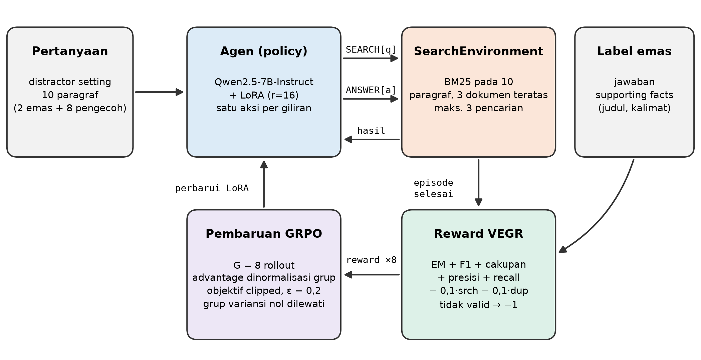

# BAB 3 PERANCANGAN SISTEM

Penelitian ini dirancang sebagai eksperimen terkontrol untuk melatih dan mengevaluasi agen pencarian berbasis *reinforcement learning* dengan *reward* berbasis bukti yang dapat diverifikasi. Model, data, lingkungan, *hyperparameter*, dan protokol evaluasi akan dibuat tetap; yang berubah antar-*run* hanyalah fungsi *reward* (dan, pada satu varian, *optimizer*). Secara umum, sistem yang diusulkan terdiri atas empat bagian utama, sebagaimana ditunjukkan pada Gambar 3.1. Bagian pertama adalah penyiapan *dataset* HotpotQA beserta anotasi *supporting facts*. Bagian kedua adalah lingkungan pencarian, tempat agen melakukan pencarian BM25 dan memberikan jawaban beserta sitasi. Bagian ketiga adalah fungsi *reward* yang diusulkan, yaitu *Verifiable Evidence-Grounded Reward* (VEGR), yang menilai setiap episode terhadap jawaban emas dan *supporting facts* emas. Bagian keempat adalah pelatihan bergaya GRPO yang membandingkan *reward* dari beberapa episode pada pertanyaan yang sama untuk memperbarui *adapter* LoRA. Setelah pelatihan, setiap model akan dievaluasi pada himpunan *holdout* beku.

Setiap episode pelatihan direncanakan mengikuti alur sebagai berikut.

1. Agen menerima sebuah pertanyaan HotpotQA.
2. Agen mengeluarkan satu aksi pada setiap giliran: `SEARCH[query]` atau aksi terminal `ANSWER[...] CITATIONS[...]`.
3. Lingkungan menjalankan pencarian dengan BM25 pada paragraf-paragraf milik pertanyaan tersebut dan mengembalikan hasilnya, atau memvalidasi jawaban dan sitasi.
4. Ketika episode berakhir, fungsi *reward* menilainya terhadap jawaban emas dan *supporting facts* emas HotpotQA.
5. GRPO membandingkan *reward* dari 8 episode pada pertanyaan yang sama dan memperbarui *adapter* LoRA.



**Gambar 3.1.** Rancangan sistem untuk satu langkah pelatihan: agen menerima pertanyaan HotpotQA, melakukan hingga 3 aksi `SEARCH` pada 10 paragraf milik pertanyaan tersebut, lalu mengakhiri episode dengan `ANSWER[a] CITATIONS[title|index; …]`; episode yang selesai dinilai oleh VEGR terhadap jawaban emas dan *supporting facts*, kemudian GRPO membandingkan *reward* dari 8 episode pada pertanyaan yang sama dan memperbarui *adapter* LoRA.

Rancangan ini dipandu oleh tiga pertanyaan penelitian (Bab 1), yaitu sebagai berikut.

- **RQ1**: Apakah GRPO meningkatkan performa agen pencarian 7B dibandingkan dengan model tanpa pelatihan?
- **RQ2**: Apakah VEGR mencegah perilaku jalan pintas (*shortcut*) dari *reward* berbasis jawaban saja, tanpa kehilangan akurasi?
- **RQ3**: Bagaimana varian *reward* dan perubahan *optimizer* memengaruhi *grounding* dan perilaku pencarian?

Terdapat dua batasan pada kontrol eksperimen ini yang perlu dinyatakan sejak awal, yaitu sebagai berikut.

1. Perbandingan utama, yaitu R1 (VEGR) dibandingkan dengan R0 (*outcome-only*), mengubah **seluruh paket *reward* sekaligus**: enam komponen ditambahkan (F1, cakupan, presisi, *retrieval recall*, biaya pencarian, dan penalti duplikasi). Rancangan ini tidak dapat menunjukkan komponen mana yang menyebabkan suatu perbedaan.
2. *Reward* yang lebih padat juga dapat mengubah jumlah langkah pelatihan yang menghasilkan pembaruan, karena grup dengan varians nol dilewati (Subbab 3.5). *Reward* yang jarang seperti R0 diduga menghasilkan lebih banyak grup dengan varians nol dibandingkan dengan VEGR.

Oleh karena itu, perbedaan antara R1 dan R0 akan diatribusikan kepada paket VEGR secara utuh, bersama dengan sinyal pelatihan yang dihasilkannya, dan bukan kepada satu komponen tertentu.

## 3.1 *Dataset* dan Pembagian Data

Penelitian ini akan menggunakan **HotpotQA** [6], versi 1.1, pada *distractor setting*. Setiap pertanyaan disertai 10 paragraf Wikipedia, yaitu 2 paragraf emas yang memuat bukti (*evidence*) jawaban dan 8 paragraf pengecoh (*distractor*). Setiap pertanyaan juga dianotasi dengan **_supporting facts_**, yaitu pasangan (judul, indeks kalimat) yang dibutuhkan untuk menjawabnya. Anotasi inilah yang memungkinkan *reward* bukti tanpa *judge*: benar atau tidaknya suatu sitasi dapat diperiksa secara berbasis aturan.

Baris data yang gagal validasi akan dilewati dan dicatat beserta alasannya (misalnya, kalimat kosong atau indeks *supporting fact* di luar jangkauan).

**Pembagian data.** Pembagian data dihasilkan oleh `scripts/prepare_splits.py` dan dicatat dalam `configs/evaluation/splits.json`, bersama dengan *hash* SHA-256 dari berkas sumber. Pembagian data yang digunakan adalah sebagai berikut.

1. **Train / validasi.** Keduanya diambil dari berkas pelatihan HotpotQA menggunakan *hash* deterministik. Setiap ID pertanyaan dipetakan ke sebuah *bucket* dalam [0; 1) dengan mengambil 8 *byte* pertama dari `sha256("7:" + question_id)`. Sebuah pertanyaan masuk ke data latih jika nilai *bucket*-nya di bawah 0,95, dan ke data validasi jika sebaliknya. Pembagian ini menghasilkan **85.573 pertanyaan latih** dan **4.452 pertanyaan validasi**. Pembagian ini tidak bergantung pada urutan berkas dan dapat direproduksi secara persis.
2. ***Holdout*.** *Holdout* adalah himpunan beku berisi **300 pertanyaan**, yaitu 300 baris valid pertama dari berkas dev HotpotQA, yang disimpan dalam `configs/evaluation/holdout_v1_ids.json` beserta *hash* dari *manifest*-nya. *Holdout* tidak akan digunakan untuk memilih pengaturan. Seluruh pengaturan dipilih pada data validasi, dan *holdout* hanya digunakan untuk angka akhir yang dilaporkan.

**Sampel pelatihan.** Setiap *run* pelatihan akan mengambil **256 pertanyaan** dari data latih. Sampel ini bergantung pada *seed* *run*, sehingga *seed* yang berbeda melihat pertanyaan yang berbeda (Subbab 3.5).

**Tabel 3.1.** Ringkasan data yang digunakan.

| Aspek | Keterangan |
|---|---|
| Sumber | HotpotQA v1.1, *distractor setting* (Wikipedia) |
| Paragraf per pertanyaan | 10 (2 emas + 8 pengecoh) |
| Anotasi bukti | *Supporting facts* (judul, indeks kalimat) |
| Data latih | 85.573 pertanyaan (berkas *train*, *bucket* < 0,95) |
| Data validasi | 4.452 pertanyaan (berkas *train*, *bucket* ≥ 0,95) |
| Sampel pelatihan per *run* | 256 pertanyaan, bergantung pada *seed* |
| *Holdout* | 300 pertanyaan beku dari berkas dev |

## 3.2 Lingkungan Pencarian

Lingkungan (`SearchEnvironment`, `src/needle/environment/search.py`) adalah sesi pencarian yang terbatas dan dapat di-*reset* untuk satu pertanyaan.

**Korpus dan *retriever*.** Korpus yang dapat dicari adalah **kumpulan tertutup berisi 10 paragraf milik pertanyaan itu sendiri**, yang selalu memuat kedua paragraf emas. Hal ini membuat *retrieval* jauh lebih mudah dibandingkan dengan pencarian *open-domain*, sehingga tugas ini lebih dekat dengan pemahaman bacaan (*reading comprehension*) dengan alat penelusur halaman dibandingkan dengan pencarian web. Istilah "agen pencarian" pada penelitian ini selalu berarti pencarian pada kumpulan tertutup tersebut. *Retrieval* menggunakan Okapi BM25 [13], melalui implementasi `rank_bm25` dengan parameter bawaannya. Setiap paragraf diindeks sebagai judulnya ditambah seluruh kalimatnya, yang ditokenisasi menjadi token kata Unicode dengan *case folding*. Setiap pencarian mengembalikan **3 dokumen teratas**. Nilai yang sama dipecahkan berdasarkan urutan dokumen asli, sehingga *retrieval* bersifat deterministik. Setiap dokumen yang dikembalikan ditampilkan secara utuh dengan kalimat-kalimat bernomor.

**Anggaran.** Satu episode mengizinkan paling banyak **3 pencarian**.

**Tata bahasa aksi.** Pada setiap giliran, agen harus mengeluarkan tepat satu aksi, yaitu sebagai berikut.

1. `SEARCH[query]` menjalankan pencarian BM25 dan menggunakan satu unit anggaran.
2. `ANSWER[answer] CITATIONS[title|index; title|index; ...]` memberikan jawaban akhir beserta kalimat-kalimat bukti yang disitasi. Aksi ini mengakhiri episode.

**Validasi dan jenis kegagalan.** Sebuah episode dinyatakan **tidak valid** jika terjadi salah satu kondisi berikut.

1. *Kegagalan protokol*: keluaran tidak sesuai dengan tata bahasa aksi (misalnya, terdapat teks tambahan, atau sitasi ditempelkan pada aksi SEARCH).
2. *Kegagalan bukti*: sebuah sitasi merujuk pada judul atau indeks kalimat yang tidak pernah muncul pada hasil pencarian mana pun dalam episode tersebut, misalnya sitasi yang dikarang.
3. *Kegagalan anggaran*: agen menghabiskan seluruh pencariannya dan tetap tidak menjawab.

Episode yang tidak valid akan menerima penalti protokol sebesar −1 selama pelatihan (Subbab 3.3) dan dihitung salah selama evaluasi (Subbab 3.7).

**Celah yang diketahui.** Jawaban dengan daftar sitasi kosong (`ANSWER[x]` atau `ANSWER[x] CITATIONS[]`) diterima sebagai jawaban yang valid. *Prompt* itu sendiri mengizinkan `CITATIONS[]` untuk kasus ketika tidak ada sitasi yang dapat divalidasi. Celah ini sengaja tidak ditutup agar setiap *run* dilatih dan dievaluasi pada lingkungan yang sama, dan tingkat sitasi akan dipantau sebagai metrik tersendiri (Subbab 3.7).

## 3.3 Rancangan *Reward* VEGR

**_Verifiable Evidence-Grounded Reward_ (VEGR)** diimplementasikan dalam `src/needle/rewards/__init__.py`. Setiap komponennya dihitung secara berbasis aturan dari anotasi emas HotpotQA, sehingga tidak melibatkan *LLM judge*.

Misalkan *G* adalah himpunan *supporting facts* emas (judul, indeks kalimat) dan *C* adalah himpunan kalimat yang disitasi oleh agen. Untuk episode yang valid:

$$
R_{\text{VEGR}} = \text{EM} + \text{F1} + \text{Cov} + \text{Prec} + \text{RetR} - 0.1\cdot\text{Cost} - 0.1\cdot\text{Dup}
$$

**Tabel 3.2.** Komponen VEGR.

| Komponen | Definisi | Rentang |
|---|---|---|
| EM | *exact match* ternormalisasi antara jawaban prediksi dan jawaban emas | {0; 1} |
| F1 | F1 tingkat token antara jawaban prediksi dan jawaban emas | [0; 1] |
| Cov (cakupan bukti) | \|G ∩ C\| / \|G\| | [0; 1] |
| Prec (presisi sitasi) | \|G ∩ C\| / \|C\|, didefinisikan 0 jika C kosong | [0; 1] |
| RetR (*retrieval recall*) | proporsi dokumen emas yang muncul pada hasil pencarian mana pun | [0; 1] |
| Cost (biaya pencarian) | jumlah pencarian yang digunakan / anggaran (3) | [0; 1] |
| Dup (penalti *query* duplikat) | (jumlah *query* − jumlah *query* unik) / jumlah *query* | [0; 1) |

Episode yang **tidak valid** menerima **R = −1**, terlepas dari komponen lainnya. Penalti protokol inilah yang membuat VEGR menegakkan tata bahasa aksi. Karena sitasi yang dikarang termasuk kegagalan bukti, agen tidak dapat menaikkan presisinya dengan menyitasi kalimat yang tidak pernah ia ambil.

Komponen-komponen tersebut terbagi ke dalam tiga kelompok, masing-masing ditujukan untuk jenis kegagalan yang berbeda, yaitu sebagai berikut.

1. **Komponen jawaban (EM, F1)** memberi *reward* atas kebenaran jawaban. F1 memberikan nilai parsial, sehingga *reward* menjadi tidak sejarang EM saja.
2. **Komponen bukti (Cov, Prec)** memberi *reward* atas penyitasian kalimat yang tepat. Presisi saja dapat dipenuhi dengan menyitasi satu kalimat yang aman, dan cakupan saja dapat dipenuhi dengan menyitasi semua kalimat, sehingga keduanya disertakan (bandingkan dengan ALCE [14]).
3. **Komponen pencarian (RetR, Cost, Dup)** memberi *reward* atas ditemukannya dokumen emas dan memberi penalti atas pencarian yang sia-sia atau berulang. Penalti tersebut diberi bobot kecil (0,1) agar dapat membentuk perilaku pencarian tanpa membuat agen enggan melakukan pencarian sama sekali.

Komponen-komponen tersebut secara individual bukanlah hal baru. Kontribusi penelitian ini adalah penggabungan komponen-komponen tersebut menjadi *reward* tanpa *judge* untuk agen pencarian *multi-turn*, bersama dengan evaluasi terkontrol atas apa yang diubah oleh kombinasi tersebut (Subbab 3.6). Seluruh bobot merupakan nilai bawaan yang tidak akan di-*tuning*.

**Varian *reward*.** Selain VEGR penuh, beberapa varian akan diuji dengan mengubah satu aspek pada satu waktu, yaitu sebagai berikut.

1. **R0, *outcome-only* (*reward* dasar).** R = EM. Seluruh bobot lainnya bernilai 0, tetapi episode yang tidak valid tetap menerima −1. Varian ini mencerminkan agen pencarian dengan *outcome reward* seperti Search-R1 [2].
2. **R2, penalti bersyarat (*gated*).** Varian ini sama dengan VEGR, kecuali bahwa penalti biaya pencarian dan duplikasi hanya diterapkan ketika EM = 1. Tujuannya adalah agar pencarian tidak diberi penalti pada pertanyaan yang belum berhasil dijawab oleh agen.
3. **R3, cakupan ×2.** Varian ini adalah VEGR dengan bobot cakupan bukti dinaikkan dari 1 menjadi 2. Varian ini menguji apakah bobot cakupan yang lebih besar mendorong agen menyitasi bukti secara lebih lengkap, bukan hanya secara presisi.

**Tabel 3.3.** Varian *reward* yang akan diuji.

| Varian | Rumus *reward* (episode valid) | Episode tidak valid | Tujuan |
|---|---|---|---|
| R0 | EM | −1 | *Reward* dasar berbasis jawaban saja |
| R1 | VEGR penuh | −1 | Metode usulan |
| R2 | VEGR, penalti Cost dan Dup hanya ketika EM = 1 | −1 | Menguji penalti pencarian bersyarat |
| R3 | VEGR dengan bobot Cov = 2 | −1 | Menguji penekanan pada cakupan bukti |

**Hipotesis mengenai sitasi pada R0.** Pada R0, episode yang valid memperoleh nilai EM-nya (0 atau 1), baik dengan maupun tanpa sitasi. Sitasi tidak pernah dapat menambah *reward*, tetapi sitasi ke judul atau kalimat yang tidak diambil membuat episode tersebut menjadi kegagalan bukti yang bernilai −1. Dengan demikian, berdasarkan definisinya, **R0 menghukum sitasi yang salah tetapi tidak pernah memberi imbalan atas sitasi yang benar**. Jika upaya sitasi oleh *policy* awal cukup sering tidak valid, rata-rata *reward* dari mencoba menyitasi dapat lebih rendah daripada tidak menyitasi, sehingga *policy gradient* diduga akan mendorong *policy* untuk menghilangkan sitasi. VEGR dirancang untuk mengubah pertukaran ini: komponen cakupan dan presisinya memberi *reward* secara langsung atas sitasi yang benar, sehingga diharapkan sitasi tetap dipertahankan selama pelatihan. Hipotesis ini akan diuji melalui RQ2.

## 3.4 Model *Policy*

**Model dasar.** *Policy* yang akan digunakan adalah **Qwen2.5-7B-Instruct** [12], yang dimuat dari bobot lokal dalam format bf16.

***Prompt*.** *Prompt* bersifat deterministik dan dibangun oleh fungsi `build_prompt` dalam `src/needle/inference/runner.py`. *Prompt* ini dibungkus dengan *chat template* milik model. Isi *prompt* adalah sebagai berikut.

1. Menjelaskan peran agen ("You are a careful evidence-seeking QA agent").
2. Menyatakan tata bahasa aksi, memberikan contoh (`ANSWER[United States] CITATIONS[Ursula K. Le Guin|1; The Left Hand of Darkness|1]`), dan memuat aturan format: satu `title|index` per sitasi, dipisahkan dengan titik koma, tidak ada teks setelah kurung penutup, judul disalin persis, dan tidak pernah mengarang judul.
3. Memberikan pertanyaan dan sisa anggaran pencarian.
4. Mencantumkan seluruh hasil pencarian sejauh ini. Untuk setiap pencarian, *prompt* menampilkan *query* lalu setiap dokumen yang dikembalikan dalam bentuk `[Title]` diikuti baris-baris `index: sentence`.

*Prompt* dibangun ulang dari awal pada setiap giliran, sehingga model selalu melihat seluruh riwayat pencarian.

***Adapter*.** Pelatihan akan menggunakan LoRA [18] dengan *rank* r = 16, α = 32, dan *dropout* 0. *Adapter* diterapkan pada seluruh proyeksi *attention* dan MLP (q, k, v, o, gate, up, down). Bobot dasar tetap dibekukan, sehingga pelatihan dapat dilakukan pada satu GPU 48 GB.

## 3.5 Algoritma Pelatihan

Pelatihan akan menggunakan ***policy gradient* bergaya GRPO dengan normalisasi grup**, yang mengikuti *Group Relative Policy Optimization* (GRPO) [3] dan diperluas untuk episode *multi-turn*. Algoritma ini berbeda dari GRPO penuh dalam hal-hal yang dinyatakan pada bagian "Fungsi objektif" di bawah. Implementasinya terdapat dalam `scripts/train_grpo.py` dan `src/needle/training/grpo.py`.

***Rollout*.** Untuk setiap pertanyaan pelatihan, *policy* saat ini menjalankan **G = 8** episode penuh, dengan *sampling* pada *temperature* 1,0 dan top-p 1,0. Setiap aksi dibatasi hingga 128 token baru. Setiap episode menerima satu nilai *reward* skalar dari fungsi *reward* milik *run* tersebut (R0–R3).

***Advantage*.** Setiap *reward* dinormalisasi di dalam grupnya:

$$
A_i = \frac{r_i - \operatorname{mean}(r_{1..G})}{\operatorname{std}(r_{1..G}) + 10^{-6}}
$$

Seluruh aksi dalam satu episode berbagi *advantage* episode tersebut. Jika kedelapan *reward* dalam satu grup bernilai sama, setiap *advantage* bernilai nol dan grup tersebut tidak membawa sinyal pembelajaran. **Grup dengan varians nol** seperti ini **dilewati**, yaitu tidak dilakukan pembaruan. Jumlah langkah yang dilewati akan dicatat sebagai diagnostik.

**Fungsi objektif.** Pembaruan menggunakan *clipped surrogate* bergaya PPO [15] dengan ε = 0,2. *Log-probability* setiap *rollout* adalah **rata-rata atas seluruh token yang dihasilkan agen dalam episode tersebut**, mencakup seluruh aksinya. Token *prompt* dan observasi dikecualikan. Dengan demikian, rasio ρ dihitung satu kali per *rollout*.

$$
\mathcal{L} = -\,\mathbb{E}\left[\min\left(\rho\,A,\; \operatorname{clip}(\rho,\,1-\varepsilon,\,1+\varepsilon)\,A\right)\right],
\qquad \rho = \exp\left(\log\pi_\theta - \log\pi_{\theta_\text{old}}\right)
$$

**Tidak ada penalti KL** terhadap model referensi. *Rollout* yang tidak valid tetap berada di dalam *batch*, sehingga penalti −1 secara aktif mendorong *policy* menjauh dari aksi yang tidak sesuai format.

Terdapat tiga sifat rancangan yang menyebabkan fungsi objektif ini bukan fungsi objektif GRPO bergaya PPO yang penuh, yaitu sebagai berikut.

1. **Satu pembaruan per grup.** Delapan *rollout* dari setiap pertanyaan digunakan untuk tepat satu langkah *optimizer*. Tidak ada *epoch* berulang dan tidak ada penggunaan ulang *minibatch*, sehingga *policy* lama dan baru identik pada saat pembaruan, ρ ≈ 1, dan *clipping* diperkirakan tidak aktif. Secara efektif, pembaruan ini adalah *policy gradient* bergaya REINFORCE dengan *baseline* rata-rata grup dan *advantage* yang dinormalisasi per grup. *Clipping* dengan ε = 0,2 tetap dipertahankan dalam kode demi kelengkapan.
2. **Tanpa komponen KL.** DAPO [17] dan Dr. GRPO [16] juga menghilangkan penalti KL.
3. **Rasio tingkat sekuens.** Rasio menggunakan *rata-rata* *log-probability* token dari setiap episode, sehingga dihitung per sekuens, bukan per token. Hal ini menskalakan gradien setiap *rollout* dengan satu per panjangnya, yaitu normalisasi panjang yang diidentifikasi oleh Dr. GRPO sebagai sumber bias [16].

**Varian *optimizer* (R4).** Satu varian mengubah *optimizer* alih-alih *reward*, yaitu **GRPO tanpa normalisasi std**. *Advantage* dihitung tanpa pembagian dengan simpangan baku, A_i = r_i − mean(r), yang merupakan salah satu dari dua perubahan yang diusulkan pada Dr. GRPO [16]. R4 **bukan Dr. GRPO penuh**: R4 tetap mempertahankan normalisasi panjang per sekuens yang dijelaskan di atas. Karena *learning rate* tetap 2 × 10⁻⁵ sementara *advantage* berubah dari skala satuan menjadi selisih *reward* mentah (*reward* VEGR berkisar dari −1 hingga sekitar 5), ukuran langkah efektif juga berubah.

**Tabel 3.4.** *Hyperparameter* pelatihan yang direncanakan.

| Parameter | Nilai |
|---|---|
| Model dasar | Qwen2.5-7B-Instruct (bf16) |
| LoRA | r = 16, α = 32, *dropout* 0; q, k, v, o, gate, up, down |
| Ukuran grup (G) | 8 *rollout* per pertanyaan |
| *Sampling* | *temperature* 1,0, top-p 1,0, maks. 128 token baru per aksi |
| *Clipping* (ε) | 0,2 |
| Penalti KL | tidak ada |
| *Optimizer* | AdamW, *learning rate* 2 × 10⁻⁵ |
| *Gradient-norm clipping* | 1,0 |
| Presisi | bf16, *gradient checkpointing* |
| Langkah per *run* | 256 (satu lintasan, satu pertanyaan per langkah) |
| *Seed* | 7, 8, 9 |

**Optimasi.** AdamW dengan *learning rate* 2 × 10⁻⁵, *gradient-norm clipping* pada 1,0, bf16, dan *gradient checkpointing*. Satu *run* melakukan satu kali lintasan atas 256 pertanyaannya (256 langkah, satu pertanyaan per langkah).

***Seed*.** *Run* akan menggunakan *seed* 7, 8, dan 9. Sebuah *seed* menentukan sampel 256 pertanyaan pelatihan sekaligus *state* acak yang digunakan untuk *sampling* *rollout*. Dengan demikian, perbedaan antar-*seed* mencerminkan derau data maupun derau optimasi.

***Pseudocode*.**

```
for step, question in enumerate(sample(train_split, 256, seed)):
    # multi-turn
    episodes = [run_episode(policy, question) for _ in range(8)]
    # VEGR or variant; invalid → −1
    rewards  = [reward_fn(ep, gold(question)) for ep in episodes]
    if all rewards equal:
        log_skip(step); continue          # zero-variance group
    # R4: no division
    A = (rewards − mean(rewards)) / (std(rewards) + 1e-6)
    for each episode i:
        # mean over all action tokens
        ρ = exp(mean_token_logp_θ(actions_i) − mean_token_logp_old(actions_i))
        loss += −min(ρ·A_i, clip(ρ, 0.8, 1.2)·A_i)
    update LoRA with AdamW (lr 2e-5, grad clip 1.0)
```

## 3.6 Skenario Eksperimen

Skenario eksperimen terdiri atas tiga kelompok, yaitu *baseline*, metode usulan, dan variasi.

### 3.6.1 Skenario *Baseline*

*Baseline* digunakan sebagai pembanding terhadap metode yang diusulkan. Terdapat dua *baseline*, yaitu sebagai berikut.

1. **B0, model tanpa pelatihan.** Qwen2.5-7B-Instruct dengan *prompt* dan lingkungan yang sama, tanpa pelatihan apa pun. *Baseline* ini digunakan untuk menjawab RQ1.
2. **R0, *outcome-only*.** Model yang dilatih dengan GRPO menggunakan *reward* berbasis jawaban saja (EM, tidak valid −1). *Baseline* ini merepresentasikan pendekatan agen pencarian dengan *outcome reward* seperti Search-R1 [2], dan digunakan untuk menjawab RQ2.

### 3.6.2 Skenario Metode Usulan

Skenario utama adalah **R1**, yaitu model yang dilatih dengan GRPO menggunakan VEGR penuh. Skenario ini digunakan untuk mengevaluasi apakah *reward* berbasis bukti yang dapat diverifikasi mampu mempertahankan atau meningkatkan akurasi jawaban sekaligus mendorong agen untuk menyitasi bukti yang benar. Hasilnya akan dibandingkan dengan B0 (RQ1) dan R0 (RQ2).

### 3.6.3 Skenario Variasi

Skenario variasi digunakan untuk menelaah pengaruh rancangan *reward* dan *optimizer* (RQ3). R2 dan R3 mengubah satu aspek *reward* dibandingkan dengan R1, sedangkan R4 mempertahankan VEGR penuh tetapi mengubah perhitungan *advantage*. Seluruh perbandingan pada kelompok ini bersifat **eksploratif**.

**Tabel 3.5.** Matriks eksperimen yang direncanakan.

| ID | Nama | *Reward* | *Optimizer* | *Seed* | Kelompok |
|---|---|---|---|---|---|
| B0 | *Baseline* tanpa pelatihan | — (tanpa pelatihan) | — | — | *Baseline* |
| R0 | *Outcome-only* | EM, tidak valid −1 | GRPO | 7, 8, 9 | *Baseline* |
| R1 | **VEGR** | VEGR penuh | GRPO | 7, 8, 9 | Metode usulan |
| R2 | *Gated* | VEGR, penalti hanya ketika EM = 1 | GRPO | 7, 8, 9 | Variasi |
| R3 | Cakupan ×2 | VEGR, bobot cakupan 2 | GRPO | 7, 8, 9 | Variasi |
| R4 | GRPO tanpa normalisasi std | VEGR penuh | GRPO, tanpa pembagian std (normalisasi panjang dipertahankan) | 7, 8, 9 | Variasi |

Dengan demikian, direncanakan 15 *run* terlatih (5 metode × 3 *seed*) ditambah satu evaluasi *baseline* B0. Perbandingan-perbandingan tersebut dipetakan ke pertanyaan penelitian sebagai berikut.

1. **RQ1 (utama):** setiap metode yang dilatih dibandingkan dengan B0.
2. **RQ2 (utama):** R1 dibandingkan dengan R0. *Optimizer* dan *seed* sama, paket *reward* berbeda.
3. **RQ3 (eksploratif):** R2 dan R3 dibandingkan dengan R1 untuk menelaah rancangan *reward*, serta R4 dibandingkan dengan R1 untuk menelaah perubahan *optimizer*.

## 3.7 Evaluasi

**Pengaturan.** Setiap model akan dievaluasi pada **300 pertanyaan *holdout*** beku yang sama, dengan *greedy decoding* dan **tanpa percobaan ulang**. Jika sebuah aksi tidak sesuai format, episode tersebut gagal.

### 3.7.1 Metrik Kualitas Jawaban

1. **EM (seluruh episode)** adalah angka akurasi utama. Setiap episode yang tidak valid dihitung 0, sehingga penyebutnya selalu 300.
2. **F1** mengukur tumpang tindih token antara jawaban prediksi dan jawaban emas, sehingga memberikan nilai parsial.
3. **EM pada episode selesai** adalah EM yang dirata-ratakan hanya atas episode yang valid. Metrik ini memisahkan kualitas jawaban dari kepatuhan terhadap protokol.

### 3.7.2 Metrik *Grounding* dan Sitasi

1. **Cakupan bukti** dan **presisi sitasi**, menggunakan definisi pada Subbab 3.3.
2. ***Precision-grounded* EM (P-gEM)** menghitung sebuah episode hanya jika EM = 1, episode tersebut memiliki setidaknya satu sitasi, dan setiap sitasinya merupakan *supporting fact* emas (presisi 1). Metrik ini ketat terhadap sitasi yang *salah*, tetapi longgar terhadap sitasi yang *hilang*: jawaban benar yang menyitasi satu dari dua kalimat emas tetap dihitung sepenuhnya ter-*grounding*. Oleh karena itu, metrik ini akan dilaporkan bersama tiga ukuran yang lebih ketat atau lebih standar, yaitu sebagai berikut.
   - ***Lenient grounded* EM:** EM = 1 dan setidaknya satu sitasi emas.
   - **Sup-EM:** himpunan yang disitasi sama dengan himpunan emas (presisi 1 dan cakupan 1), seperti pada evaluasi *supporting fact* HotpotQA [6].
   - **Joint-EM dan Joint-F1:** metrik gabungan HotpotQA. Joint-EM mensyaratkan EM dan Sup-EM sekaligus. Joint-F1 menggabungkan F1 jawaban dengan presisi dan cakupan sitasi (P = F1 × presisi, R = F1 × cakupan).
3. **Tingkat sitasi** adalah proporsi episode selesai yang memiliki setidaknya satu sitasi. Metrik ini digunakan untuk mendeteksi perilaku jalan pintas berupa jawaban tanpa sitasi (Subbab 3.2).

### 3.7.3 Metrik Pencarian

1. ***Retrieval recall***, yaitu proporsi dokumen emas yang muncul pada hasil pencarian mana pun dalam episode.
2. **Jumlah pencarian per episode.**

Metrik pada Subbab 3.7.2 (kecuali yang telah didefinisikan atas seluruh episode) dan Subbab 3.7.3 dirata-ratakan hanya atas episode yang selesai.

### 3.7.4 Analisis Kegagalan dan Diagnostik Perilaku

1. **Episode selesai** adalah jumlah episode valid dari 300 episode. Kegagalan akan dirinci berdasarkan jenisnya, yaitu kegagalan bukti, kegagalan protokol, dan kegagalan anggaran (Subbab 3.2).
2. **Diagnostik perilaku** berasal dari log episode dan log pelatihan. Diagnostik ini mencakup proporsi episode yang mengulang *query*, distribusi jumlah sitasi dan indeks kalimat yang disitasi, tingkat ketidakvalidan selama pelatihan, serta jumlah langkah pelatihan yang dilewati (varians nol).

### 3.7.5 Rencana Analisis Statistik

Mengikuti Agarwal dkk. [10] dan Henderson dkk. [9], hasil dari satu *run* tidak akan dianggap konklusif. Rencana analisis statistik adalah sebagai berikut.

1. **Selang utama: *paired bootstrap* yang memperhitungkan *seed* (hierarkis).** Setiap dari 10.000 *resample* mengambil 3 *seed* dengan pengembalian untuk setiap metode, dan 300 pertanyaan *holdout* dengan pengembalian yang digunakan bersama oleh metode-metode yang dibandingkan. Dengan demikian, selang persentil 95% mencakup variasi dari pemilihan *seed* maupun pemilihan pertanyaan. Sebuah perbedaan dinyatakan signifikan hanya jika selang ini tidak memuat 0.
2. **Selang sekunder: *paired bootstrap* hanya atas pertanyaan.** Skor setiap pertanyaan dirata-ratakan atas tiga *seed* milik metode tersebut, dan hanya pertanyaan yang di-*resample* (10.000 *resample*, *seed* RNG 0). Selang ini mengabaikan varians *seed* dan lebih sempit; selang ini akan dilaporkan hanya sebagai rujukan.
3. Setiap metode dilatih dengan **3 *seed*** (7, 8, 9). Hasil akan dilaporkan per *seed* dan sebagai rata-rata ± simpangan baku antar-*seed*.
4. **Perbandingan utama dan eksploratif.** Perbandingan utama adalah RQ1 (setiap metode dibandingkan dengan B0) dan R1 − R0. Seluruh perbandingan lainnya (R2, R3, R4 dibandingkan dengan R1) bersifat **eksploratif** dan tidak dikoreksi untuk perbandingan berganda. Dengan tiga *seed*, hasil eksploratif yang tidak signifikan akan dilaporkan sebagai **tidak konklusif**, bukan sebagai bukti tidak adanya efek.

## 3.8 Rencana Implementasi dan Kebutuhan Komputasi

**Perangkat lunak.** Implementasi akan menggunakan Python 3.11 (dikelola dengan `uv`), PyTorch, Transformers 4.57.6, PEFT 0.21.2, dan `rank_bm25`. Pelatihan dan evaluasi akan dijalankan secara *offline* dari bobot lokal, dengan mode *offline* Hugging Face diaktifkan.

**Perangkat keras.** Pelatihan dan evaluasi direncanakan berjalan pada satu GPU 48 GB, yaitu NVIDIA L40S yang disewa di RunPod dengan biaya sekitar $1,10 per jam. Sebagai perbandingan, Search-R1 [2] dilatih pada 8 GPU H100; dengan bobot dasar yang dibekukan dan *adapter* LoRA, penelitian ini diharapkan dapat dilakukan pada satu GPU.

**Anggaran.** Anggaran komputasi untuk seluruh eksperimen (Tabel 3.5) direncanakan sekitar **$45**.

**Tabel 3.6.** Kebutuhan komputasi yang direncanakan.

| Aspek | Rencana |
|---|---|
| GPU | 1 × NVIDIA L40S (48 GB), RunPod, ± $1,10 per jam |
| Jumlah *run* | 15 *run* terlatih (R0–R4 × 3 *seed*) + evaluasi B0 |
| Perangkat lunak | Python 3.11, PyTorch, Transformers 4.57.6, PEFT 0.21.2, `rank_bm25` |
| Anggaran | ± $45 |

**Reproduktibilitas.** Rencana untuk menjaga reproduktibilitas adalah sebagai berikut.

1. Pembagian data ditetapkan dengan *manifest* ber-*hash* (Subbab 3.1).
2. Setiap *run* didefinisikan oleh sebuah konfigurasi JSON dalam `configs/training/` dan menulis `run_metadata.json` (versi pustaka, *seed*, konfigurasi), `summary.json`, `episodes.jsonl` (setiap episode evaluasi), dan `metrics.jsonl` (metrik pelatihan per langkah) ke `results/<date>/<run>/`.
3. Setiap *batch* eksperimen akan memiliki log bertanggal dalam `logs/`.
4. Prosedur langkah demi langkah untuk menjalankan *run* di RunPod akan didokumentasikan dalam `docs/runbooks/runpod.md`.
